# MedSystem

**English** | [Русский](README.ru.md)

A hospital information system for a multi-department clinic: patient registration and hospital
stays, appointments, orders and prescriptions with drug-interaction warnings, a cash desk, and
pharmacy and warehouse stock tracked by batch and expiry date. Laravel 13 on PostgreSQL 18, with a
Russian interface.

[](https://github.com/FarrukhShomurodov/medsystem/actions/workflows/ci.yml)


[](LICENSE)

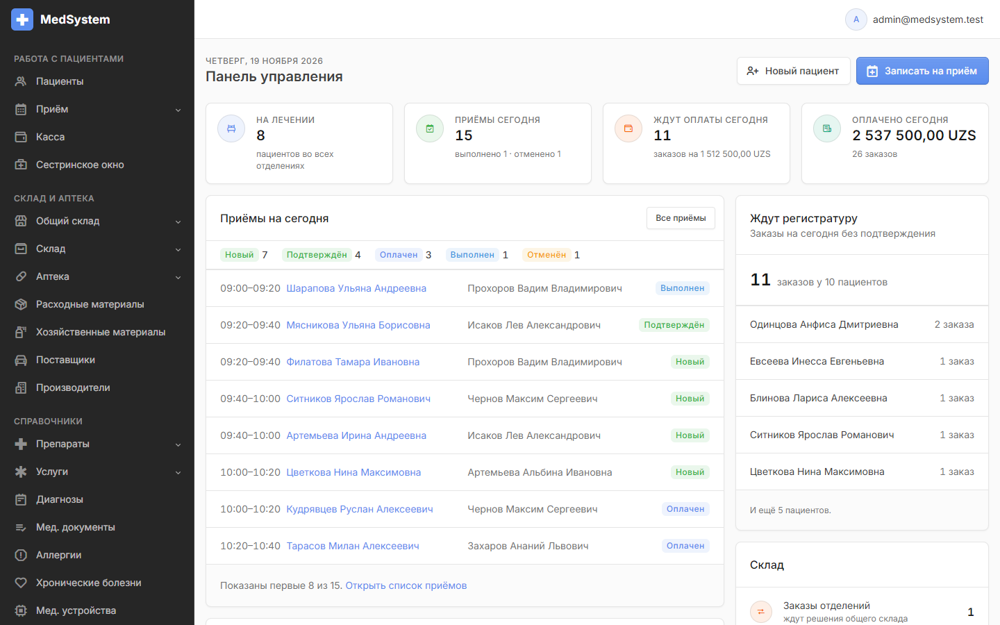

## What it does

Every employee signs in to the same dashboard. What an account can see and do is decided by the
permissions of the employee's staff position: each position is a role on the `admin` guard, edited
on the positions screen. `main_admin` holds every permission, the registrar and cashier roles are
seeded with theirs, and the roles of the other positions start empty and are filled in on that
screen. The home page shows each account only the summary cards of the pages it may open.

| Role | Work in the system |
|---|---|
| Registrar | Registers patients and keeps their card (passport, contacts and addresses, insurance, emergency contact, scanned documents), opens a hospital stay, orders services, books appointments, and confirms the basket of a patient's orders so the cash desk can take payment. The basket exports to Excel. |
| Cashier | Sees every unpaid order of every kind (services, procedures, appointments, prescriptions) with its price and status, takes the payment for a patient's selected orders in one step, filters by date and status, and exports the list to Excel. |
| Doctor | Works from the patient card: diagnoses from the ICD-10 catalogue, orders for services and procedures, prescriptions with warnings about known dangerous drug combinations, the stay with its medical documents and scored assessment scales, and the visit history. A doctor's account works only on that doctor's own calendar: it lists, books and opens only the doctor's own appointments, for the doctor's own services. |
| Nurse | The nurse window lists the in-patients of the nurse's own department, records vital signs and charts them, and fills in the fall-risk and pain scales (Morse, Humpty Dumpty, FLACC, NIPS, CPOT and others). |
| Pharmacy and warehouse | The main warehouse receives goods (every medication line becomes a batch with its number and expiry date), shows remains by batch, writes stock off, and approves or rejects the supply requests of the department warehouses. Department warehouses keep the batches they received and transfer medications to pharmacies. |
| Head of department | The department's own warehouse: remains by batch with expiry warnings, supply requests to the main warehouse; the department's wards and beds, and its staff. |
| Administrator | Dashboard accounts, staff with their schedules, absences and logins, positions with their permission sets, departments, floors and offices, and the reference data: the price list, ICD-10 diagnoses and dangerous combinations (each importable from Excel), medications, the medical document editor, allergies, chronic diseases, devices and equipment. |

An order moves through the same steps whoever placed it:

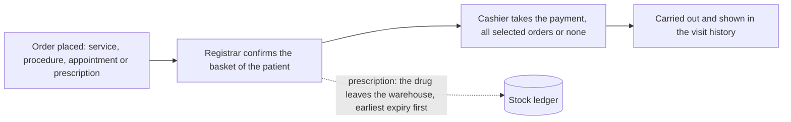

## Screenshots

The screenshots show the demo data. Click one to open it full size.

<table>
  <tr>
    <td width="33%"><a href="docs/screenshots/patient-card.png">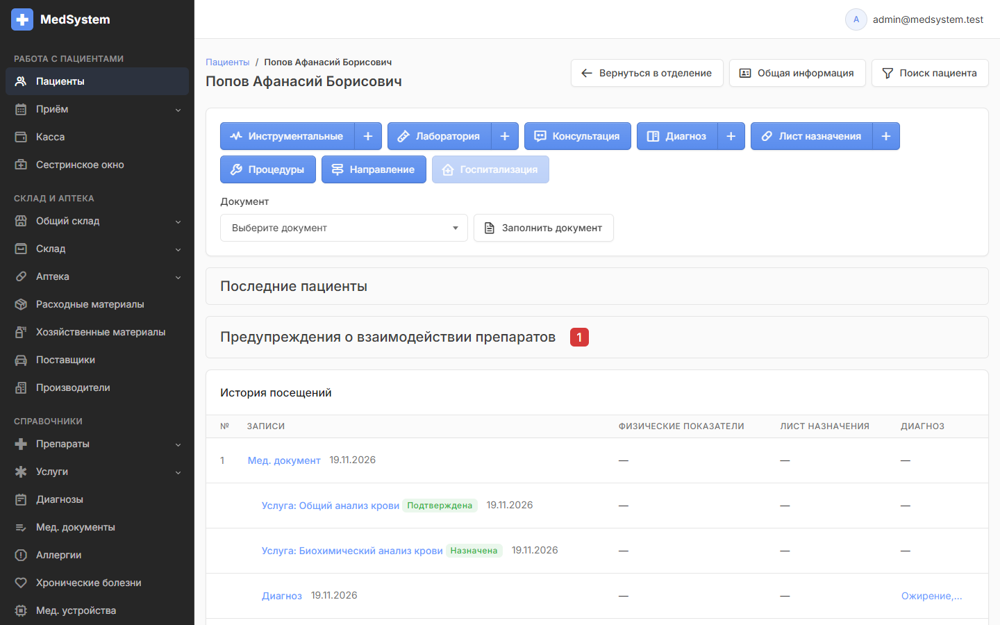</a><br><sub>Patient card: orders, drug interaction warnings, visit history</sub></td>
    <td width="33%"><a href="docs/screenshots/appointment.png">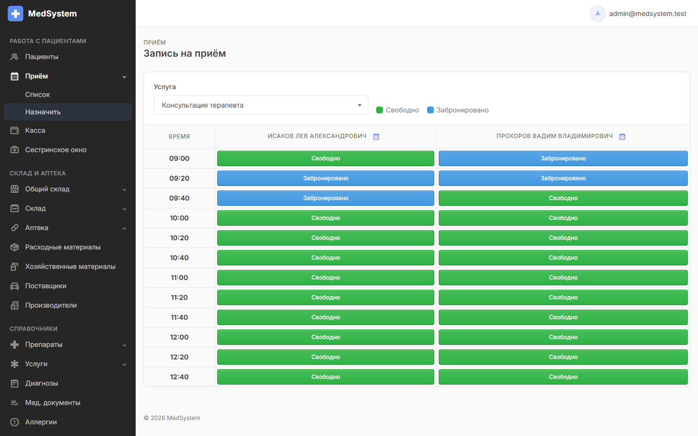</a><br><sub>Booking an appointment by service</sub></td>
    <td width="33%"><a href="docs/screenshots/doctor-calendar.png">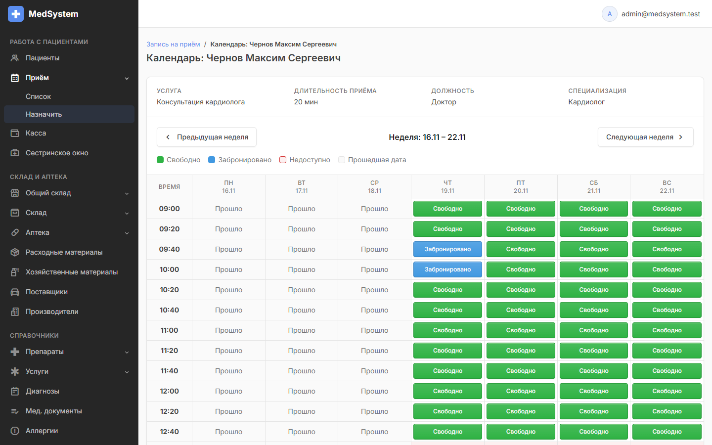</a><br><sub>A doctor's week: free, booked and past slots</sub></td>
  </tr>
  <tr>
    <td><a href="docs/screenshots/cashier.png">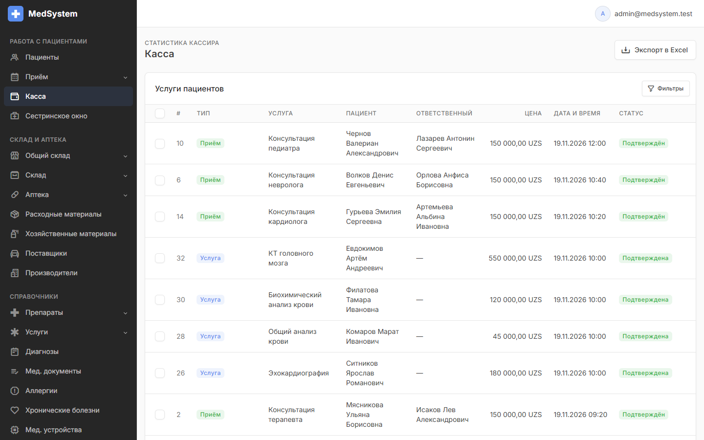</a><br><sub>Cash desk: unpaid orders of every kind, prices in UZS</sub></td>
    <td><a href="docs/screenshots/nurse-window.png">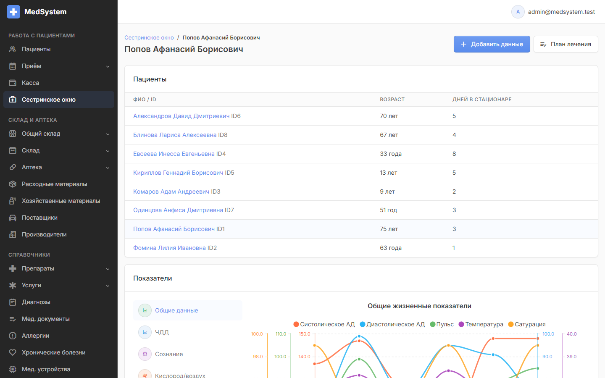</a><br><sub>Nurse window: in-patients and vital sign charts</sub></td>
    <td><a href="docs/screenshots/stock-remains.png">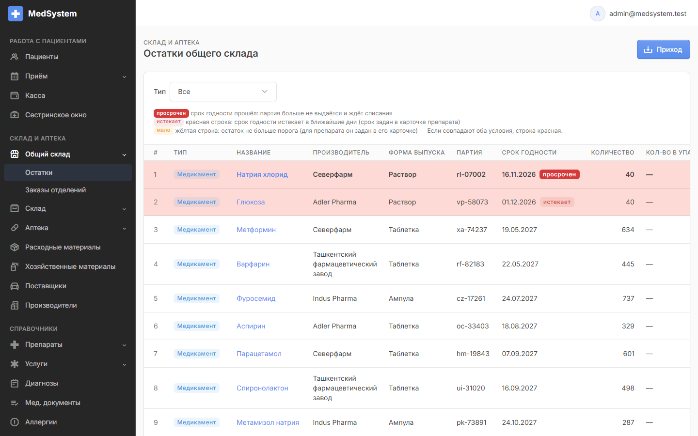</a><br><sub>Main warehouse remains by batch</sub></td>
  </tr>
</table>

<details>
<summary>More screenshots: sign-in, patient list, staff list, error page</summary>

<table>
  <tr>
    <td width="50%"><a href="docs/screenshots/login.png">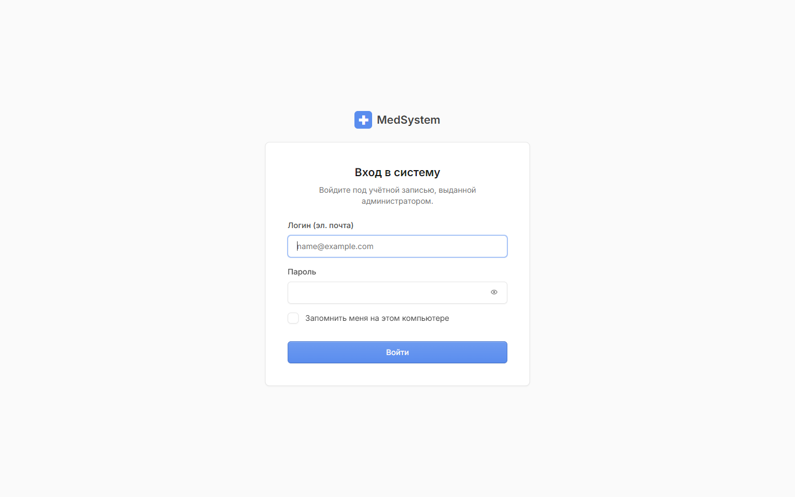</a><br><sub>Sign-in page</sub></td>
    <td width="50%"><a href="docs/screenshots/patients.png">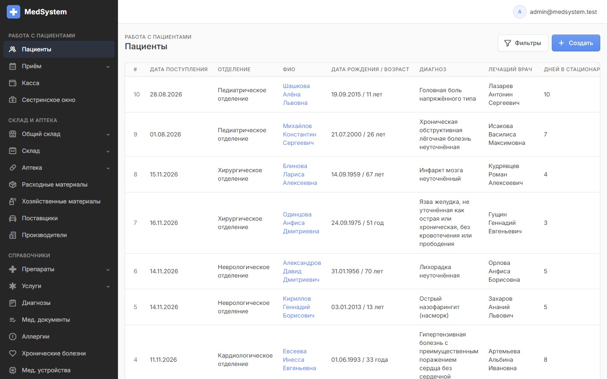</a><br><sub>Patient list with search and filters</sub></td>
  </tr>
  <tr>
    <td><a href="docs/screenshots/staff.png">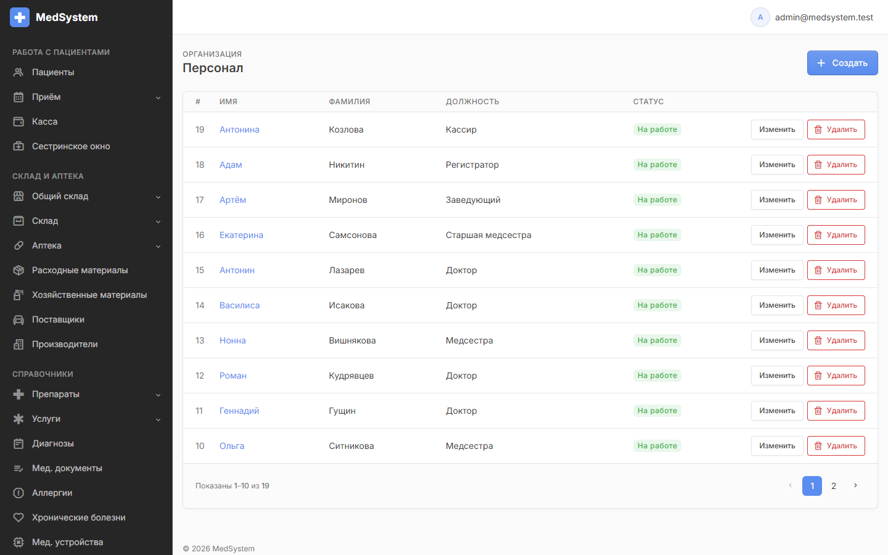</a><br><sub>Staff list</sub></td>
    <td><a href="docs/screenshots/error-404.png">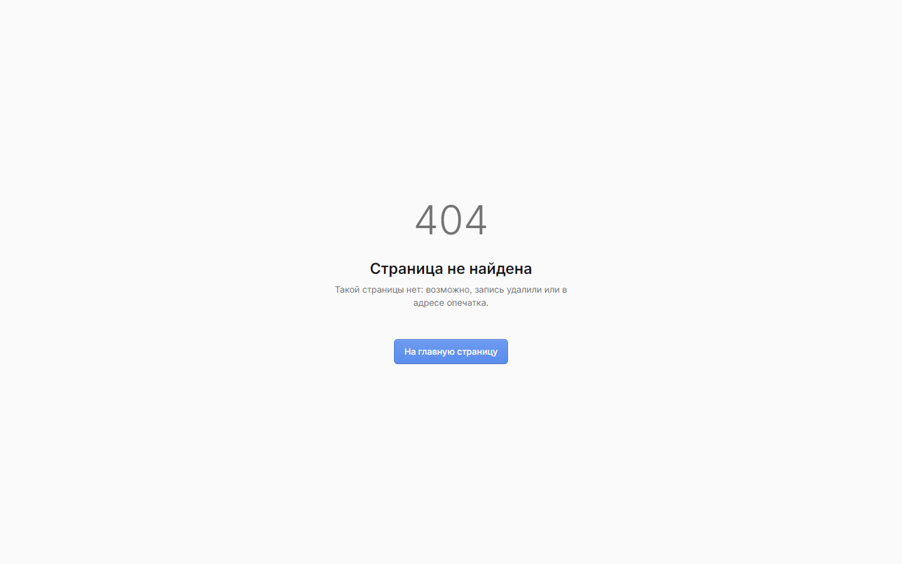</a><br><sub>404 page inside the layout</sub></td>
  </tr>
</table>

</details>

## Engineering highlights

- **One writer of stock, by batch and earliest expiry first.** `StockLedger` is the only code that
  changes a quantity: it locks the rows (`SELECT ... FOR UPDATE`), takes units across batches earliest
  expiry first or refuses the whole document, never takes an expired batch, and records every change
  with its reason, document and user in the append-only `stock_movements` table. A cancelled
  prescription puts its units back into the batches they came from; CHECK constraints keep
  quantities from going negative even for writes that bypass the ledger.
  See [ADR 0005](docs/adr/0005-append-only-stock-ledger.md).
- **Exact money, per currency.** Prices are `decimal(14,2)` columns; billing reads them into
  `Amount`, an integer count of minor units, and `CurrencyTotals` adds them up per currency, never
  across currencies. The cashier's totals are computed in SQL by the same filter as the list, and a
  test holds them equal to the sums in PHP. See
  [ADR 0006](docs/adr/0006-money-in-minor-units-with-per-currency-totals.md).
- **Orders keep their price.** Service orders, procedures and appointments store the price (and, for
  services and appointments, the currency) they were placed at, as prescriptions already did, so
  editing the price list never changes what an earlier order is billed. See
  [ADR 0007](docs/adr/0007-orders-keep-their-price-and-currency.md).
- **No double booking, twice over.** `ReceptionService` books under a row lock on the doctor and
  checks reception hours, absences and the slot grid (length and start); a PostgreSQL exclusion
  constraint on `receptions` (a GiST index over the staff id and the time range, cancelled
  appointments left out) rejects any overlap that gets past it, and its violation is turned into
  the same refusal. See
  [ADR 0001](docs/adr/0001-postgresql-as-the-only-database.md) and [ADR 0004](docs/adr/0004-row-locks-in-a-fixed-order.md).
- **Lifecycles as enums.** The five status enums (`ServiceStatus`, `ReceptionStatus`,
  `PatientMedicationStatus`, `TransferStatus`, `SupplyRequestStatus`) declare their allowed next
  statuses; services lock the row and check the transition before writing it. The registrar's
  confirmation and the cashier's payment each run in one transaction, all orders or none, and the
  cashier locks orders in a fixed order, so two payments never deadlock. Polymorphic columns store
  aliases from an enforced morph map, not class names. See
  [ADR 0003](docs/adr/0003-backed-enums-and-morph-aliases.md).
- **A permission on every route.** Every dashboard route but sign-out carries a `permission:`
  middleware, and a test walks the whole route table to keep it so. The sidebar (`App\Support\Navigation\Navigation`)
  and the dashboard cards name the same permission as the route they link to. Three policies decide
  what depends on the record: `AdminPolicy` protects `main_admin` accounts, `ReceptionPolicy` keeps
  a doctor on their own calendar, and `DocumentResponsePolicy` guards the filled-in medical
  documents. A dismissed employee's session ends on the next request (`EnsureAccountIsActive`). See
  [ADR 0008](docs/adr/0008-authorization-permissions-positions-and-policies.md).
- **Deletion guards.** Foreign keys to reference data `RESTRICT` the delete (or `SET NULL`), and a
  refused delete is answered with a message, or a 409 for AJAX, instead of a 500. `RetainedRecords`
  refuses to delete a patient or a stay while one of its orders was paid or had its drug dispensed,
  or while the patient has a finished stay. See
  [ADR 0009](docs/adr/0009-restrict-deletes-and-retain-records.md).
- **No paid template.** The interface is built on [Tabler](https://tabler.io) (MIT, Bootstrap 5.3)
  and npm packages pinned by `package-lock.json`, bundled by Vite; nothing loads from a CDN. Page
  tests render every dashboard page and fail on leftovers of the former commercial template or on
  a CDN host. See [ADR 0010](docs/adr/0010-tabler-and-vite-instead-of-a-commercial-template.md).

The reasoning behind each decision, with its trade-offs, is in the [architecture decision
records](docs/adr/README.md); the rules as the code enforces them are in the [domain
documentation](docs/architecture/domain.md).

## Tech stack

| Area | Choice |
|---|---|
| Language and framework | PHP 8.3 (CI also runs 8.4), Laravel 13 |
| Database | PostgreSQL 18: exclusion and CHECK constraints, partial unique indexes, case-insensitive `ILIKE` search |
| Access control | spatie/laravel-permission 8 on the `admin` guard, Laravel policies |
| Spreadsheets | maatwebsite/excel 4: imports of the price list, ICD-10 diagnoses and dangerous combinations; cashier and basket exports |
| Front end | Blade, Tabler 1.7 (Bootstrap 5.3), jQuery 4, select2, flatpickr, ApexCharts, bs-stepper, Boxicons, Inter; Vite 8 and Sass |
| Tests | Pest 4: Feature, Unit and architecture tests, on PostgreSQL; Vitest and happy-dom for the page scripts |
| Code quality | Larastan 3 at level 8 without a baseline, Rector 2 with rector-laravel, Pint |
| Local environment | Docker Compose: PHP-FPM, nginx, PostgreSQL 18, Node 24 for Vite; Telescope in the local environment only |
| CI | GitHub Actions |

## Quick start

### With Docker

Requires Docker with Compose and `make` (on Windows, run it from WSL or Git Bash, or type the
`docker compose` commands from the [Makefile](Makefile) yourself).

```bash
git clone https://github.com/FarrukhShomurodov/medsystem.git
cd medsystem
cp .env.example .env   # Laravel reads it on every request, so later edits apply at once
make up                # build the PHP image and start the stack
make install           # composer install, app key, storage link, migrate:fresh --seed, front-end build
```

Open http://localhost:8080 and sign in with one of the [demo accounts](#demo-accounts).

| Service | What it runs |
|---|---|
| `app` | PHP 8.3-FPM, the `dev` target of `docker/php/Dockerfile` (source bind-mounted, pcov) |
| `web` | nginx on `APP_PORT` (8080) |
| `db` | PostgreSQL 18 on host port `FORWARD_DB_PORT` (54320); creates `medsystem_testing` on first start |
| `vite` | Node 24, only for `make assets` and `make assets-watch` (Vite dev server on `VITE_PORT`, 5173) |

The ports listen on localhost only. To reach the stack from another device, set
`FORWARD_HOST_IP=0.0.0.0` in `.env`, after changing `DB_PASSWORD` and the demo passwords.

`make help` lists every target: `up`, `down`, `restart`, `build`, `install`, `shell`, `logs`,
`migrate`, `fresh`, `seed`, `test`, `coverage`, `lint`, `fix`, `analyse`, `refactor`, `ci`,
`assets`, `assets-watch`.

### Without Docker

Requires PHP 8.3 or newer with `bcmath`, `gd`, `intl`, `pdo_pgsql` and `zip`, Composer 2,
Node.js 22.12 or newer, and PostgreSQL 18.

```bash
git clone https://github.com/FarrukhShomurodov/medsystem.git
cd medsystem
cp .env.example .env   # then set DB_HOST, DB_PORT, DB_USERNAME, DB_PASSWORD for your server
# add -h, -p and -U for your server; the role in DB_USERNAME must own both databases
createdb -T template0 -E UTF8 --locale-provider=builtin --builtin-locale=C.UTF-8 medsystem
createdb -T template0 -E UTF8 --locale-provider=builtin --builtin-locale=C.UTF-8 medsystem_testing
composer setup         # install, key:generate, storage:link, migrate --seed, npm ci, npm run build
php artisan serve      # http://localhost:8000 (set APP_URL to match)
```

Two settings matter:

- **`APP_TIMEZONE=Asia/Tashkent`** (the default in `.env.example` and `config/app.php`). Appointment
  slots, "today" on the dashboard and the cashier's date filters are calendar dates of the
  application timezone; the test suite forces the same value in `phpunit.xml`.
- **A UTF-8 locale for the databases.** Patient search uses `ILIKE` on Cyrillic names, which needs a
  UTF-8 character type. `pest --parallel` creates its per-process databases from `template1`, so
  the locale of `template1` should be UTF-8 as well.

### Demo accounts

`php artisan db:seed` always creates the main administrator from `ADMIN_EMAIL` and `ADMIN_PASSWORD`
(and refuses the default password in production). In the `local` environment it also seeds a demo
hospital (`DemoSeeder`): five departments with wards and beds, doctors with weekly schedules, 40
patients (twelve with a hospital stay, eight of them still open), a price list in UZS, an ICD-10
subset, stock with batches near and past expiry, orders at every stage from ordered to paid, and
these accounts:

| E-mail | Password | Role |
|---|---|---|
| `admin@medsystem.test` | `password` | `main_admin`: every permission |
| `registrar@medsystem.test` | `password` | Регистратор: registers patients, opens stays, orders services, confirms baskets, sees the cash desk list |
| `cashier@medsystem.test` | `password` | Кассир: the cash desk, takes payments |

The demo doctors, nurses and other staff have no logins: an account is added on the staff form, and
its position's permissions on the positions screen. These credentials are for a local machine only;
change the administrator's password on any shared installation.

## Quality

| Command | What it does |
|---|---|
| `composer test` | the whole Pest suite, sequentially (clears the config cache first) |
| `composer test -- --parallel` | the same, one database per process |
| `vendor/bin/pest --testsuite=Arch` | the architecture rules only |
| `npm test` | the page script tests (Vitest, `tests/js`) |
| `composer lint` / `composer lint:fix` | Pint check / fix |
| `composer analyse` | Larastan, level 8, over `app/`, `bootstrap/app.php`, `database/` and `routes/` |
| `composer refactor` / `composer refactor:fix` | Rector dry run / apply |
| `composer ci` | lint, analyse, refactor and test, as CI does |
| `make test`, `make ci`, `make lint`, `make analyse`, `make refactor` | the same inside the Docker stack |

The suite has more than 1,250 tests. Feature tests are grouped by module (Billing, Clinical,
Patients, Scheduling, Stock) and cross-cutting concerns (Authorization, Security, Database,
Frontend, Dashboard); they render every dashboard page as `main_admin`, check each route's
permission against the router, and pin the query count of the main pages (patient card and list,
cash desk, nurse window, dashboard). Unit tests cover the logic without HTTP or a database, and the
architecture tests guard the folder layout (for example, services never touch the HTTP layer and
`env()` is read in config files only). Larastan runs with no baseline and no `@phpstan-ignore`.

Tests run against PostgreSQL only, on the `medsystem_testing` database set in `phpunit.xml`. A
`DB_DATABASE` in the real environment takes precedence, which is why `make test` passes it
explicitly: `RefreshDatabase` empties whatever database the suite runs on. For parallel runs on
your own server, raise `max_locks_per_transaction` as `compose.yaml` does (256).

CI ([`.github/workflows/ci.yml`](.github/workflows/ci.yml)) runs on every pull request and on
pushes to `main`:

- the page script tests (Vitest), the front-end build, and a check that every file the views load
  is in the Vite manifest;
- `composer audit` of every Composer package and `npm audit` of the packages that reach the browser;
- Pint;
- Larastan and a Rector dry run that must find nothing to change;
- on PHP 8.3 and 8.4 against PostgreSQL 18: migrations and seeders on an empty database, a
  rollback of every migration over the demo data, then `pest --parallel --coverage --min=40`.

The test layout, helpers and database setup are described in
[docs/architecture/testing.md](docs/architecture/testing.md), the choice of gates in
[ADR 0011](docs/adr/0011-quality-gates.md).

## Project layout

```
app/
  Enums/              stored vocabularies and the five lifecycles
  Http/               controllers (pages, Api/ for the AJAX endpoints), middleware, form requests
  Models/  Policies/
  Queries/            read models per module: cashier list, patient card, dashboard, stock alerts
  Services/           workflows per module: Billing, Clinical, Patients, Scheduling, Stock
  Support/Navigation/ the sidebar, defined once with each link's permission
  View/Components/
database/             migrations, factories, seeders (reference rows with fixed ids, demo data)
docker/               PHP-FPM image, nginx, PostgreSQL init script
docs/                 architecture, decision records, screenshots
resources/            views, js (one module per page), scss
routes/               web.php (pages), ajax.php (/api on the admin session)
tests/                Feature and Unit by module, Arch; js (the page scripts, Vitest)
```

Where each kind of class goes, and why: [docs/architecture/folder-layout.md](docs/architecture/folder-layout.md).

## Documentation

| Document | Contents |
|---|---|
| [docs/README.md](docs/README.md) | index of the documentation |
| [Architecture overview](docs/architecture/overview.md) | system context, modules, layers, one request end to end |
| [Domain rules](docs/architecture/domain.md) | the business rules per module, where each is enforced and tested |
| [Data model](docs/architecture/data-model.md) | ER diagram of the core tables and the constraints |
| [Security](docs/architecture/security.md) | authentication, authorization, input and output handling |
| [Testing](docs/architecture/testing.md) | test strategy, helpers, database setup, CI |
| [Folder layout](docs/architecture/folder-layout.md) | where each kind of class lives |
| [Front end](docs/architecture/frontend.md) | build, widgets, writing a page |
| [Decision records](docs/adr/README.md) | the architecture decisions and their trade-offs |
| [CONTRIBUTING.md](CONTRIBUTING.md), [SECURITY.md](SECURITY.md), [CHANGELOG.md](CHANGELOG.md) | workflow, vulnerability reports, history of the refactor |

## Known limitations and roadmap

- **Discounts are not applied.** `services.discount` is stored, imported and shown in the price
  list, but billing ignores it.
- **A payment is a status, not a record.** Paying marks the orders paid and stamps the moment on
  each of them (`paid_at`), so the "paid" figures of the cash desk and the dashboard count an order
  on the day it was paid. There is no payments table: no receipt, payment method, refund, or record
  of which cashier took the money. A payments table is the next step for billing.
- **Re-pointing a confirmed order.** Changing the service of an order the registrar confirmed but
  nobody has paid yet re-prices it and keeps it confirmed, without a new confirmation.
- **No undo of a dismissal.** Clearing an employee's dismissal date on the staff form does not
  re-employ them or restore their login.
- **Medication release forms are a fixed list.** `medications.release_form` allows 34 values set in
  the code; it belongs in an editable reference table.
- **Allergies, chronic diseases and medical devices are catalogues only.** Their reference lists
  are maintained, but no screen records them for a patient yet (the link tables exist unused).
- **Batches only in the warehouses.** The main and department warehouses keep medications by
  batch and expiry; pharmacy stock, medical supplies and household materials are one quantity per
  item.
- **Coverage is not measured yet.** CI enforces a 40% line-coverage floor with pcov, and
  `make coverage` runs the same report in Docker, but the actual figure has not been measured: the
  development machine has no coverage driver.
- **No browser end-to-end tests.** Feature tests render every page and parse its inline scripts,
  and Vitest runs the shared script modules and the two booking grids in happy-dom, but the other
  interactive flows have been checked by hand only.
- **Russian only.** Apart from the validation, sign-in and pagination messages, the interface
  text is written in the views and controllers, not in translation files.
- **The production image is not exercised.** `docker/php/Dockerfile` has a `prod` target that CI
  does not build.

## License

MIT, see [LICENSE](LICENSE). Tabler and the other front-end packages keep their own licenses.
