# MedSystem

[English](README.md) | **Русский**

Медицинская информационная система для многопрофильной клиники: регистрация пациентов и
госпитализации, запись на приём, назначения и рецепты с предупреждениями о лекарственных
взаимодействиях, касса, учёт аптеки и складов по партиям и срокам годности. Laravel 13 на
PostgreSQL 18, интерфейс на русском языке.

[](https://github.com/FarrukhShomurodov/medsystem/actions/workflows/ci.yml)


[](LICENSE)

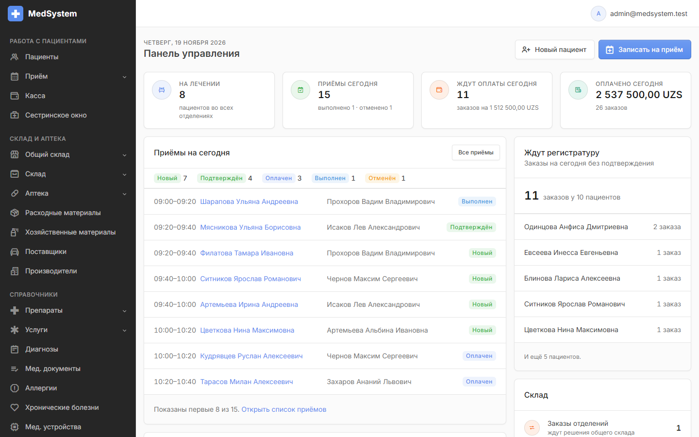

## Что умеет система

Все сотрудники входят в одну панель. Что видит и что может сделать учётная запись, определяют
права должности сотрудника: каждая должность — это роль на guard `admin`, которая настраивается
на экране должностей. У `main_admin` есть все права, роли регистратора и кассира создаются с
готовым набором прав, а роли остальных должностей изначально пусты и заполняются на том же экране.
Главная страница показывает каждой учётной записи только карточки тех страниц, которые ей доступны.

| Роль | Работа в системе |
|---|---|
| Регистратор | Регистрирует пациентов и ведёт их карточку (паспорт, контакты и адреса, страховка, контакт для экстренной связи, сканы документов), открывает госпитализацию, назначает услуги, записывает на приём и подтверждает корзину назначений пациента, после чего касса может принять оплату. Корзину можно выгрузить в Excel. |
| Кассир | Видит все неоплаченные назначения всех видов (услуги, процедуры, приёмы, препараты) с ценой и статусом, одним действием принимает оплату за выбранные назначения пациента, фильтрует по дате и статусу и выгружает список в Excel. |
| Врач | Работает в карточке пациента: диагнозы из справочника МКБ-10, назначения услуг и процедур, рецепты с предупреждениями об известных опасных сочетаниях препаратов, госпитализация с медицинскими документами и оценочными шкалами, история посещений. Учётная запись врача работает только со своим календарём: видит, записывает и открывает только приёмы этого врача, на его услуги. |
| Медсестра | В сестринском окне видит стационарных пациентов своего отделения, записывает показатели жизненно важных функций, которые выводятся графиками, и заполняет шкалы риска падения и боли (Морсе, Humpty Dumpty, FLACC, NIPS, CPOT и другие). |
| Аптека и склад | Общий склад принимает товар (каждая строка препарата становится партией со своим номером и сроком годности), показывает остатки по партиям, списывает товар, одобряет или отклоняет заказы складов отделений. Склады отделений хранят полученные партии и передают препараты в аптеки. |
| Заведующий отделением | Склад своего отделения: остатки по партиям с предупреждениями о сроке годности, заказы на общий склад; палаты и койки отделения, его сотрудники. |
| Администратор | Учётные записи панели, сотрудники с расписанием, отсутствиями и логинами, должности с наборами прав, отделения, этажи и кабинеты, справочники: прейскурант, диагнозы МКБ-10 и опасные сочетания (всё с импортом из Excel), препараты, редактор медицинских документов, аллергии, хронические болезни, устройства и оборудование. |

Назначение проходит одни и те же шаги, кто бы его ни создал:

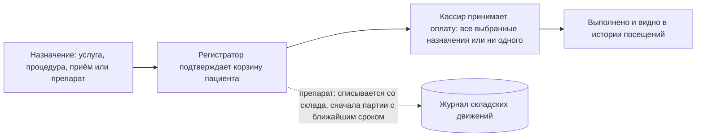

## Скриншоты

На скриншотах демо-данные. Нажмите на изображение, чтобы открыть его в полном размере.

<table>
  <tr>
    <td width="33%"><a href="docs/screenshots/patient-card.png">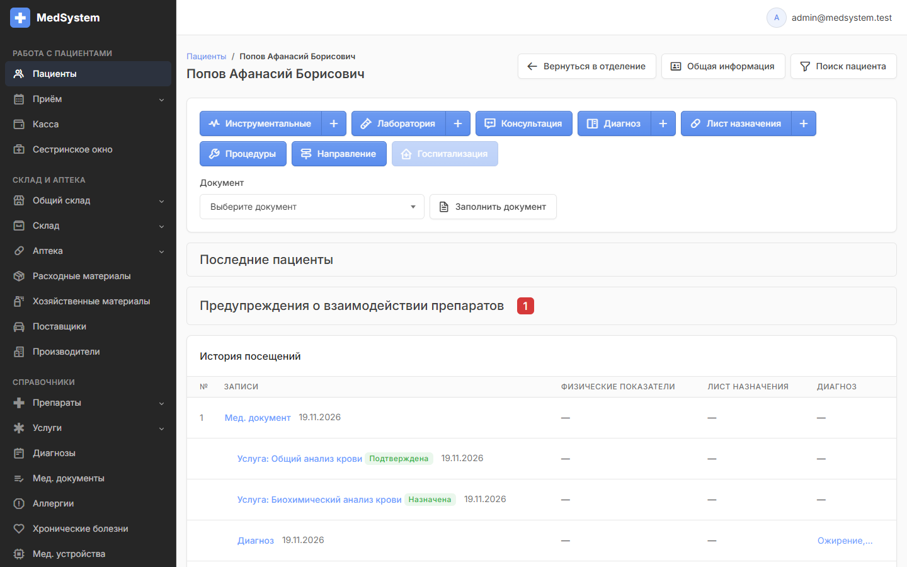</a><br><sub>Карточка пациента: назначения, предупреждения о взаимодействиях, история посещений</sub></td>
    <td width="33%"><a href="docs/screenshots/appointment.png">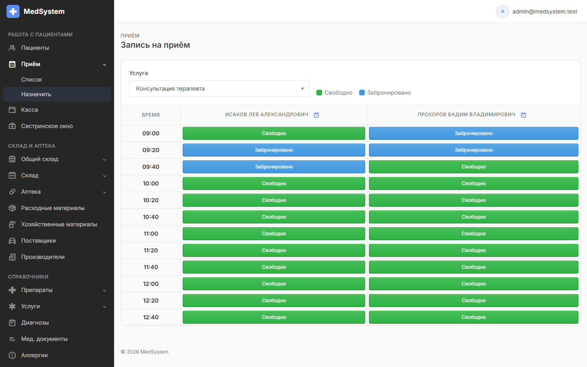</a><br><sub>Запись на приём по услуге</sub></td>
    <td width="33%"><a href="docs/screenshots/doctor-calendar.png">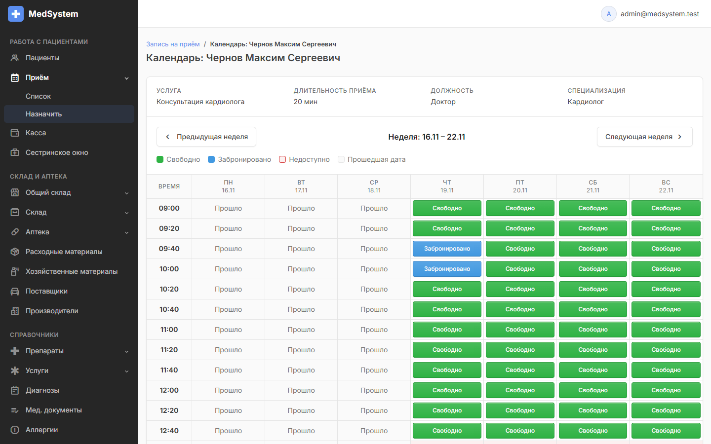</a><br><sub>Неделя врача: свободные, занятые и прошедшие слоты</sub></td>
  </tr>
  <tr>
    <td><a href="docs/screenshots/cashier.png">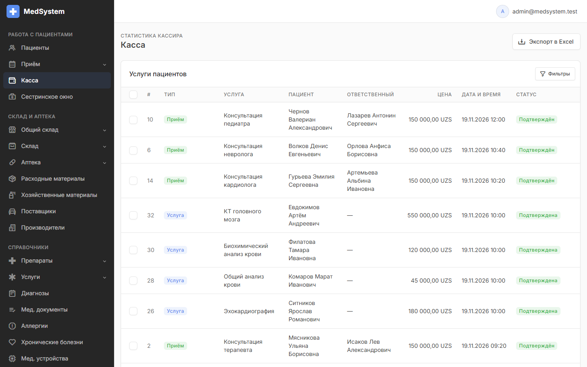</a><br><sub>Касса: неоплаченные назначения всех видов, цены в UZS</sub></td>
    <td><a href="docs/screenshots/nurse-window.png">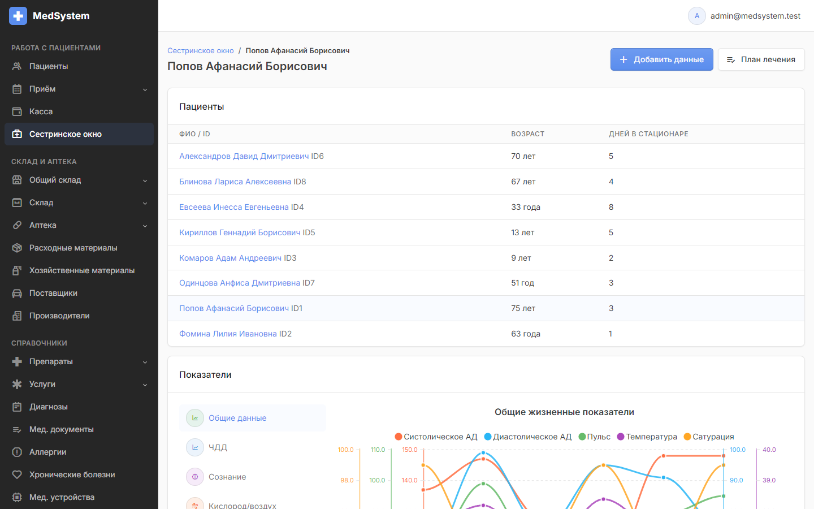</a><br><sub>Сестринское окно: стационарные пациенты и графики показателей</sub></td>
    <td><a href="docs/screenshots/stock-remains.png">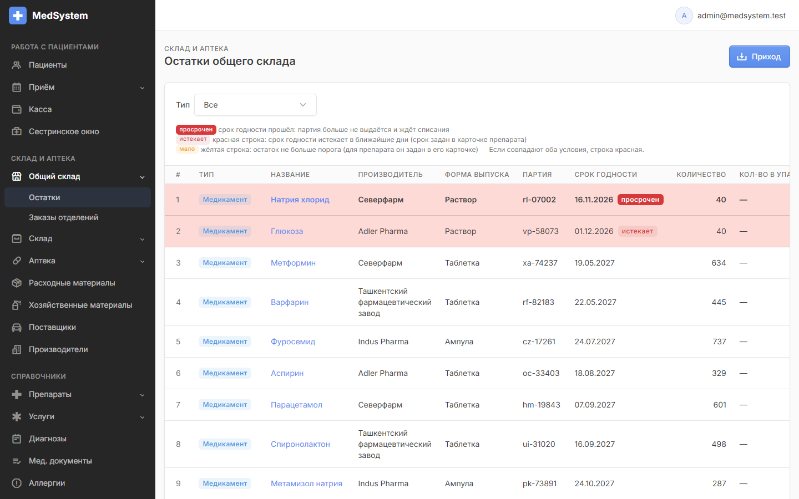</a><br><sub>Остатки общего склада по партиям</sub></td>
  </tr>
</table>

<details>
<summary>Ещё скриншоты: вход, список пациентов, список сотрудников, страница ошибки</summary>

<table>
  <tr>
    <td width="50%"><a href="docs/screenshots/login.png">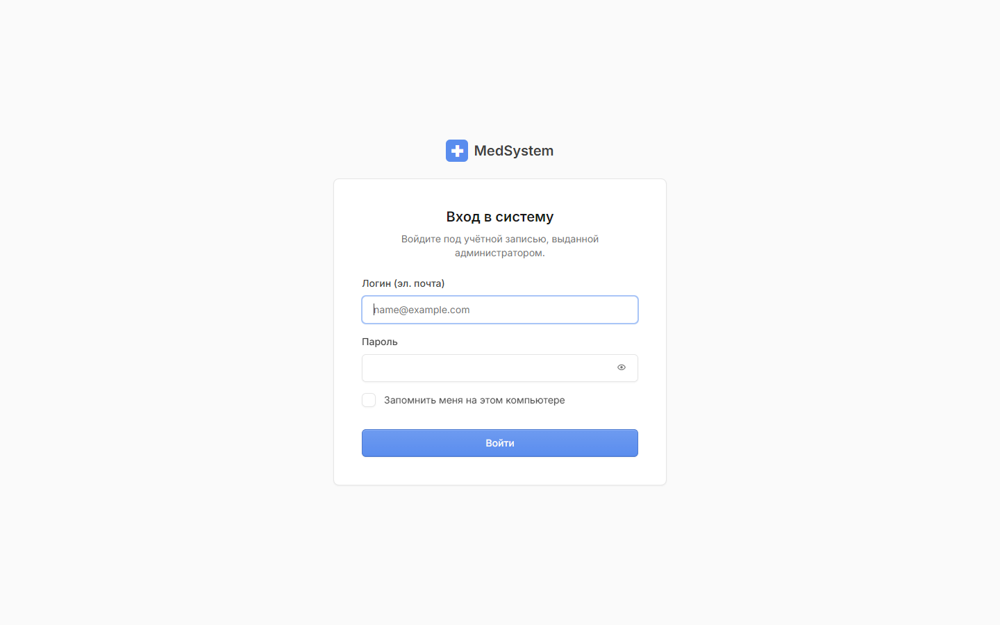</a><br><sub>Страница входа</sub></td>
    <td width="50%"><a href="docs/screenshots/patients.png">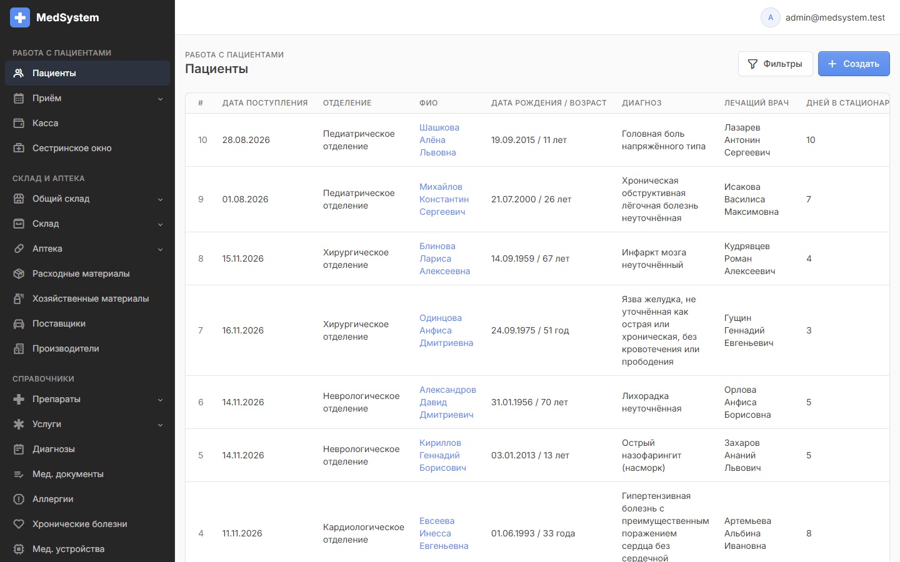</a><br><sub>Список пациентов с поиском и фильтрами</sub></td>
  </tr>
  <tr>
    <td><a href="docs/screenshots/staff.png">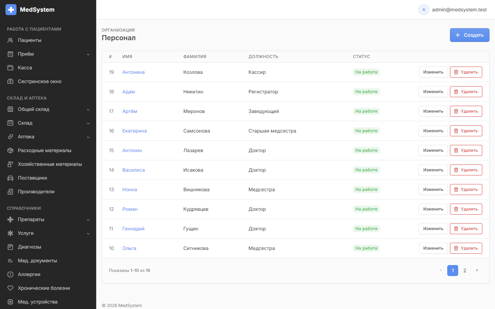</a><br><sub>Список сотрудников</sub></td>
    <td><a href="docs/screenshots/error-404.png">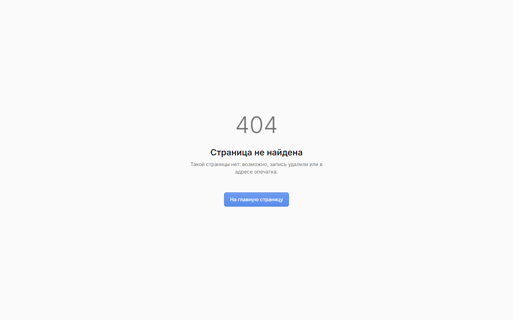</a><br><sub>Страница 404 внутри макета</sub></td>
  </tr>
</table>

</details>

## Инженерные решения

- **Одна точка изменения остатков, по партиям и с ближайшим сроком первым.** Количество меняет только
  `StockLedger`: он блокирует строки (`SELECT ... FOR UPDATE`), берёт единицы из партий начиная с
  ближайшего срока годности или отклоняет документ целиком, никогда не берёт просроченную партию и
  записывает каждое изменение с причиной, документом и пользователем в журнал `stock_movements`,
  в который только добавляются записи. Отменённый рецепт возвращает единицы в те партии, из
  которых они были взяты; CHECK-ограничения не дают количеству уйти в минус даже при записи в
  обход журнала. См. [ADR 0005](docs/adr/0005-append-only-stock-ledger.md).
- **Точные деньги, по валютам.** Цены хранятся в столбцах `decimal(14,2)`; биллинг читает их в
  `Amount` — целое число минимальных единиц, а `CurrencyTotals` суммирует по каждой валюте
  отдельно и никогда не складывает разные валюты. Итоги кассы считаются в SQL по тому же фильтру,
  что и список, и тест сверяет их с суммами, посчитанными в PHP. См.
  [ADR 0006](docs/adr/0006-money-in-minor-units-with-per-currency-totals.md).
- **Назначение хранит свою цену.** Назначенные услуги, процедуры и приёмы сохраняют цену (а услуги
  и приёмы ещё и валюту), по которой были назначены, как это уже делали рецепты, поэтому правка
  прейскуранта не меняет сумму к оплате по прежним назначениям. См.
  [ADR 0007](docs/adr/0007-orders-keep-their-price-and-currency.md).
- **Двойная защита от двойной записи.** `ReceptionService` записывает под блокировкой строки врача
  и проверяет часы приёма, отсутствия и сетку слотов (длину и начало); исключающее ограничение
  PostgreSQL на `receptions` (GiST-индекс по id сотрудника и интервалу времени, без отменённых
  приёмов) отклоняет любое пересечение, прошедшее мимо этой проверки, а его нарушение превращается
  в тот же отказ. См.
  [ADR 0001](docs/adr/0001-postgresql-as-the-only-database.md) и [ADR 0004](docs/adr/0004-row-locks-in-a-fixed-order.md).
- **Жизненные циклы в перечислениях.** Пять перечислений статусов (`ServiceStatus`, `ReceptionStatus`,
  `PatientMedicationStatus`, `TransferStatus`, `SupplyRequestStatus`) объявляют допустимые
  следующие статусы; сервисы блокируют строку и проверяют переход перед записью. Подтверждение
  регистратора и оплата в кассе выполняются каждое в одной транзакции — все назначения или ни
  одного, а касса блокирует назначения в фиксированном порядке, поэтому две оплаты не
  взаимоблокируются. Полиморфные столбцы хранят псевдонимы из обязательной morph map, а не имена
  классов. См. [ADR 0003](docs/adr/0003-backed-enums-and-morph-aliases.md).
- **Право на каждом маршруте.** У каждого маршрута панели, кроме выхода, есть middleware
  `permission:`, и тест проходит по всей таблице маршрутов, чтобы так и оставалось. Боковое меню
  (`App\Support\Navigation\Navigation`) и карточки главной страницы называют то же право, что и
  маршрут, на который ведут. Три политики решают то, что зависит от записи: `AdminPolicy` защищает
  учётные записи `main_admin`, `ReceptionPolicy` оставляет врача в его собственном календаре, а
  `DocumentResponsePolicy` охраняет заполненные медицинские документы. Сессия уволенного
  сотрудника завершается на следующем запросе (`EnsureAccountIsActive`). См.
  [ADR 0008](docs/adr/0008-authorization-permissions-positions-and-policies.md).
- **Защита от удаления.** Внешние ключи на справочные данные запрещают удаление (`RESTRICT`) или
  обнуляют ссылку (`SET NULL`), а на отклонённое удаление пользователь получает сообщение (для
  AJAX — ответ 409), а не ошибку 500. `RetainedRecords` не даёт удалить пациента или госпитализацию,
  пока одно из назначений оплачено или по нему выдан препарат, а также пока у пациента есть
  завершённая госпитализация. См. [ADR 0009](docs/adr/0009-restrict-deletes-and-retain-records.md).
- **Без платного шаблона.** Интерфейс построен на [Tabler](https://tabler.io) (MIT, Bootstrap 5.3)
  и npm-пакетах, закреплённых в `package-lock.json`, и собирается Vite; с CDN ничего не
  загружается. Тесты страниц отрисовывают каждую страницу панели и падают, если находят остатки
  прежнего коммерческого шаблона или адрес CDN. См.
  [ADR 0010](docs/adr/0010-tabler-and-vite-instead-of-a-commercial-template.md).

Обоснование каждого решения и его компромиссы описаны в [архитектурных
решениях](docs/adr/README.md), правила в том виде, в каком их соблюдает код, — в [описании
предметной области](docs/architecture/domain.md) (документация на английском).

## Технологии

| Область | Выбор |
|---|---|
| Язык и фреймворк | PHP 8.3 (CI проверяет и 8.4), Laravel 13 |
| База данных | PostgreSQL 18: исключающие и CHECK-ограничения, частичные уникальные индексы, поиск без учёта регистра через `ILIKE` |
| Права доступа | spatie/laravel-permission 8 на guard `admin`, политики Laravel |
| Таблицы | maatwebsite/excel 4: импорт прейскуранта, диагнозов МКБ-10 и опасных сочетаний; выгрузка кассы и корзины |
| Фронтенд | Blade, Tabler 1.7 (Bootstrap 5.3), jQuery 4, select2, flatpickr, ApexCharts, bs-stepper, Boxicons, Inter; Vite 8 и Sass |
| Тесты | Pest 4: Feature-, Unit- и архитектурные тесты, на PostgreSQL; Vitest и happy-dom для скриптов страниц |
| Качество кода | Larastan 3 на уровне 8 без baseline, Rector 2 с rector-laravel, Pint |
| Локальное окружение | Docker Compose: PHP-FPM, nginx, PostgreSQL 18, Node 24 для Vite; Telescope только в окружении local |
| CI | GitHub Actions |

## Быстрый старт

### С Docker

Нужны Docker с Compose и `make` (в Windows запускайте из WSL или Git Bash либо выполните команды
`docker compose` из [Makefile](Makefile) вручную).

```bash
git clone https://github.com/FarrukhShomurodov/medsystem.git
cd medsystem
cp .env.example .env   # Laravel читает его при каждом запросе, правки действуют сразу
make up                # собрать образ PHP и запустить стек
make install           # composer install, ключ приложения, storage link, migrate:fresh --seed, сборка фронтенда
```

Откройте http://localhost:8080 и войдите под одной из [демо-учётных записей](#демо-доступ).

| Сервис | Что запускает |
|---|---|
| `app` | PHP 8.3-FPM, цель `dev` из `docker/php/Dockerfile` (исходники смонтированы, pcov) |
| `web` | nginx на порту `APP_PORT` (8080) |
| `db` | PostgreSQL 18 на порту хоста `FORWARD_DB_PORT` (54320); при первом запуске создаёт `medsystem_testing` |
| `vite` | Node 24, только для `make assets` и `make assets-watch` (dev-сервер Vite на `VITE_PORT`, 5173) |

Порты открыты только на localhost. Чтобы стек был доступен с другого устройства, укажите
`FORWARD_HOST_IP=0.0.0.0` в `.env`, предварительно сменив `DB_PASSWORD` и пароли демо-учётных
записей.

`make help` выводит все цели: `up`, `down`, `restart`, `build`, `install`, `shell`, `logs`,
`migrate`, `fresh`, `seed`, `test`, `coverage`, `lint`, `fix`, `analyse`, `refactor`, `ci`,
`assets`, `assets-watch`.

### Без Docker

Нужны PHP 8.3 или новее с расширениями `bcmath`, `gd`, `intl`, `pdo_pgsql` и `zip`, Composer 2,
Node.js 22.12 или новее и PostgreSQL 18.

```bash
git clone https://github.com/FarrukhShomurodov/medsystem.git
cd medsystem
cp .env.example .env   # затем укажите DB_HOST, DB_PORT, DB_USERNAME, DB_PASSWORD своего сервера
# добавьте -h, -p и -U для своего сервера; владельцем обеих баз должна быть роль из DB_USERNAME
createdb -T template0 -E UTF8 --locale-provider=builtin --builtin-locale=C.UTF-8 medsystem
createdb -T template0 -E UTF8 --locale-provider=builtin --builtin-locale=C.UTF-8 medsystem_testing
composer setup         # install, key:generate, storage:link, migrate --seed, npm ci, npm run build
php artisan serve      # http://localhost:8000 (укажите такой же APP_URL)
```

Важны две настройки:

- **`APP_TIMEZONE=Asia/Tashkent`** (значение по умолчанию в `.env.example` и `config/app.php`).
  Слоты приёма, «сегодня» на главной странице и фильтры кассы по дате — это календарные даты
  часового пояса приложения; набор тестов задаёт то же значение принудительно в `phpunit.xml`.
- **UTF-8-локаль баз данных.** Поиск пациентов использует `ILIKE` по кириллическим именам, а для
  этого нужен UTF-8 тип символов. `pest --parallel` создаёт базы для своих процессов из
  `template1`, поэтому локаль `template1` тоже должна быть UTF-8.

### Демо-доступ

`php artisan db:seed` всегда создаёт главного администратора из `ADMIN_EMAIL` и `ADMIN_PASSWORD`
(и отказывается использовать пароль по умолчанию в production). В окружении `local` он также
заполняет демо-больницу (`DemoSeeder`): пять отделений с палатами и койками, врачи с недельным
расписанием, 40 пациентов (двенадцать с госпитализацией, восемь из них ещё открыты), прейскурант в
UZS, часть МКБ-10, остатки с партиями, срок которых подходит к концу или истёк, назначения на
каждом этапе — от назначенных до оплаченных, и следующие учётные записи:

| E-mail | Пароль | Роль |
|---|---|---|
| `admin@medsystem.test` | `password` | `main_admin`: все права |
| `registrar@medsystem.test` | `password` | Регистратор: регистрирует пациентов, открывает госпитализации, назначает услуги, подтверждает корзины, видит список кассы |
| `cashier@medsystem.test` | `password` | Кассир: касса, принимает оплату |

У демо-врачей, медсестёр и остальных сотрудников нет логинов: учётная запись добавляется в форме
сотрудника, а права его должности — на экране должностей. Эти данные предназначены только для
локальной машины; на любой общей установке смените пароль администратора.

## Качество

| Команда | Что делает |
|---|---|
| `composer test` | весь набор тестов Pest последовательно (сначала очищает кэш конфигурации) |
| `composer test -- --parallel` | то же, по отдельной базе на процесс |
| `vendor/bin/pest --testsuite=Arch` | только архитектурные правила |
| `npm test` | тесты скриптов страниц (Vitest, `tests/js`) |
| `composer lint` / `composer lint:fix` | проверка / исправление стиля Pint |
| `composer analyse` | Larastan, уровень 8, по `app/`, `bootstrap/app.php`, `database/` и `routes/` |
| `composer refactor` / `composer refactor:fix` | Rector: пробный прогон / применение |
| `composer ci` | lint, analyse, refactor и test, как в CI |
| `make test`, `make ci`, `make lint`, `make analyse`, `make refactor` | то же внутри стека Docker |

В наборе больше 1 250 тестов. Feature-тесты сгруппированы по модулям (Billing, Clinical, Patients,
Scheduling, Stock) и сквозным темам (Authorization, Security, Database, Frontend, Dashboard): они
отрисовывают каждую страницу панели от имени `main_admin`, сверяют право каждого маршрута с
роутером и фиксируют число запросов основных страниц (карточка и список пациентов, касса,
сестринское окно, главная). Unit-тесты проверяют логику без HTTP и базы данных, а архитектурные
тесты охраняют структуру папок (например, сервисы не обращаются к HTTP-слою, а `env()` читается
только в файлах конфигурации). Larastan работает без baseline и без `@phpstan-ignore`.

Тесты выполняются только на PostgreSQL, на базе `medsystem_testing`, заданной в `phpunit.xml`.
`DB_DATABASE` из реального окружения имеет приоритет, поэтому `make test` передаёт его явно:
`RefreshDatabase` очищает ту базу, на которой выполняется набор. Для параллельного прогона на своём
сервере увеличьте `max_locks_per_transaction`, как это делает `compose.yaml` (256).

CI ([`.github/workflows/ci.yml`](.github/workflows/ci.yml)) запускается на каждый pull request и на
push в `main`:

- тесты скриптов страниц (Vitest), сборка фронтенда и проверка, что каждый файл, который
  загружают шаблоны, есть в манифесте Vite;
- `composer audit` по всем пакетам Composer и `npm audit` по пакетам, попадающим в браузер;
- Pint;
- Larastan и пробный прогон Rector, которому нечего менять;
- на PHP 8.3 и 8.4 с PostgreSQL 18: миграции и сидеры на пустой базе, откат каждой миграции
  поверх демо-данных, затем `pest --parallel --coverage --min=40`.

Структура тестов, хелперы и настройка базы описаны в
[docs/architecture/testing.md](docs/architecture/testing.md), выбор проверок — в
[ADR 0011](docs/adr/0011-quality-gates.md).

## Структура проекта

```
app/
  Enums/              хранимые словари и пять жизненных циклов
  Http/               контроллеры (страницы, Api/ для AJAX), middleware, form requests
  Models/  Policies/
  Queries/            модели чтения по модулям: список кассы, карточка пациента, главная, складские предупреждения
  Services/           процессы по модулям: Billing, Clinical, Patients, Scheduling, Stock
  Support/Navigation/ боковое меню, описанное один раз вместе с правом каждой ссылки
  View/Components/
database/             миграции, фабрики, сидеры (справочные строки с фиксированными id, демо-данные)
docker/               образ PHP-FPM, nginx, скрипт инициализации PostgreSQL
docs/                 архитектура, архитектурные решения, скриншоты
resources/            шаблоны, js (по модулю на страницу), scss
routes/               web.php (страницы), ajax.php (/api на сессии admin)
tests/                Feature и Unit по модулям, Arch; js (скрипты страниц, Vitest)
```

Какой класс где лежит и почему: [docs/architecture/folder-layout.md](docs/architecture/folder-layout.md).

## Документация

Документация написана на английском.

| Документ | Содержание |
|---|---|
| [docs/README.md](docs/README.md) | оглавление документации |
| [Обзор архитектуры](docs/architecture/overview.md) | контекст системы, модули, слои, один запрос от начала до конца |
| [Правила предметной области](docs/architecture/domain.md) | бизнес-правила по модулям, где каждое соблюдается и как проверяется |
| [Модель данных](docs/architecture/data-model.md) | ER-диаграмма основных таблиц и ограничения |
| [Безопасность](docs/architecture/security.md) | аутентификация, авторизация, обработка ввода и вывода |
| [Тестирование](docs/architecture/testing.md) | стратегия тестов, хелперы, настройка базы, CI |
| [Структура папок](docs/architecture/folder-layout.md) | где лежит каждый вид классов |
| [Фронтенд](docs/architecture/frontend.md) | сборка, виджеты, как написать страницу |
| [Архитектурные решения](docs/adr/README.md) | принятые решения и их компромиссы |
| [CONTRIBUTING.md](CONTRIBUTING.md), [SECURITY.md](SECURITY.md), [CHANGELOG.md](CHANGELOG.md) | порядок работы, сообщения об уязвимостях, история рефакторинга |

## Известные ограничения и планы

- **Скидки не применяются.** `services.discount` хранится, импортируется и показывается в
  прейскуранте, но биллинг его не учитывает.
- **Оплата — это статус, а не запись.** Оплата отмечает назначения оплаченными и записывает в
  каждое момент оплаты (`paid_at`), поэтому показатели «оплачено» в кассе и на главной странице
  относят назначение к дню, когда его оплатили. Таблицы платежей нет: нет чека, способа оплаты,
  возврата и записи о том, какой кассир принял деньги. Таблица платежей — следующий шаг для
  биллинга.
- **Замена услуги в подтверждённом назначении.** Если сменить услугу в назначении, которое
  регистратор подтвердил, но ещё никто не оплатил, оно получает новую цену и остаётся
  подтверждённым без повторного подтверждения.
- **Увольнение нельзя отменить.** Если очистить дату увольнения в форме сотрудника, он не
  восстанавливается в работе и не получает обратно доступ.
- **Формы выпуска препаратов — фиксированный список.** `medications.release_form` допускает 34
  значения, заданные в коде; им место в редактируемом справочнике.
- **Аллергии, хронические болезни и медицинские устройства — только справочники.** Их списки
  ведутся, но ни один экран пока не привязывает их к пациенту (таблицы связей существуют, но не
  используются).
- **Партии только на складах.** Общий склад и склады отделений ведут препараты по партиям и
  срокам годности; остатки аптек, расходных и хозяйственных материалов — одно количество на
  позицию.
- **Покрытие пока не измерено.** CI требует не менее 40% покрытия строк с pcov, а
  `make coverage` строит тот же отчёт в Docker, но фактическое значение не измерялось: на машине
  разработки нет драйвера покрытия.
- **Нет сквозных браузерных тестов.** Feature-тесты отрисовывают каждую страницу и разбирают её
  встроенные скрипты, а Vitest выполняет общие модули скриптов и обе сетки записи в happy-dom, но
  остальные интерактивные сценарии проверялись только вручную.
- **Только русский язык.** Кроме сообщений валидации, входа и пагинации, тексты интерфейса
  записаны прямо в шаблонах и контроллерах, а не в файлах переводов.
- **Production-образ не проверяется.** В `docker/php/Dockerfile` есть цель `prod`, но CI её не
  собирает.

## Лицензия

MIT, см. [LICENSE](LICENSE). Tabler и остальные пакеты фронтенда распространяются под своими
лицензиями.
