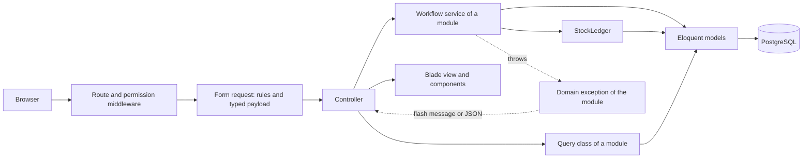

# 2. Workflow services by module, read models in queries, typed form requests

- Status: Accepted
- Date: 2025-11

## Context

In the original code the hospital's workflows lived in controllers. The cashier's "pay selected"
loop updated rows one by one without a transaction and loaded the price list entry instead of the
patient's procedure; a supply request approval collected errors in an array and then committed the
items that had succeeded; page queries were assembled inline, with an extra query per eager-load
constraint. None of this could be tested without a full HTTP request, and the same rule (what
"waiting for the cashier" means, which statuses an order passes through) was written in several
places.

The application is a dashboard over about ninety Eloquent models. Most screens only save the form of
one record; a handful run a real workflow that changes statuses, moves stock or money, or books time.

## Decision

The code is organised around five modules, the hospital's workflows: `Billing`, `Clinical`,
`Patients`, `Scheduling` and `Stock`. The full placement table is in
[docs/architecture/folder-layout.md](../architecture/folder-layout.md); the decisions behind it are:

1. **Workflow logic is a service of its module**, in `app/Services/<Module>/`
   (`CashierPaymentService`, `RegistrarConfirmationService`, `PatientMedicationService`,
   `ReceptionService`, `StockLedger`, `SupplyRequestService`, `TransferService` ...). A workflow
   service owns its transaction and its row locks, checks the status transition, and refuses an
   operation by throwing an exception of its module from `app/Exceptions/<Module>/`, each a
   `DomainException` directly or through the module's base class (`ClinicalException`,
   `StockException`). Value objects and enums that are never stored sit next to the service that
   uses them (`Amount`, `CurrencyTotals`, `BillableType`, `TimeRange`, `SlotGrid`, `MedicalScale`).
2. **Saving the form of one record stays flat**, in `app/Services/<Model>Service.php`
   (`CityService`, `PatientService`, `StaffService` ...). A flat service moves into a module once it
   changes a status, moves stock or money, or books time.
3. **Reads for a page, an export or a dashboard card are query classes** in
   `app/Queries/<Module>/` (`PatientCardQuery`, `CashierItemsQuery`, `RegistrarBasketQuery`,
   `NursePatientsQuery`, `StockAlertsQuery`, `DashboardSummary` ...). They return read-only shapes
   (`BillableItem`, `OrderTotals`, `RegistrarQueue`, `Dashboard`) rather than models when a page
   combines several tables. `App\Queries\LikePattern` is the one way a search matches text. A figure
   on the dashboard home is read through the query of the page its card links to
   (`NursePatientsQuery::count()`, `CashierItemsQuery::totals()`, `RegistrarBasketQuery::queue()`),
   so the card and the page agree.
4. **Controllers are thin.** A form request validates the input and hands the service a named,
   typed payload built from Laravel's typed readers (`ReceptionRequest::booking()`,
   `TransferRequest::transfer()`, `LoginRequest::credentials()`, `Admin\UpdateRequest::account()`).
   The controller calls the service and turns a domain exception into a Russian flash message or a
   JSON error. The signed-in account is injected as `#[CurrentUser(Admin::GUARD)] Admin`.
5. **Form requests** of a record's create and edit form are flat in `app/Http/Requests/`; those of
   a module's other actions (filters, status changes, decisions, payments, readings) are in
   `app/Http/Requests/<Module>/` (`Billing/PayItemsRequest`, `Stock/RejectSupplyRequest`).
6. **The layout is enforced by tests.** `tests/Arch/ArchitectureTest.php` (Pest `arch()`) checks,
   among other rules, that services use nothing from the HTTP layer (`App\Http`, request and
   response classes and facades, `request()`, `redirect()`, `abort()` ...), that `*Query` classes
   live only in `App\Queries`, that controllers, models, form requests and exceptions live in their
   namespaces, and that Blade components and the sidebar (`App\View`, `App\Support\Navigation`) do not
   query models. Pages with many relations have a fixed-query-count test (`PatientCardTest`,
   `AdminAccountsTest`, `StaffManagementTest`, `DashboardSummaryTest`), so a missing eager load fails
   a test instead of slowing the page down.

## Consequences

### Positive

- Each rule has one home. The cashier list and the dashboard tile use the same filter
  (`CashierItemsQuery::matching()`), and the registrar basket and the day's queue use the same
  "waiting for the registrar" condition.
- Workflows are tested as behaviour of their module: `tests/Feature/<Module>/` through HTTP and the
  database, `tests/Unit/<Module>/` for logic without them.
- Services can be called from a seeder, a command or a test without an HTTP request; `DemoSeeder`
  dispenses prescriptions through `PatientMedicationService::sendToFloor()`.
- The read side can be optimised on its own (SQL aggregates, window functions, fixed query counts)
  without touching the write rules.
- The architecture tests stop the layout from drifting when new code is added.

### Negative

- There are two kinds of service folder. Whether a class is a "form service" or a "workflow
  service" is a judgement call, written down in `folder-layout.md` but not checked by a tool.
- Services depend on Eloquent directly; there are no repositories or interfaces in front of the
  models, so a service test runs against the database.
- The typed payload methods cover most forms but not all: some flat services
  (`ExaminationMapService`, `PatientService`, `StaffService`) still receive the `validated()` array.
- Not every module enum lives in `app/Enums`: `BillableType`, `PaymentState` and `MedicalScale` stay
  with their service because no column stores them, so "enums live in `App\Enums`" is not an
  architecture rule.

## Alternatives considered

- **Laravel's default flat layout with logic in controllers and models.** This was the starting
  point, and the source of the partial commits and duplicated rules described above.
- **One class per use case (an `App\Actions` folder).** Rejected for the workflows: the operations of
  one workflow share their locks, lifecycle checks and stock rules (prescribing, sending to the
  floor, returning and cancelling a prescription), and keeping them in one service keeps those rules
  together.
- **Hexagonal architecture with domain entities and repositories.** More ceremony than a dashboard
  with five workflows needs; it would duplicate the Eloquent models and hide the SQL the read models
  depend on.
- **Read logic in model scopes and accessors only.** Scopes stay for reusable conditions
  (`unexpired()`, `active()`), but a page that combines four order tables, prices and currencies
  needs a class of its own that can be tested and counted.
