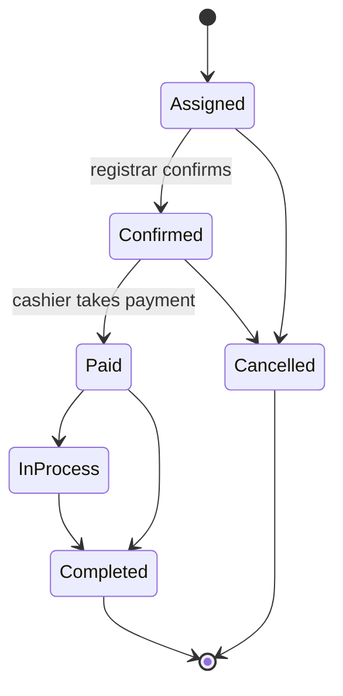

# 3. Stored vocabularies as backed enums with declared lifecycles; morph aliases in polymorphic columns

- Status: Accepted
- Date: 2025-11

## Context

Statuses and other closed vocabularies were plain strings. Each one had a parallel set of model
constants and label arrays (`PatientMedication::STATUS_LABELS`, `PatientService::getStatusBadge()`
building HTML in PHP), views compared raw strings, and the allowed transitions were implied by
whatever a controller happened to write. The `CHECK` constraint of a column and the code drifted
apart: the model knew a `paid` status the column did not admit, so every payment at the cash desk
failed. Some stored values were Russian display words (`equipment.status = 'работает'`).

Polymorphic columns (`files.fileable_type`, `stock_movements.*_type`, spatie's
`model_has_roles.model_type`) stored PHP class names, so renaming or moving a model would orphan
every row that pointed at it.

## Decision

### Enums

- Every closed vocabulary that is stored in a column and read by code is a string-backed enum in
  `app/Enums`: five lifecycles (`ServiceStatus`, `ReceptionStatus`, `PatientMedicationStatus`,
  `TransferStatus`, `SupplyRequestStatus`) and the vocabularies (`Gender`, `AdministrationRoute`,
  `StockMovementReason`, `QuestionType`, `EquipmentStatus`, `PackagingType` ...).
- Stored values are ASCII snake_case; the Russian word is the `label()` (`HasLabel`). The Russian
  values already stored were rewritten by `2025_11_20_110200_store_english_values_of_equipment_status_and_packaging_type`.
- Models cast the column to its enum in `casts()`; forms list `Enum::options()` and validate with
  `Rule::enum()`; PHP and Blade compare enum cases, never strings.
- A lifecycle declares one list per status, `nextStatuses()`. The `HasLifecycle` trait derives
  `canTransitionTo()`, `isFinal()`, `finalStatuses()` and `finalValues()` from it. A service locks
  the row and checks `canTransitionTo()` before it writes the new status
  (`ReceptionService::changeStatus()`, `TransferService::changeStatus()`,
  `SupplyRequestService::lockUndecided()`).
- A value shown as a badge or an icon implements `HasBadge` or `HasIcon` and is drawn by the
  class-based components `<x-status-badge>` and `<x-status-icon>` (`App\View\Components\StatusBadge`
  and `StatusIcon`, typed on the contract), never by HTML built in PHP.
- The database keeps `varchar` plus a `CHECK` that lists the same values
  ([ADR 1](0001-postgresql-as-the-only-database.md)); `EnumColumnsTest` holds the two equal.
- Enums that no column stores stay with the module that uses them: `BillableType` (the one place
  that says which status of each kind of order means "ordered", "to be paid" and "paid"),
  `PaymentState` and `MedicalScale` (int-backed by the ids of the scored documents).

The lifecycle of a service or procedure order (`ServiceStatus`) shows the pattern; payment is the
cashier's step, so the clinician's choices are `manualNextStatuses()`, the same list without `paid`:

| Lifecycle | Column | Statuses, first to final |
|---|---|---|
| `ServiceStatus` | `patient_services.status`, `patient_procedures.status` | assigned, confirmed, paid, in_process, completed; cancelled |
| `ReceptionStatus` | `receptions.status` | new, confirmed, paid, done; cancelled |
| `PatientMedicationStatus` | `patient_medications.status` | ordered, sent_to_floor, received_at_station, completed; returned, cancelled |
| `TransferStatus` | `transfers.status` | pending, completed; canceled |
| `SupplyRequestStatus` | `supply_requests.status` | pending, approved; rejected |

`tests/Unit/Enums/LifecyclesTest.php` checks every lifecycle as a graph: one start status from which
all others can be reached, no path back to a status already left, and exactly the statuses without a
successor treated as final.

### Morph aliases

- `AppServiceProvider` calls `Relation::enforceMorphMap()` with snake_case aliases for every model
  stored in a polymorphic column: `admin` (spatie's role and permission pivots), `patient`, the three
  stock items, the seven stock rows, `supply_request`, `transfer` and `patient_medication`.
- A model that is not in the map cannot be stored in such a column
  (`ClassMorphViolationException`), so a new polymorphic relation must name its alias.
- The migration `2025_11_20_110100_store_morph_aliases_in_polymorphic_columns` rewrote the stored
  class names. It holds a frozen copy of the map, so a later class rename does not change what it
  does; it is idempotent, drops a duplicate role grant whose alias twin already exists, and `down()`
  restores the class names. `tests/Feature/Database/MorphMapTest.php` runs it up, up again and down.

## Consequences

### Positive

- A misspelt status is a type error that Larastan reports (it reads the casts at level 8, see
  [ADR 11](0011-quality-gates.md)), not a silently empty query.
- The transitions of each lifecycle are in one list, read by the services, the views (which offer
  only the next statuses) and the tests.
- Labels and badge colours are the same on every screen; the cashier shows the statuses of four
  kinds of order in one column with consistent colours.
- Stored data no longer depends on PHP class names or on Russian spelling.

### Negative

- Adding a value takes two changes that must agree: the enum case and a migration that replaces the
  column's `CHECK` constraint. The test catches a mismatch, but the work is still twice.
- Transition rules are enforced in PHP. A raw `UPDATE` can still skip a step; the database only
  guarantees that the value belongs to the vocabulary.
- Values once stored are frozen. `TransferStatus::Canceled` keeps the value `canceled` while the other
  lifecycles say `cancelled`.
- The morph migration must run together with the release that enforces the map: until it has run,
  spatie looks up `model_type = 'admin'` and accounts appear to have no roles.
- `images.imageable_type` was not rewritten, because no model owned that table. The table has
  since been dropped with the other tables of removed modules ([data-model.md](../architecture/data-model.md#tables-without-a-model)).
- Not everything is an enum. `medications.release_form` holds 34 display strings no code branches
  on; it belongs in a reference table. The column is plain text, and only the form limits it to
  the list in `Medication::RELEASEFORM`.

## Alternatives considered

- **PostgreSQL `ENUM` types.** A value can be added with `ALTER TYPE ... ADD VALUE` but never
  removed, which makes rollbacks and the Russian-to-ASCII rewrite awkward. A `CHECK`
  constraint is dropped and recreated in the same migration.
- **Lookup tables for statuses.** Code branches on every status, so the rows would be read by id or
  by name in code, and the ids would become another fixed contract.
- **A state machine package with a class per state.** The lifecycles have three to six statuses and
  no per-state behaviour beyond the transition list; an enum with `nextStatuses()` states them in a
  few lines.
- **Integer-backed enums.** Smaller columns, but unreadable in SQL, in exports and in the
  `CHECK` definitions.
- **Keeping class names in polymorphic columns.** Laravel's default, but it ties every stored row to
  the current class names and namespaces.
