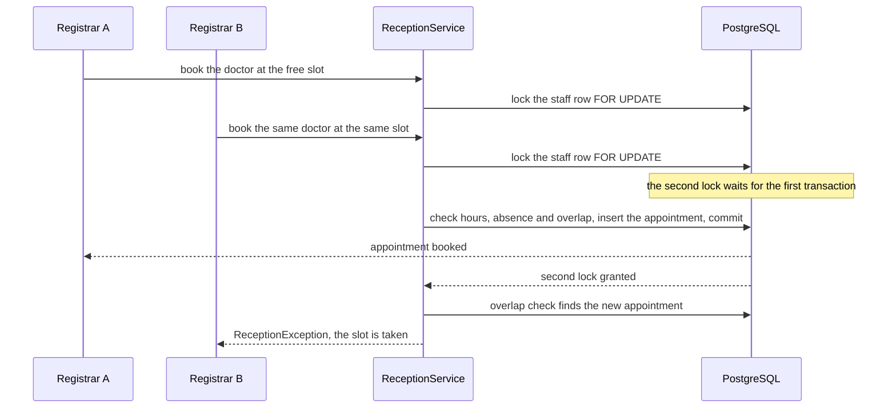

# 4. Pessimistic row locks in a fixed order, with database constraints as the backstop

- Status: Accepted
- Date: 2025-11

## Context

Registrars, cashiers, nurses and warehouse staff work in the dashboard at the same time, often on the
same patient or the same stock. The original code ran its workflows without transactions or locks,
and a review of the 1.x code found the results: a supply request approval committed the items that succeeded and
could then be approved a second time, moving stock twice; a transfer saved its "completed" status
before the stock check, so a repeated request decremented again; the cashier's loop half-applied a
payment when one order failed; two registrars could book the same doctor for the same time; a
double-submitted admission form opened a second stay.

The workflows are short (a few rows each), and a refused operation must leave nothing behind: the
user is told why in Russian and tries again.

## Decision

1. **Every workflow write runs in `DB::transaction()` and locks the rows it decides on**
   (`SELECT ... FOR UPDATE`, Eloquent's `lockForUpdate()`) before it reads their state:
   - the record whose status changes: an order (`PatientServiceAssignService`, `ReceptionService`,
     `PatientMedicationService`), a transfer (`TransferService`), a supply request
     (`SupplyRequestService::lockUndecided()`);
   - the parent row that serialises one decision: the staff row for a booking
     (`ReceptionService::book()`) and for a change of that employee's schedule, absences or
     employment (`StaffService::update()` and `destroy()` take it first, as a booking does), the
     patient row for an admission (`ExaminationMapService::store()`),
     the position row when its role is created (`StaffPositionService::roleOf()`), the main
     administrators' rows for the "last main administrator" rule (`AdminService`);
   - stock rows, always through `StockLedger` ([ADR 5](0005-append-only-stock-ledger.md)).
2. **Rows are locked in one fixed order**, so two transactions never wait on each other in a
   cycle. Orders are locked kind by kind in `BillableType` case order, then by id
   (`CashierPaymentService::lockOrders()`, `RetainedRecords`); the registrar confirmation takes
   prescriptions in medication order, so confirmations of different patients lock shared stock rows
   in the same order.
3. **All or nothing.** A refusal throws a domain exception inside the transaction and everything
   rolls back: a payment of several orders, a registrar confirmation with one drug short, a supply
   request with one item missing.
4. **A repeated request is harmless.** Asking for the status a record already has changes nothing
   (`ReceptionService::changeStatus()`); the registrar confirmation's `UPDATE` matches only orders
   still in their ordered status, and PostgreSQL re-checks that condition on a row a concurrent
   transaction has just changed; a second payment of the same orders is refused because they are
   no longer payable.
5. **The deadlock that remains possible is retried.** Two confirmations can still lock shared stock
   rows from different sides; `RegistrarConfirmationService` runs its transaction with three
   attempts, and PostgreSQL aborts one side of a deadlock.
6. **The database is the backstop** for writes that bypass the services: the exclusion constraint
   on appointments, the partial unique index on open stays and the quantity `CHECK` constraints of
   [ADR 1](0001-postgresql-as-the-only-database.md).

Two registrars booking the same slot with the same doctor:

## Consequences

### Positive

- The workflows are correct under concurrency without an application-level mutex, a queue or a
  cache lock, and the reasoning stays local to one service.
- Refusals are clean: no half-paid baskets, no partially approved supply requests, no stock moved
  twice. The tests cover the repeated request for each workflow (`CashierPaymentTest` "refuses a
  repeated payment request instead of applying it twice", the "once" cases of the stock tests).
- A write that escapes the service layer still cannot double-book a doctor, open a second stay or
  drive stock negative.

### Negative

- Locks serialise work on one staff member, one patient or one stock row. That is the intent, but a
  slow transaction would make others wait; the transactions are kept to a few statements.
- The lock order is a convention written in the services' docblocks, not checked by a tool. A new
  service that locks orders or stock rows in another order can deadlock with the existing ones.
- Concurrency is not tested with real parallel connections. The tests send the repeated request
  sequentially and rely on PostgreSQL's locking semantics for the concurrent case.
- There are no idempotency keys. A form that creates a record, such as a prescription or a supply
  request, and is submitted twice creates two records; only operations with a status to check
  (payment, confirmation, approval, booking) are safe to repeat.

## Alternatives considered

- **Optimistic locking with a version column.** Every conflict would surface as an error the user
  has to resolve, and Eloquent has no built-in support. Conflicts here are rare but costly (money,
  stock), and waiting a few milliseconds for a lock is the better experience.
- **`SERIALIZABLE` isolation.** It would catch the same anomalies without explicit locks, at the
  price of retrying every transaction that loses a serialization check, not only deadlocks.
- **Advisory locks (`pg_advisory_xact_lock`) keyed by staff or patient id.** Equivalent for
  serialisation, but the lock is invisible in the schema and in the rows themselves.
- **Running all writes through one queue worker.** It removes concurrency entirely, but the
  dashboard needs the result of a booking or a payment in the same request.
