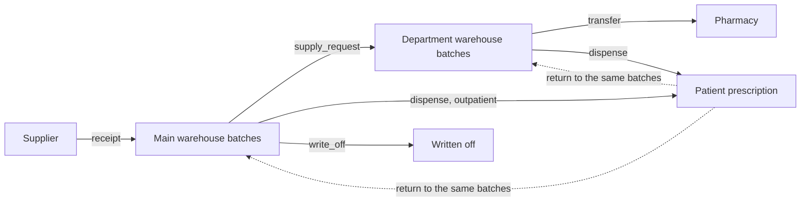

# 5. An append-only stock ledger as the single writer of stock, with FEFO batches

- Status: Accepted
- Date: 2025-11

## Context

Stock lives in several places: the main warehouse, the department warehouses, the pharmacies. The
main warehouse and the departments hold medications as batches with an expiry date; supplies,
household materials and pharmacy stock have one row per item and place. Medications reach a patient
through a prescription, from the department of the stay or, for an outpatient, from the main
warehouse.

A review of the 1.x code found stock written from many places and wrongly in most of them: approving a supply
request overwrote every batch of a medication with one value; a transfer decremented every row of
the item; dispensing a prescription never decremented anything; a separate `stock` column on the
main warehouse batches was never kept in line with `quantity`; discarding one line through a GET
request removed every batch of the item and left no record. Nobody could say where a unit had gone.

## Decision

1. **`App\Services\Stock\StockLedger` is the only code that changes a stock quantity.** The seven
   stock row models implement the `StockLot` interface (`MainWarehouseMedication`,
   `MainWarehouseMedicalSupply`, `MainWarehouseHouseholdMaterial`, `WarehouseAccounting`,
   `WarehouseMedicalSupply`, `WarehouseHouseholdMaterial`, `PharmacyMedication`), and the workflow
   services call the ledger instead of writing `quantity` themselves:
   - `take()` locks the candidate rows, takes the units across as many rows as needed in the order
     the caller's query gives, or throws `InsufficientStockException` and takes nothing;
   - `lot()` returns the locked row of an item in a place, inserting an empty one first when the
     place never held the item (the table's unique key makes a concurrent first put wait for it);
   - `put()` adds units to a row;
   - `writeOff()` records the whole quantity as written off and deletes the row;
   - `restore()` puts back what a document took out, into the very rows it came from, and refuses
     with a `StockException` if one of them was written off in the meantime.
2. **Every change is a row of `stock_movements`** (migration
   `2025_11_19_100000_create_stock_movements_table`): the stock row and the catalogue item (both
   morphs, [ADR 3](0003-backed-enums-and-morph-aliases.md)), a signed quantity, the reason
   (`StockMovementReason`: receipt, write_off, supply_request, transfer, dispense, return), the
   document behind it (a supply request, a transfer or a prescription), the admin and the time.
   `StockMovement` has no `updated_at`; no code updates or deletes a movement.
3. **Batches are taken earliest expiry first (FEFO).** Callers pass `unexpired()` batches ordered
   by `expiration_date`, then id. An expired batch is never dispensed or moved on, however early it
   expires: it stays until it is written off.
4. **Each document moves stock once, at one status change**, under the locks of
   [ADR 4](0004-row-locks-in-a-fixed-order.md):

| Document | When stock moves | From | To | Service |
|---|---|---|---|---|
| Receipt | when it is saved; every medication line is a batch of its own | supplier | main warehouse | `MainWarehouseService::storeGoods()` |
| Supply request | pending to approved | main warehouse batches, FEFO | the department's batch of the same number and expiry | `SupplyRequestService::approve()` |
| Transfer | pending to completed | department batches, FEFO | the pharmacy's row | `TransferService::changeStatus()` |
| Prescription | ordered to sent_to_floor, at the registrar's confirmation | the stay department's medication warehouse, or the main warehouse for an outpatient or a department without one | the patient | `PatientMedicationService::sendToFloor()` |
| Returned prescription | sent_to_floor or received_at_station to returned | the patient | the exact batches it was taken from | `PatientMedicationService` through `StockLedger::restore()` |
| Write-off | when one row is selected and deleted | main warehouse | out of stock | `MainWarehouseService::writeOff()` |

5. **The database guards the result**: `quantity >= 0` on every stock table and positive line
   quantities ([ADR 1](0001-postgresql-as-the-only-database.md)); a warehouse or pharmacy that holds
   or ordered stock cannot be deleted (`2025_11_19_100300_restrict_deletes_of_places_holding_stock`).
   The stale `main_warehouse_medications.stock` column was dropped
   (`2025_11_20_100000_drop_stock_from_main_warehouse_medications_table`); `quantity` is the only
   figure on hand.

## Consequences

### Positive

- Every unit that moved since the ledger was introduced can be traced to a document, a reason and
  an admin; a written-off batch leaves its trace even though its row is gone.
- A returned prescription restores exactly what it took, batch by batch, because the dispense
  movements say where the units came from.
- The stock rules are in one class with one set of locks, so a new kind of document needs only to
  decide which rows to pass to `take()` and `put()`.
- The tests can assert movements, not only quantities: "dispenses an inpatient prescription from
  the department warehouse, earliest expiry first, once", "returns a dispensed prescription whole
  or not at all when one of its batches was written off", "never sends an expired batch to a
  department, however early it expires".

### Negative

- The ledger is a history of changes since it was introduced, not a full reconstruction. Rows that
  held stock before the migration have no receipt movement, and neither has the opening stock of the
  demo data, which `DemoSeeder` creates with factories. The sum of a row's movements equals its
  quantity only for stock received through the application, and no report reconciles the two.
- Append-only is a convention of the code. The database does not forbid an `UPDATE` or `DELETE` on
  `stock_movements` (no trigger, no revoked privilege).
- The polymorphic `stock` reference has no foreign key; after a write-off it points to a deleted
  row by design, so the movement cannot be joined back to the batch's other columns.
- A receipt has no document of its own: its movements carry no source, so the lines of one delivery
  are grouped only by time and admin. A write-off records no reason (expired, damaged, lost).
- The ledger reads its author from the signed-in session, so a movement written outside a request
  (a seeder, a console command) has no admin, and deleting an account sets its movements' `admin_id`
  to `NULL` (`RegistrarConfirmTest` pins the first case).
- Only the main warehouse has a write-off. Department stock leaves only through a transfer or a
  prescription, and pharmacy stock, which has no batches or expiry dates, is never taken out by the
  application at all: there is no pharmacy sale yet.

## Alternatives considered

- **Quantities updated in place by each service, without a ledger.** This was the original design
  and the reason no one could explain a quantity.
- **Event sourcing, with quantities derived from the movements.** The ledger would become the source
  of truth and quantities a projection. That is a larger change to every stock page and query; the
  current design keeps `quantity` authoritative and the ledger as its audit trail.
- **FIFO by receipt date instead of FEFO.** In a hospital the expiry date decides what must be used
  first; FEFO also keeps expired units from being dispensed by accident.
- **Soft-deleting a written-off batch.** It would keep the row joinable, but every stock query
  would have to exclude it; the write-off movement keeps the quantity and the item, which is what
  the ledger needs.
