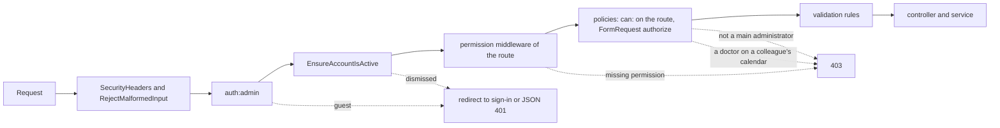

# 8. Authorization: a permission on every route, roles derived from staff positions, policies for record-level rules

- Status: Accepted
- Date: 2025-11

## Context

The dashboard serves doctors, nurses, registrars, cashiers, warehouse staff and administrators, each
allowed a different set of screens and actions. A review of the 1.x code found:

- routes with no permission at all, among them the supply request approval that moves stock;
- staff positions linked to spatie roles by name only: renaming a position created a new role while
  the staff kept the old one, and changing an employee's position added the new role without
  removing the old one, so permissions only ever accumulated;
- behaviour keyed on Russian role names (`'Регистратор'`, `'Доктор'`);
- any holder of `edit_admins` could change a main administrator's e-mail or password and take over
  the dashboard;
- a dismissed employee kept a working login.

## Decision

1. **One guard, permissions from spatie/laravel-permission.** Every dashboard account is an
   `App\Models\Admin` on the `admin` guard (sessions). `App\Support\Authorization\PermissionCatalog`
   is the catalogue of permissions, each named after a screen or action (`list_patients`,
   `accept_payments`, `approve_supply_requests` ...) with the Russian label the staff position form
   shows; `PermissionSeeder` seeds it. The `main_admin` role holds all of them.
2. **Every dashboard route requires the admin session and a permission.** Resource controllers
   declare one permission per action in `HasMiddleware::middleware()`; every other route carries
   its own `permission:` middleware; a page reached from several screens accepts any of their
   permissions (`a|b`). The only route without one is `logout`.
   `tests/Feature/Authorization/RouteAuthorizationTest.php` reads the route table, controller
   middleware included, and fails when a route has no permission, names a permission that is not
   seeded, or when a seeded permission is checked nowhere. `PageAccessTest` and
   `ActionPermissionsTest` open the pages and actions per role.
3. **The AJAX endpoints are not a separate API.** `routes/ajax.php` is mounted by `bootstrap/app.php`
   under `/api` in the `web` group behind `auth:admin`: the same session, the same CSRF token, and
   on each endpoint the permission of the page that calls it. Errors come back as JSON.
4. **The interface shows exactly what the routes allow.** Each sidebar link in
   `App\Support\Navigation\Navigation` names its route's permission (`NavigationTest` compares them
   with the router), each dashboard card declares the permission of the page it links to
   (`DashboardCard::permissions()`, checked by `DashboardCardsTest`), and buttons are wrapped in
   `@can` with the permission of their route.
5. **A staff position owns its role.** `staff_positions.role_id`
   (`2025_11_19_130000_add_role_id_to_staff_positions_table`) links each position to one role;
   creating, renaming or deleting a position does the same to its role (`StaffPositionService`;
   `roleOf()` links a position that has no role yet). An employee's login holds exactly the role of their current
   position plus system roles (`StaffService` calls `syncRoles()`), and a position can never take a
   reserved name such as `main_admin`. Default permissions go to the registrar and cashier
   positions by their fixed ids ([ADR 12](0012-fixed-id-reference-data-and-idempotent-seeders.md)).
6. **Policies only where the answer depends on the record.** Three policies, registered with
   `Gate::policy()`, run after the route's permission and answer a denial with a 403 and a Russian
   reason:
   - `App\Policies\AdminPolicy` lets only a main administrator edit or delete a main
     administrator's account. It runs in `FormRequest::authorize()` before validation
     (`Admin\UpdateRequest`, `StaffRequest`), so a refused request learns nothing about which
     e-mails are taken. Business refusals, such as deleting your own account or the last active
     main administrator, are `AccountException`s shown as flash messages.
   - `App\Policies\ReceptionPolicy` keeps a doctor's account on the doctor's own calendar. The
     routes that name an employee or an appointment ask it with `can:` middleware. A booking names
     its employee in the body, so `ReceptionRequest::authorize()` asks it before validation, also
     for an id that names nobody: a refused doctor learns nothing about which ids exist.
   - `App\Policies\DocumentResponsePolicy` decides which filled-in medical documents may be
     deleted (only an initial nursing assessment no stay holds yet), opened on their answers page
     (only an initial nursing assessment, to the permission of the stay form that links it) and
     followed up in the nurse window (only the sheets of the open stays that window shows).
7. **Only active accounts work.** An account whose employee is dismissed is inactive
   (`Admin::isActive()`). `LoginRequest` adds the active condition to the credential lookup and
   says "account disabled" only after the password was right; `EnsureAccountIsActive`, appended to
   the `web` group, ends a session or a "remember me" cookie the account already holds on its next
   request. Sign-in is limited to five attempts a minute per login and address.
8. **Record-level visibility is part of the query, and the policies ask the same rule.** A
   doctor's account lists only its own appointments (`Admin::doctorProfile()`), and a nurse's
   window shows only the stays of her own department (`NursePatientsQuery`). The endpoints that act
   on one record ask a policy built on the same method: `ReceptionPolicy` on `doctorProfile()`,
   `DocumentResponsePolicy::trackActions()` on `NursePatientsQuery`. Who counts as a doctor is
   decided by the employee's position, whatever the account's roles, `main_admin` included.

## Consequences

### Positive

- A route that forgets its permission fails a test before any page test has to notice; so does a
  sidebar link or a dashboard card whose permission differs from its route's.
- Renaming a position keeps its grants, and moving an employee to another position removes the old
  role, so permissions no longer accumulate.
- The main administrator accounts cannot be taken over through the admins or staff screens, and a
  dismissal takes effect on the employee's next request.
- The AJAX endpoints inherit the session, CSRF and permission rules of the pages; there is no token
  scheme to secure separately.

### Negative

- Permissions are per screen and action, so the catalogue is long and the position form lists every
  one of them. There are no permission groups beyond the role.
- Record-level rules are keyed on staff positions and departments (a doctor is position 1). A list
  is narrowed in its query and a single record is checked by a policy, so a new endpoint has to
  remember the policy; `ApiAccessTest` enforces that only for the booking routes.
- Permission names are strings. The tests compare them with the seeded list, but the type system
  does not.
- `EnsureAccountIsActive` costs one query per request for accounts linked to an employee.
- The AJAX endpoints are usable only from the dashboard's own pages; another client would need an
  API of its own.

## Alternatives considered

- **Role checks in code (`hasRole('registrar')`).** Rejected: positions and their roles are renamed
  by the hospital, and a check on a name breaks silently. Code checks permissions; roles only bundle
  them.
- **A policy for every model.** Most decisions here do not depend on the record, only on the screen
  or action; a policy per model would wrap the same permission check in another layer. Policies are
  kept for the decisions that depend on the record, the three above.
- **Laravel Gate abilities without spatie.** Possible, but the hospital edits which position may do
  what on a screen, which needs permissions stored in the database.
- **A token API (Sanctum) for the AJAX calls.** It would add tokens, CORS and a second
  authentication path for endpoints that only the dashboard's own pages call.
