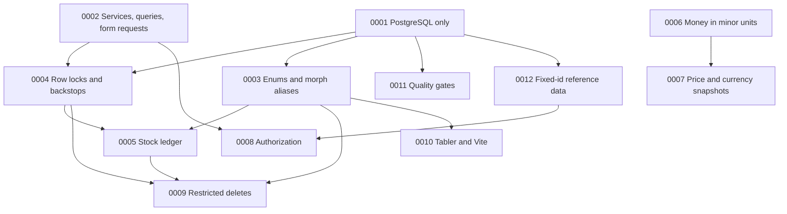

# Architecture decision records

Each record states one decision that shapes the code of MedSystem: the problem it answered, what was
decided, what it costs, and what else was considered. They were written during the refactor that
turned the original dashboard into the current code base (November 2025). The Context sections
describe the code as it was before; the Decision and Consequences sections describe the code as it
is, and every class, migration and test they name there exists in this repository.

| No. | Decision | Status |
|---|---|---|
| [0001](0001-postgresql-as-the-only-database.md) | PostgreSQL as the only supported database: exclusion and `CHECK` constraints, a partial unique index, `ILIKE` and window functions instead of a portable schema | Accepted |
| [0002](0002-workflow-services-read-models-and-form-requests.md) | Workflow services by module, read models in query classes, thin controllers with typed form request payloads, enforced by architecture tests | Accepted |
| [0003](0003-backed-enums-and-morph-aliases.md) | Stored vocabularies as string-backed enums with declared lifecycles; polymorphic columns store morph aliases, not class names | Accepted |
| [0004](0004-row-locks-in-a-fixed-order.md) | Pessimistic row locks taken in a fixed order, all-or-nothing workflows, database constraints as the backstop | Accepted |
| [0005](0005-append-only-stock-ledger.md) | An append-only stock ledger as the single writer of stock quantities, with batches taken earliest expiry first | Accepted |
| [0006](0006-money-in-minor-units-with-per-currency-totals.md) | Money as integer minor units in PHP over `decimal(14, 2)` columns, totals kept per currency | Accepted |
| [0007](0007-orders-keep-their-price-and-currency.md) | Orders keep the price and currency they were placed at | Accepted |
| [0008](0008-authorization-permissions-positions-and-policies.md) | A permission on every route, roles owned by staff positions, policies for record-level rules, only active accounts | Accepted |
| [0009](0009-restrict-deletes-and-retain-records.md) | Restricted deletes and retained records instead of cascades or soft deletes | Accepted |
| [0010](0010-tabler-and-vite-instead-of-a-commercial-template.md) | Tabler and Vite instead of the commercial template | Accepted |
| [0011](0011-quality-gates.md) | Quality gates: Pest on PostgreSQL, Larastan level 8 without a baseline, Rector, Pint, architecture tests and dependency audits | Accepted |
| [0012](0012-fixed-id-reference-data-and-idempotent-seeders.md) | Reference data with fixed ids named in code, idempotent seeders, demo data through the domain services | Accepted |

## How the decisions fit together

An arrow points from a decision to one that relies on it.

## Related documents

- [Folder layout](../architecture/folder-layout.md): where each kind of class goes, and the
  conventions for statuses and vocabularies.
- [Front end](../architecture/frontend.md): the build, the widgets and how a page is written.

## Writing a new record

- Copy the structure of an existing record: title, status, date, Context, Decision, Consequences
  (positive and negative), Alternatives considered.
- Number it with the next free number and a short kebab-case title, for example
  `0013-payments-table.md`, and add it to the table above.
- A record is not edited once accepted, apart from corrections of fact. A decision that changes is a
  new record; set the old one's status to "Superseded by NNNN" and link the two.
- Name the real classes, migrations and tests, and state the costs as plainly as the benefits.
