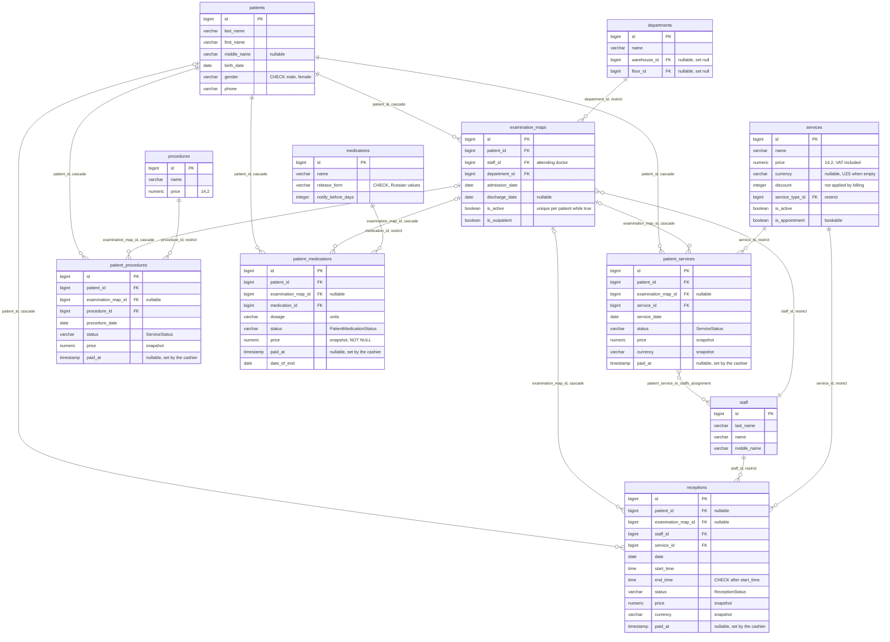
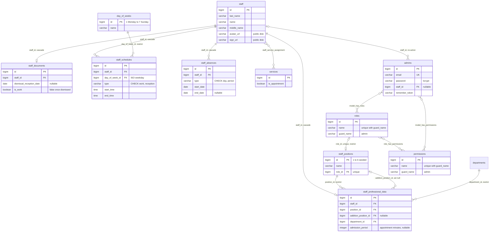
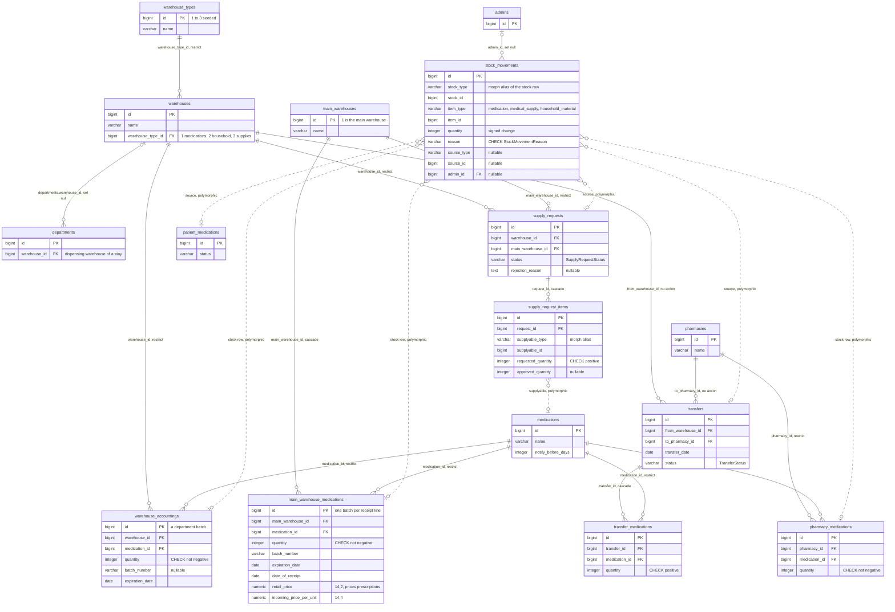
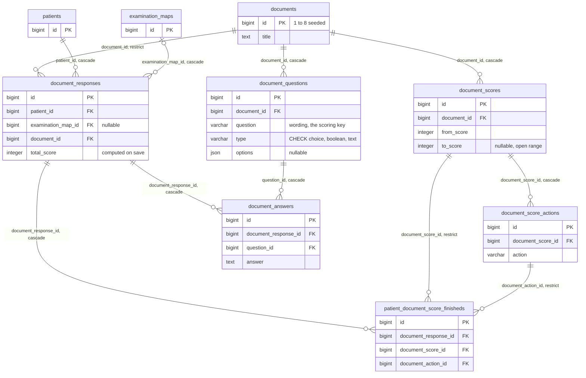

# Data model

The schema has about 120 tables. This page covers the core ones: about 40 tables, in four
diagrams. They were drawn from a freshly migrated and seeded database
(`APP_ENV=local php artisan migrate:fresh --seed`, then `information_schema` and `pg_catalog`).

- Each diagram shows the keys and the columns the rules depend on, not every column.
- Relationship labels give the foreign key column and its `ON DELETE` rule.
- Dashed lines are polymorphic links (`*_type` plus `*_id`). The database has no foreign key for
  them.

The business rules behind these tables are in [domain.md](domain.md).

## Patients, stays, orders and appointments



## Staff and access



`model_has_roles.model_type` and `model_has_permissions.model_type` hold the morph alias `admin`,
not a class name.

## Stock



Supplies and household materials follow the same pattern with one row per item and place. In the
main warehouse those rows are `main_warehouse_medical_supplies` and
`main_warehouse_household_materials`. In the department warehouses they are
`warehouse_medical_supplies` and `warehouse_household_materials`. They are left out of the diagram
to keep it readable.

## Medical documents and scores



## Constraints

### Foreign keys and `ON DELETE`

The rules follow what a row is to the row it points to:

| Rule | Where | Why |
|---|---|---|
| `CASCADE` | Everything a patient or a stay owns: `examination_maps`, the four order tables, `document_responses`, `survey_responses`, `patient_diagnoses`, vital signs, recently viewed entries, and the patient's allergy, chronic-disease and device links. Also the detail rows of a record: staff contacts, documents, schedules, absences, the items of a supply request, the lines of a transfer, the questions of a document. | These rows mean nothing without their owner. `RetainedRecords` refuses to delete a patient or a stay whose orders are financial or stock records ([domain.md](domain.md#deletion-guards)). |
| `RESTRICT` | Catalogue entries an order or a stock row uses: `services`, `procedures`, `medications`, `diagnoses`, `day_of_weeks`, `staff_positions`, `warehouse_types`, manufacturers, suppliers. Also the attending staff and department of a stay, the staff of an appointment, and every place that holds stock (`warehouse_id`, `pharmacy_id`, `main_warehouse_id` of supply requests). | Deleting reference data that is in use is refused. `bootstrap/app.php` shows the refusal as a message, or as a JSON 409 on AJAX routes, instead of a 500. |
| `SET NULL` | Optional references: a patient's region and city, `departments.warehouse_id` and `floor_id`, `offices.floor_id`, `patient_assignments.staff_id`, `surveys.diagnosis_id`, `main_warehouse_medications.supplier_id`, `staff_professional_data.addition_position_id`, `stock_movements.admin_id`. | The row stays valid without the reference. The movement journal outlives a deleted account. |
| `NO ACTION` | `admins.staff_id`, `transfers.from_warehouse_id`, `transfers.to_pharmacy_id` | Checked at the end of the statement. In effect this is a restriction. |

Some foreign keys behave differently:

- `cities.region_id` is `CASCADE`: deleting a region deletes its cities.
- `main_warehouse_id` of the three main-warehouse stock tables is `CASCADE`, unlike the other places
  that hold stock. No route deletes a main warehouse: there is one, with the fixed id 1.
- `staff_service_assignment` is `CASCADE` on both sides: deleting an employee or a service drops
  the link between them (a service that orders use is still kept by `RESTRICT`).
- `staff_professional_data.department_id` and `speciality_id` were added `NOT VALID`. PostgreSQL
  checks every new or changed row, but not the rows that existed before the migration
  (`2025_11_19_130200_add_foreign_keys_to_staff_professional_data_table`).

### CHECK constraints

- **Enum columns.** Laravel's `enum()` column is `varchar` plus a CHECK on PostgreSQL. Every status
  and vocabulary column cast to a PHP enum has one:
  - statuses: `patient_services.status`, `patient_procedures.status`, `receptions.status`,
    `patient_medications.status`, `transfers.status`, `supply_requests.status`,
    `stock_movements.reason`
  - vocabularies: `patients.gender`, `staff.gender`, `patient_services.place`,
    `patient_medications.method` and `admission_rules`, `staff_schedules.type`,
    `staff_absences.type` and `reason`, `equipment.status`, `packaging_type`,
    `staff_professional_data.category`, `document_questions.type`, `survey_questions.type`
  - `tests/Feature/Database/EnumColumnsTest.php` reads each CHECK from `pg_constraint` and requires
    it to admit exactly the values of the enum the model casts the column to.
- **Quantities.** `quantity >= 0` holds on every stock table (`main_warehouse_medications`,
  `main_warehouse_medical_supplies`, `main_warehouse_household_materials`, `warehouse_accountings`,
  `warehouse_medical_supplies`, `warehouse_household_materials`, `pharmacy_medications`).
  `quantity > 0` holds on `transfer_medications`, and `requested_quantity > 0` on
  `supply_request_items` (migration `2025_11_19_100200_add_quantity_checks_to_stock_tables`).
- **Appointments.** `receptions_end_after_start` requires `end_time > start_time`.
- The quantity and appointment checks are added `NOT VALID`: old rows were not rewritten, and every
  new write is checked.

### The exclusion constraint

Simplified from what `pg_get_constraintdef` reports:

```sql
ALTER TABLE receptions ADD CONSTRAINT receptions_no_overlap
    EXCLUDE USING gist (
        int8range(staff_id, staff_id, '[]') WITH &&,
        tsrange(date + start_time, date + GREATEST(start_time, end_time)) WITH &&
    )
    WHERE (status <> 'cancelled');
```

- Two appointments of one employee that are not cancelled cannot overlap in time.
- The staff id is compared as a one-value range, so the GiST index needs no `btree_gist`
  extension.
- `tsrange` is half-open, so back-to-back appointments do not overlap.
- `GREATEST` turns an invalid legacy row whose end is not after its start into an empty range, so
  such a row cannot block the migration.
- An exclusion constraint cannot be added `NOT VALID`. On a database that already held double
  bookings, the migration leaves those rows out of the constraint by id. On a fresh database the
  condition is only the status.
- `ReceptionService` maps SQLSTATE 23P01 to the "slot taken" refusal.

### Unique indexes

| Index | Rule |
|---|---|
| `examination_maps_one_active_per_patient` on `(patient_id) WHERE is_active` | one open stay per patient (a partial index) |
| `admins_email_unique` | one account per e-mail |
| `staff_positions_role_id_unique` | a role belongs to at most one position |
| `last_viewed_patients (admin_id, patient_id)` | a patient appears once in an account's recent list |
| `patient_document_score_finisheds (document_response_id, document_score_id, document_action_id)` | a recommended action is marked done once per response |
| `*_one_row_per_item` on `pharmacy_medications`, `warehouse_medical_supplies`, `warehouse_household_materials`, `main_warehouse_medical_supplies`, `main_warehouse_household_materials` (place, item) and `warehouse_accountings (warehouse_id, medication_id, batch_number, expiration_date) NULLS NOT DISTINCT` | a stock row holds one item (one batch) in one place; `StockLedger::lot()` inserts on it |
| `roles (name, guard_name)`, `permissions (name, guard_name)` | spatie/laravel-permission |

### Polymorphic columns

Polymorphic `*_type` columns store the aliases of the morph map in `AppServiceProvider`
(`Relation::enforceMorphMap`), such as `patient`, `medication`, `main_warehouse_medication` or
`supply_request`. They never store class names. A model that is not in the map cannot be stored
in such a column. This covers `stock_movements` (`stock_type`, `item_type`, `source_type`),
`supply_request_items.supplyable_type`, `files.fileable_type`, `model_has_roles.model_type` and
`model_has_permissions.model_type`. Migration
`2025_11_20_110100_store_morph_aliases_in_polymorphic_columns` rewrote the old class names.
`tests/Feature/Database/MorphMapTest.php` checks all of this.

### Column types

- Money is stored as `numeric(14,2)`, except `incoming_price_per_unit` (`numeric(14,4)`). The
  percentages next to it are `markup` (`numeric(8,2)`) and `pharmacy_medications.discount`
  (`numeric(5,2)`); `services.discount` is an `integer`. PHP reads money as decimal strings and adds
  it up in integer minor units (`Amount`).
- Vital-sign readings and a patient's normal values are `numeric(8,1)`.
- Dates and times are `date`, `time` and `timestamp` without a time zone, in the hospital's time
  zone (`APP_TIMEZONE`).

## Reference rows with fixed ids

The application relies on some rows by id or by name. The reference seeders create them with
explicit ids through `Database\Seeders\Concerns\SeedsRowsWithFixedIds`:

- `firstOrCreateWithId()` creates a row only if its id is missing, and never overwrites a renamed
  row.
- `syncIdSequence()` then moves the table's sequence past those ids.

Every reference seeder can be run again (`tests/Feature/Database/SeedersTest.php`).
`DatabaseSeeder` runs them in every environment. `DemoSeeder` runs only when `APP_ENV=local`.

| Table | Rows | What relies on them |
|---|---|---|
| `documents` | 1 Первичный сестринский осмотр (initial nursing assessment), 2 Morse fall risk, 3 Humpty Dumpty fall risk, 4 outpatient fall risk (КДО), 5 pain (numeric), 6 FLACC, 7 NIPS, 8 CPOT | `Document::INITIAL_NURSING_ASSESSMENT` (1) is attached on admission and offered on the stay forms. `Scoring\MedicalScale` maps 2 to 8 to their scoring rules. (`DocumentSeeder`) |
| `staff_positions` | 1 Доктор, 2 Старшая медсестра, 3 Медсестра, 4 Заведующий, 5 Регистратор, 6 Кассир, each linked to its role | The `StaffPosition` constants. `DOCTOR` decides who counts as a doctor (`Admin::doctorProfile()`). `REGISTRAR` gets the short registration form. `PermissionSeeder` gives default permissions to the roles of 5 and 6. `SEEDED_IDS` cannot be deleted. (`StaffPositionSeeder`) |
| `warehouse_types` | 1 Медикаменты, 2 Хозяйственный материал, 3 ИМН | `WarehouseType::MEDICATIONS`, `HOUSEHOLD_MATERIALS`, `MEDICAL_SUPPLIES`. `WarehouseType::STOCK_ITEMS` maps each type to the catalogue it stores. (`WarehouseSeeder`) |
| `main_warehouses` | 1 Общий склад | `MainWarehouse::MAIN`: receipts, write-offs, supply requests, prescription prices. (`WarehouseSeeder`) |
| `day_of_weeks` | 1 Понедельник to 7 Воскресенье | `DayOfWeek::idOf()` returns the ISO weekday (Monday = 1), so schedules match the calendar by id. (`DayOfWeekSeeder`) |
| `service_types` | 1 to 21, from 1 Данные отсутствуют to 21 Питание | `ServiceType::LAST_SYSTEM_TYPE_ID` (21): these types cannot be edited or deleted. `INSTRUMENTAL_STUDIES_ID` (4): the patient card orders only the instrumental studies booked by appointment. (`ServiceTypeSeeder`) |
| `roles` | `main_admin` (by name) | `Admin::MAIN_ADMIN_ROLE`. `PermissionSeeder` gives it every permission of the `admin` guard. (`PermissionSeeder`) |
| `permissions` | the names of `PermissionCatalog::PERMISSIONS` | Route middleware, `@can` in views and the menu. `php artisan permissions:prune` lists, and with `--force` deletes, permissions the seeder no longer seeds. |
| `vital_parameters` | 9 rows, matched by name (Систолическое АД, Пульс, Температура, ...) | `VitalSignsChart` (`VitalParameterSeeder`) |
| `admins` | one main administrator, from `ADMIN_EMAIL` / `ADMIN_PASSWORD` (`config/medsystem.php`) | `AdminSeeder`. In production it refuses to seed the default password. |

## Tables without a model

Three tables have their foreign keys but no code that writes them: `patient_allegories`,
`patient_chronic_diseases` and `patient_medical_devices`, the links of a patient to the allergy,
disease and device catalogues ([domain.md](domain.md#known-gaps)).

The tables of the modules 2.0.0 removed are dropped by
`2025_11_21_120000_drop_tables_of_removed_modules`: `analyzes` and the `analyze_*` tables,
`laboratories`, `users`, `images`, `warehouse_inventories` and `warehouse_transfers`. No code used
them, and their keys to staff, equipment and suppliers refused deletes no screen explained. On a
database upgraded from 1.x the migration stops while any of them holds rows and names those
tables, so old laboratory records are exported, never dropped silently. `sessions`, created by
the same original migration as `users`, stays.

The remaining tables without a model of their own are pivots that a relation names
(`staff_service_assignment`, `patient_medication_compatibility`, `last_viewed_patients`, the
spatie tables `model_has_roles`, `model_has_permissions` and `role_has_permissions`, ...) and
framework tables (`sessions`, `cache`, `cache_locks`, `jobs`, `job_batches`, `failed_jobs`,
`password_reset_tokens`, `migrations`, the Telescope tables).

## Related decisions

- [ADR 0001](../adr/0001-postgresql-as-the-only-database.md): PostgreSQL as the only database
- [ADR 0003](../adr/0003-backed-enums-and-morph-aliases.md): Backed enums and morph aliases
- [ADR 0009](../adr/0009-restrict-deletes-and-retain-records.md): Restricted deletes and retained records
- [ADR 0012](../adr/0012-fixed-id-reference-data-and-idempotent-seeders.md): Fixed-id reference data
