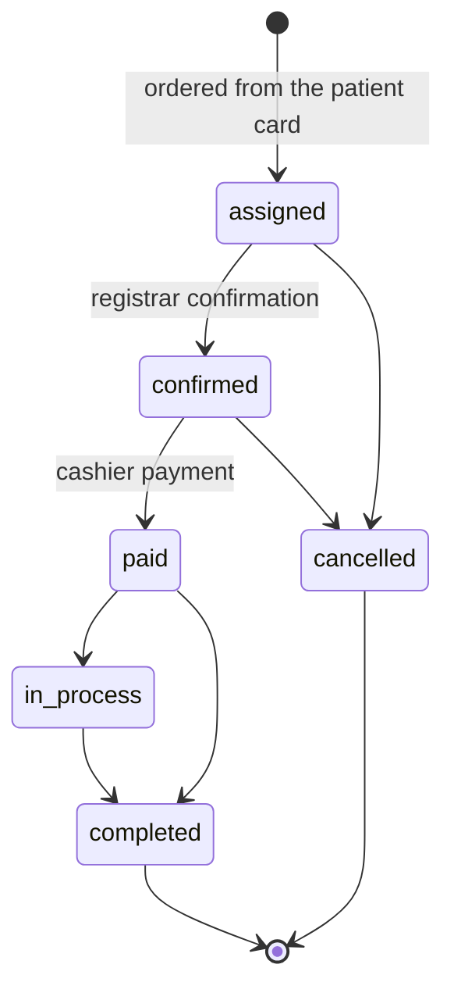
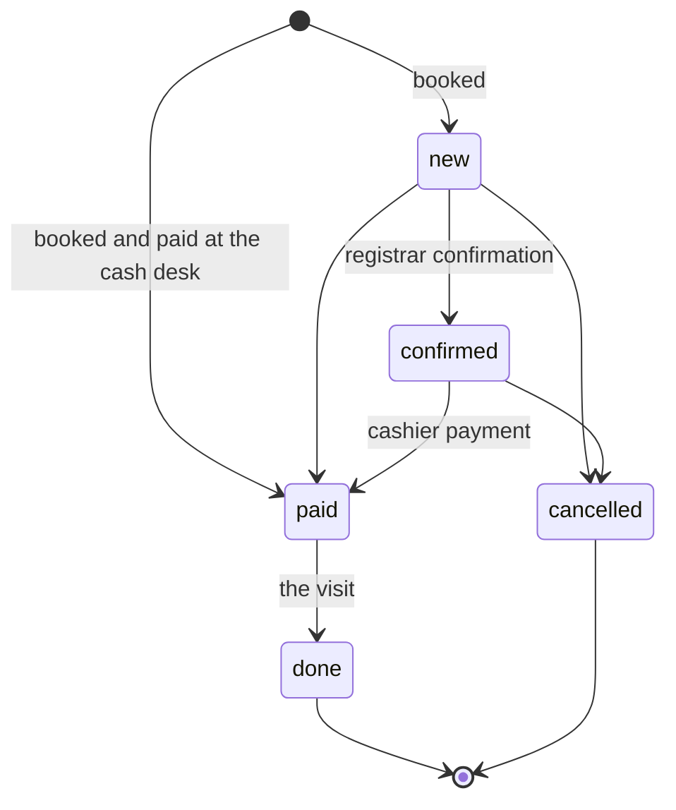
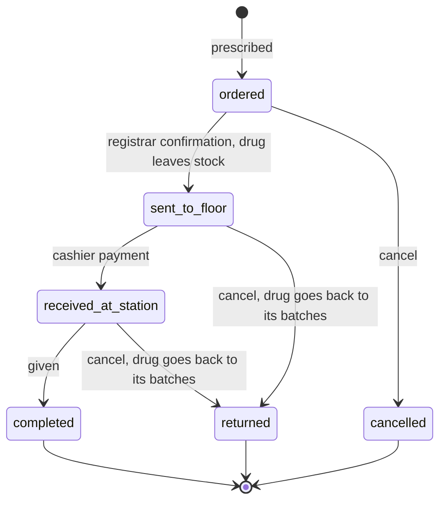
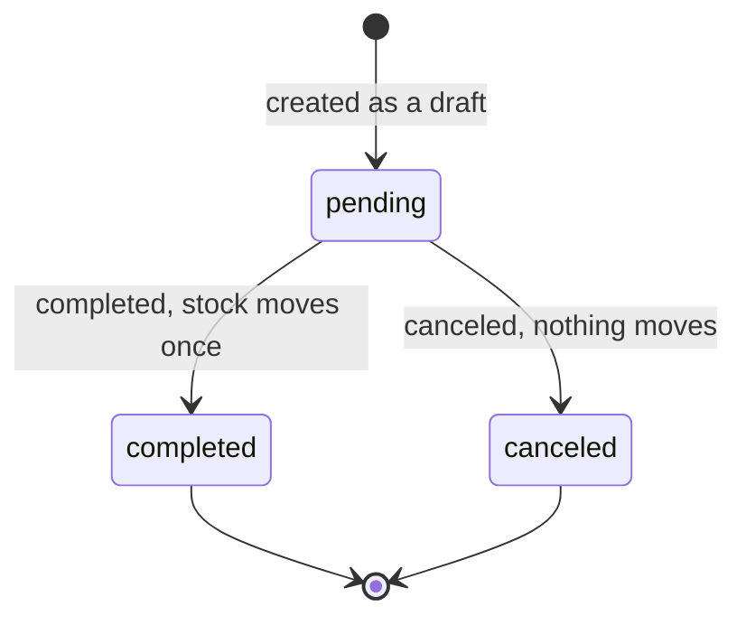
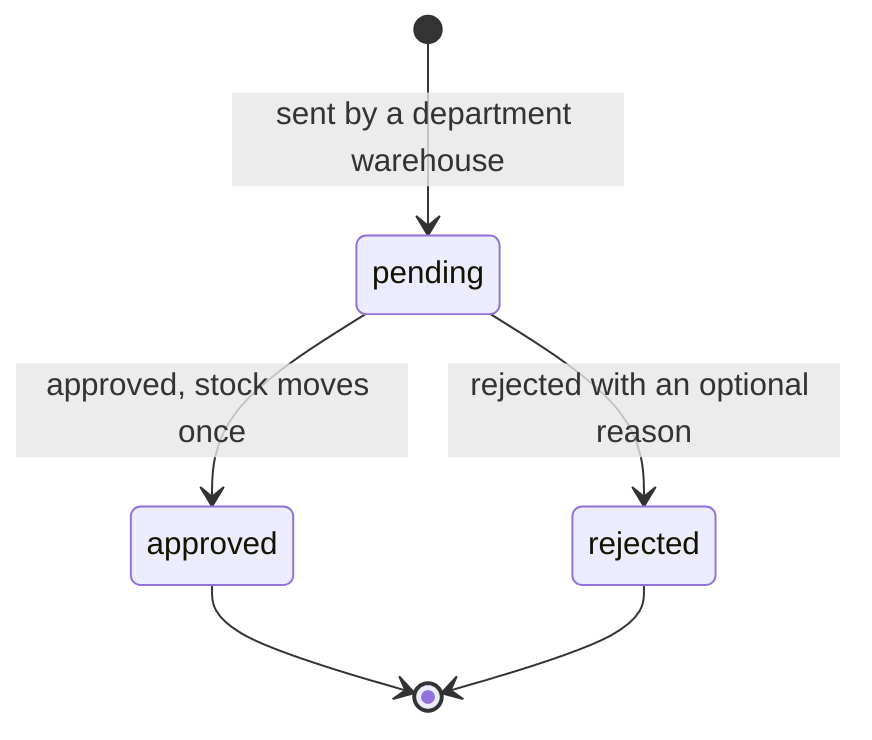

# Domain rules

This page lists the hospital's business rules as the code enforces them. Each rule names the class
or database constraint that enforces it, and the test that proves it. Paths are relative to the
repository root. Test files are under `tests/Feature/<Module>/` unless a path says otherwise.

The general patterns behind most rules:

- A workflow runs inside `DB::transaction()` in a service. The service locks the rows it decides on
  (`SELECT ... FOR UPDATE`) before it checks them, so two requests at once cannot both pass a check
  that only one of them should pass.
- To refuse an operation, a service throws a module exception (`App\Exceptions\<Module>\...`,
  always a `DomainException`). It carries a Russian message, and the controller shows it as a flash
  message.
- Where a rule can also be stated in the schema, PostgreSQL enforces it as well: CHECK
  constraints, a partial unique index, an exclusion constraint, `ON DELETE RESTRICT`
  ([data-model.md](data-model.md#constraints)).

Contents:
[Patients and stays](#patients-and-hospital-stays) ·
[Order lifecycles](#orders-and-their-lifecycles) ·
[Registrar confirmation](#registrar-confirmation) ·
[Cashier payment](#cashier-payment) ·
[Money](#money-minor-units-and-currencies) ·
[Price snapshots](#prices-and-currencies-are-snapshots) ·
[Scheduling](#scheduling-and-the-no-overlap-rule) ·
[Prescriptions](#prescriptions-and-dangerous-combinations) ·
[Stock](#stock) ·
[Medical documents](#medical-documents-and-scoring-scales) ·
[Staff and access](#staff-positions-roles-and-dismissals) ·
[Deletion guards](#deletion-guards) ·
[Known gaps](#known-gaps)

## Patients and hospital stays

A patient record is created once at the front desk. A hospital stay is an **examination map**
(`examination_maps`): it opens with an admission and closes with a discharge date. Orders,
appointments, prescriptions and filled-in medical documents of an inpatient belong to the open stay.

| Rule | Enforced in | Tested in |
|---|---|---|
| A patient needs a name, a date of birth that is not in the future, gender, citizenship, passport data and a phone. Postcodes must fit the integer column. | `PatientRequest` | `Patients/PatientRegistrationTest.php` |
| A region or city typed into the address selects is created once and reused afterwards. A city needs its region. | `PatientService::attributes()` (`firstOrCreate`), `PatientRequest` | `Patients/PatientRegistrationTest.php` |
| Staff in the registrar position get the short registration form. Everyone else gets the full card. | `PatientController::create()` (position `StaffPosition::REGISTRAR`) | `Patients/PatientRegistrationTest.php` |
| A patient's name always reads "Фамилия Имя Отчество". | `Patient::full_name` (the same order as `Staff::full_name`) | `Patients/PatientCardTest.php` |
| Attached documents are pdf, jpg, jpeg, png, doc or docx files, at most 10 files of up to 10 MB each. They are stored on the private disk. | `PatientRequest`, `PatientService::storeFiles()` | `Security/PatientFilesTest.php` |
| A patient has at most one open stay. A second admission is refused, even when the form is posted twice at the same moment. | `ExaminationMapService::store()` locks the patient row and throws `ActiveExaminationMapException`. The partial unique index `examination_maps_one_active_per_patient` backs it up. The `ExaminationMapIsActive` middleware guards the create page. | `Patients/ExaminationMapTest.php` |
| A stay that is already finished (discharge date given) can be recorded next to an open one. | `ExaminationMapService::store()` (`is_active` is set from the discharge date) | `Patients/ExaminationMapTest.php` |
| A discharge date closes the stay for good. It may not be before the admission or in the future. The patient of a stay never changes. | `ExaminationMapRequest`, `ExaminationMapService::update()` | `Patients/ExaminationMapTest.php` |
| A closed stay is a medical record: it can be viewed, but not edited or deleted. The permission is checked before the stay's state is revealed. | `ExaminationMapIsActive`, listed after the permission middleware in `ExaminationMapController::middleware()` | `Patients/ExaminationMapTest.php`, `Authorization/ActionPermissionsTest.php` |
| The initial nursing assessment (document 1) filled in before the admission is attached to the new stay. | `ExaminationMapService::store()`, `Document::INITIAL_NURSING_ASSESSMENT` | `Patients/ExaminationMapTest.php` |
| New orders, appointments, prescriptions and document responses join the patient's open stay. An order form may only pick a stay of the same patient. | `PatientServiceAssignService::store()`, `PatientProcedureService::store()`, `ReceptionService::book()`, `PatientMedicationService::store()`, `DocumentResponseService::store()`, `PatientServiceRequest` | `Clinical/PatientOrdersTest.php`, `Scheduling/ReceptionBookingTest.php`, `Clinical/MedicalDocumentsTest.php` |
| The nurse window lists the inpatients of the nurse's own department. An account without a department (an administrator) sees all departments. A measurement is recorded, and a scored sheet's recommended actions are opened and marked done, only on an open stay in the nurse's department. | `NursePatientsQuery`, `PatientParameterController::store()`, `DocumentResponsePolicy::trackActions()` | `Patients/NurseWindowTest.php` |
| Each account keeps its 10 most recently opened patients. Two cards opened at the same moment record the patient once. | `RecordPatientView` (an upsert on the unique key `admin_id, patient_id`) | `Patients/PatientCardTest.php` |

## Orders and their lifecycles

There are four kinds of patient orders. Each kind has its own table and its own status column:

| Kind (`BillableType`) | Table | Status enum | Ordered | Waiting for payment | Paid |
|---|---|---|---|---|---|
| `service` | `patient_services` | `ServiceStatus` | `assigned` | `confirmed` | `paid` |
| `procedure` | `patient_procedures` | `ServiceStatus` | `assigned` | `confirmed` | `paid` |
| `reception` | `receptions` | `ReceptionStatus` | `new` | `confirmed` | `paid` |
| `medication` (prescription) | `patient_medications` | `PatientMedicationStatus` | `ordered` | `sent_to_floor` | `received_at_station` |

`App\Services\Billing\BillableType` is the one place that maps the three billing steps to each
kind's statuses (`orderedStatus()`, `payableStatus()`, `paidStatus()`).

Each status enum declares one list, `nextStatuses()`. The `HasLifecycle` trait derives
`canTransitionTo()`, `isFinal()` and the final statuses from it. A service locks the row and calls
`canTransitionTo()` before it writes a status, so a repeated click is harmless. For services and
appointments a request for the status the row already has changes nothing. A transfer or a supply
request is decided once: a second decision is refused with a message. The diagrams below are drawn
from `nextStatuses()`, edge for edge. The labels name the code path that performs each step.

### Services and procedures (`ServiceStatus`)

- Only the cashier sets `paid`. The status select on the patient card offers
  `ServiceStatus::manualNextStatuses()` (everything but `paid`), and `PatientServiceStatusRequest`
  rejects `paid`.
- Nothing moves an order back to `assigned`, so an order is never billed twice.
- A paid order cannot be cancelled by a status change. That would be a refund, and refunds are not
  modelled.
- Enforced in `PatientServiceAssignService::changeStatus()` (it throws
  `ServiceStatusTransitionException`). Tested in `tests/Unit/Enums/ServiceStatusTest.php` and
  `Clinical/PatientOrdersTest.php`.

### Appointments (`ReceptionStatus`)

- A booking starts as `new`, or as `paid` when the person booking holds `accept_payments`
  (`ReceptionStatus::initial()`, `ReceptionRequest`).
- The receptions screens may only set `done` or `cancelled` (`ReceptionStatusRequest`).
  Confirmation and payment are left to the registrar and the cashier.
- A cancelled appointment frees its time (`ReceptionStatus::holdsSlot()`).
- A paid appointment cannot be cancelled by a status change. That would be a refund, as for
  services. The calendars offer no cancel button for it (`can_cancel`).
- Enforced in `ReceptionService::changeStatus()` (it throws `ReceptionException`). Tested in
  `tests/Unit/Enums/ReceptionStatusTest.php` and `Scheduling/ReceptionStatusTest.php`.

### Prescriptions (`PatientMedicationStatus`)

- The drug leaves the warehouse when the prescription is sent to the floor. From then on the
  prescription can only be given or returned, never cancelled.
- "Cancel" on a dispensed prescription returns it instead (`PatientMedicationService::cancel()`).
- Tested in `tests/Unit/Enums/StockStatusesTest.php` and `Stock/PrescriptionTest.php`.

### Transfers and supply requests

`TransferStatus`:

`SupplyRequestStatus`:

Tested in `tests/Unit/Enums/StockStatusesTest.php`. `tests/Unit/Enums/LifecyclesTest.php` also
checks the shape of every lifecycle: one start, no way back, every path ends in a final status.

## Registrar confirmation

The registrar card on the patient page lists the patient's **basket**: the orders waiting for the
registrar. `RegistrarController::confirm()` (route `registrar.confirm`, permission
`confirm_patient_registration`) moves the whole basket to "waiting for payment".

| Rule | Enforced in | Tested in |
|---|---|---|
| The basket holds orders in their ordered status that are outpatient (no stay) or belong to an open stay of the order's own patient. Orders left on a closed stay are not billed again. | `RegistrarBasketQuery::waitingForRegistrar()` (a correlated `EXISTS` on `examination_maps`) | `Billing/RegistrarConfirmTest.php` |
| Confirmation is one transaction: every order of the basket moves, or none does. | `RegistrarConfirmationService::confirm()` | `Billing/RegistrarConfirmTest.php` |
| Confirming twice changes nothing the second time, and the registrar is told so. Each `UPDATE` only matches rows still in their ordered status, and PostgreSQL re-checks that condition on rows a concurrent transaction has just changed. | `RegistrarConfirmationService::confirm()` | `Billing/RegistrarConfirmTest.php` |
| Confirming a prescription sends it to the floor: its drug is taken out of stock. If one drug is short, nothing is confirmed, and the message names the drug. | `PatientMedicationService::sendToFloor()` through `StockLedger::take()` (`InsufficientStockException`) | `Billing/RegistrarConfirmTest.php`, `Stock/PrescriptionTest.php` |
| Prescriptions are locked in medication order, so confirmations of two patients lock shared stock rows in the same order. If PostgreSQL still aborts one of them as a deadlock, the transaction is retried up to 3 times. | `RegistrarConfirmationService::sendPrescriptionsToFloor()`, `ATTEMPTS` | (concurrency, not unit-tested) |
| The cashier cannot confirm. | the route permission `confirm_patient_registration` | `Authorization/ActionPermissionsTest.php`, `Billing/RegistrarConfirmTest.php` |
| The basket can be exported to Excel with its total per currency. | `RegistrarController::export()`, `PatientRecordsExport` | `Billing/RegistrarExportTest.php` |

## Cashier payment

The full request path is traced in [overview.md](overview.md#one-request-end-to-end-the-cashier-takes-a-payment).

| Rule | Enforced in | Tested in |
|---|---|---|
| Only `accept_payments` may pay. `view_cashier` only shows the list and the export, without checkboxes or the pay button. | the route `cashier.updateAll`, `CashierController::index()` (`canPay`) | `Billing/CashierPaymentTest.php`, `Authorization/ActionPermissionsTest.php` |
| A payment covers the orders of one patient only. | `CashierPaymentService::ensurePayable()` (`PaymentRefusedException::severalPatients()`) | `Billing/CashierPaymentTest.php` |
| Only orders the registrar confirmed and that are not paid yet can be paid. If one ticked order is not payable, nothing is paid. | `CashierPaymentService::ensurePayable()` (`notPayable()`) | `Billing/CashierPaymentTest.php` |
| A repeated payment request is refused instead of being applied twice. | row locks in `CashierPaymentService::lockOrders()` (fixed order: kind, then id) | `Billing/CashierPaymentTest.php` |
| The form posts at most 500 records, each `kind:id`, with no duplicates, and every one must exist. | `PayItemsRequest` | `Billing/CashierPaymentTest.php` |
| Paying for a prescription releases the drug to the nurse station (`received_at_station`). It moves no stock: the stock moved at confirmation. | `BillableType::paidStatus()` | `Billing/CashierPaymentTest.php`, `tests/Unit/Billing/BillableTypeTest.php` |
| The list of orders waiting for payment filters each kind by its own day: services by `service_date`, appointments by `date`, procedures by `procedure_date`, prescriptions by the day they were written. | `BillableType::dateColumn()`, `CashierItemsQuery` | `Billing/CashierListTest.php` |
| The Excel export of the list holds at most `medsystem.cashier_export_max_rows` (10,000) orders. A larger selection is refused with a message before any order is loaded; a smaller one is written from PostgreSQL 1,000 orders at a time, with its totals from SQL. A text cell that starts with `=` is written as text, never as a formula. | `CashierController::export()`, `CashierListExport` (`CashierItemsQuery::lazy()`, `TextSafeValueBinder`) | `Billing/CashierListTest.php`, `Security/SpreadsheetFormulaTest.php` |
| A payment records its moment on the order (`paid_at`). The paid list and the dashboard's "Оплачено сегодня" count an order on the day it was paid, and keep it once it moves on (carried out, the visit done, the drug given or returned). An order paid before `paid_at` existed counts by its status (`BillableType::paidStatuses()`) on its own day. | `CashierPaymentService::pay()`, `ReceptionService::book()`, `CashierItemsQuery::matching()` | `Billing/CashierPaymentTest.php`, `Dashboard/DashboardSummaryTest.php` |

## Money: minor units and currencies

| Rule | Enforced in | Tested in |
|---|---|---|
| Prices are stored as `numeric(14,2)`. In PHP an amount is an integer count of minor units (tiyin, cents), so sums are exact. A value with more than two decimals is refused instead of being rounded. | `App\Services\Billing\Amount` (`fromDecimal()`, `plus()`) | `tests/Unit/Billing/MoneyTest.php` |
| Amounts in different currencies are never added together. A total is one sum per currency, in the order the currencies first appear in the list. "Nothing to pay" shows as zero UZS (`BillableItem::DEFAULT_CURRENCY`). | `CurrencyTotals` | `tests/Unit/Billing/MoneyTest.php`, `Billing/CashierTotalsTest.php` |
| The dashboard adds up the cashier's totals in SQL, by the same rule the PHP loader applies to each order, UZS first. A test keeps the two equal. | `CashierItemsQuery::totals()` against `BillableItemLoader` and `CurrencyTotals::of()` | `Billing/CashierTotalsTest.php` |
| The price list stores what the cash desk charges, VAT included. The form and the import store «Стоимость» as given, and an edit shows the stored price back. Nothing adds or removes VAT later. | `ServiceService`, `ServicesImport` | `Clinical/CataloguesTest.php` |
| On screen an amount reads "150 000,00", in spreadsheets "150000.00". | `Amount::format()`, `Amount::toDecimal()` | `tests/Unit/Billing/MoneyTest.php` |

## Prices and currencies are snapshots

An order keeps the price, and for services and appointments the currency, that applied when it was
placed. Later changes to the price list do not change what the patient pays.

| Rule | Enforced in | Tested in |
|---|---|---|
| A service order copies the service's price and currency when it is created. If the order is moved to another service before payment, it takes that service's current price. | `PatientServiceAssignService::store()` / `update()` (`priceOf()`) | `Billing/OrderPriceTest.php` |
| An appointment copies the service's price and currency when it is booked. | `ReceptionService::book()` | `Billing/OrderPriceTest.php` |
| A procedure order copies the procedure's price. Procedures are billed in UZS. | `PatientProcedureService::store()`, `BillableItemLoader` | `Billing/OrderPriceTest.php` |
| A prescription is priced when it is written: the retail price of the latest batch received by the main warehouse (or its incoming unit price) times the units, rounded half-up to two decimals. A drug the main warehouse never received cannot be prescribed. | `PatientMedicationService::price()` (brick/math `BigDecimal`) | `Stock/PrescriptionTest.php` |
| The currency is read from the price list as typed, trimmed and upper-cased. An empty currency means UZS. | `Service::priceCurrency()` | `Billing/OrderPriceTest.php` |
| An order without a kept price or currency (written before those columns existed) is charged the price list's current values. The migrations filled in the existing rows. | `BillableItemLoader::priceOf()` / `currencyOf()` and the same rule in SQL in `CashierItemsQuery::amountsOf()`. Migrations `2025_11_20_120000_add_price_to_patient_orders`, `2025_11_20_130000_add_currency_to_patient_orders` | `Billing/OrderPriceTest.php`, `Billing/CashierTotalsTest.php` |

## Scheduling and the no-overlap rule

Patients book an appointment (`receptions`) with an employee for a service. Each employee has an
appointment length (`staff_professional_data.admission_period`), working and reception hours per
weekday (`staff_schedules`), and absences (`staff_absences`).

| Rule | Enforced in | Tested in |
|---|---|---|
| An appointment is booked for today or later, with its end after its start. Its initial status is `new`, or `paid` at the cash desk. | `ReceptionRequest` | `Scheduling/ReceptionBookingTest.php` |
| Only an employee who takes appointments (has an appointment length) can be booked, and only for one of their own services marked `is_appointment` and still on the price list (`is_active`). | `ReceptionService::ensureBookable()`, `Api\ReceptionController::staffByService()` | `Scheduling/ReceptionBookingTest.php`, `Scheduling/ReceptionPagesTest.php` |
| An appointment is exactly one slot of the employee's current grid: one appointment length long, starting a whole number of lengths after midnight. The end time the browser sends is not trusted, so one booking cannot block the whole day. A start between two slots (10:05 for a 20-minute doctor) is refused, because no calendar can offer the gaps it would leave. A wrong length and a wrong start get their own messages. Appointments booked on an older grid, before the length changed, stay valid, keep blocking the slots they overlap, and are not listed as uncovered. | `ReceptionService::ensureBookable()` (`lengthMismatch`, `offGrid`), `SlotGrid::has()` | `Scheduling/ReceptionBookingTest.php`, `tests/Unit/Scheduling/SlotGridTest.php` |
| An appointment lies inside the employee's reception hours for that weekday. Weekdays are matched by ISO number: Monday is 1. | `ReceptionService::withinReceptionHours()`, `DayOfWeek::idOf()`, `TimeRange::contains()` | `Scheduling/ReceptionBookingTest.php`, `tests/Unit/Scheduling/TimeRangeTest.php` |
| Dismissed or absent employees cannot be booked. | `ReceptionService::ensureBookable()` (`Staff::isDismissed()`, `StaffAbsence::covering()`) | `Scheduling/ReceptionBookingTest.php` |
| An absence, new reception hours or a dismissal is saved even over booked appointments: it is a fact, not a request. Those appointments stay in both calendars, and the staff form lists the ones of today and later that the change leaves without cover. The staff row is locked first, as a booking locks it. | `StaffService::update()`, `ReceptionService::uncoveredAppointmentsOf()`, `AppointmentCalendar` | `Scheduling/StaffManagementTest.php`, `Scheduling/StaffAvailabilityTest.php` |
| **No overlap.** Two appointments of one employee that are not cancelled never overlap. Back-to-back appointments are allowed, and so is the slot of a cancelled appointment. The staff row is locked first, so two registrars cannot take the same time. | `ReceptionService::book()` (staff row lock plus overlap query) | `Scheduling/ReceptionBookingTest.php` |
| **No overlap, database backstop.** The exclusion constraint `receptions_no_overlap` (GiST over the staff id and the time range, only rows with `status <> 'cancelled'`) refuses an overlap written past the service. SQLSTATE 23P01 becomes the same "slot taken" message. | migration `2025_11_19_130100_add_overlap_constraint_to_receptions_table`, `ReceptionService::book()` | `Scheduling/ReceptionBookingTest.php` |
| The booking grid offers only slots that lie completely inside the reception hours. A slot an appointment overlaps is booked. The appointment length is 5 to 240 minutes. | `SlotGrid`, `AppointmentCalendar`, `StaffRequest` | `tests/Unit/Scheduling/SlotGridTest.php`, `Scheduling/StaffAvailabilityTest.php` |
| The doctor's calendar page opens only for an active appointment service the employee offers. Any other pair comes from a typed URL, and the page goes back to the booking page with the reason. | `ReceptionController::doctorCalendar()` | `Scheduling/ReceptionPagesTest.php` |
| **A doctor works only on their own calendar.** A doctor's account lists only the doctor's own appointments, without the staff filter. Its booking page offers only the doctor's own appointment services, and the doctors of a service are the doctor alone. Opening another employee's calendar page, reading their free or booked slots, booking them, and showing or cancelling one of their appointments are refused with a 403 and the reason. A booking that names any other employee id, existing or not, gets the same 403, so the answer does not tell which ids exist. A doctor's account is any login whose employee holds the doctor position (`StaffPosition::DOCTOR`, fixed id 1), whatever its roles, `main_admin` included. A login without an employee, or whose employee holds another position, works on every calendar. | `Admin::doctorProfile()`, `ReceptionPolicy::workOnCalendar()` (`can:` on the routes in `routes/ajax.php` and `routes/web.php`, `ReceptionRequest::authorize()`, the filter in `Api\ReceptionController::staffByService()`), `ReceptionController::index()` / `appointment()` | `Scheduling/ReceptionPagesTest.php`, `Scheduling/ReceptionBookingTest.php`, `Scheduling/StaffAvailabilityTest.php`, `Scheduling/ReceptionStatusTest.php` (each over the `doctorAccounts()` dataset of `SchedulingFixtures`: a doctor, and a doctor who is also the main administrator), `Security/ApiAccessTest.php` |
| "Today" is the hospital's date (`APP_TIMEZONE`, default `Asia/Tashkent`). | `config/app.php`; the tests force `Asia/Tashkent` in `phpunit.xml` | `Scheduling/StaffAvailabilityTest.php` |

`ReceptionPolicy` decides whose calendar an account works on, not who may read or bill an
appointment. The patient card's history (`api.patients.history.partial`, `view_patients`) shows
every appointment of the patient, as it shows every other record. Registrar confirmation
(`registrar.confirm`) and cash-desk payment (`cashier.updateAll`) move the appointments in the
patient's basket whoever the doctor is, for any holder of `confirm_patient_registration` or
`accept_payments`, a doctor's account included: they act on the whole basket, all orders or none.

## Prescriptions and dangerous combinations

| Rule | Enforced in | Tested in |
|---|---|---|
| Each form line becomes one prescription. It always starts as `ordered` and is priced (see above). An inpatient's lines join the open stay. The parallel form arrays must line up, line by line. | `PatientMedicationService::store()`, `PatientMedicationRequest` | `Stock/PrescriptionTest.php` |
| The drug and its quantity, and so the price, can change only while the prescription is `ordered`. A prescription in a final status cannot be edited or extended. Extending adds one day. | `PatientMedicationService::update()` / `extend()`, `PatientMedicationController::edit()` | `Stock/PrescriptionTest.php` |
| An inpatient's drug is dispensed from the medication warehouse of the stay's department. An outpatient prescription, or a department without a medication warehouse, is served by the main warehouse. Batches are taken earliest expiry first, and expired ones are never taken. | `PatientMedicationService::dispense()` | `Stock/PrescriptionTest.php` |
| Cancelling a dispensed prescription returns its units into the very batches they came from, found through its `dispense` movements. If one of those batches was written off meanwhile, nothing is returned. | `StockLedger::restore()` | `Stock/PrescriptionTest.php` |
| **Dangerous combinations warn, they do not block.** After saving, the doctor sees every known dangerous pair among the new prescriptions and the patient's prescriptions still in progress. The patient card shows the pairs among the prescriptions in progress. Cancelled, returned and completed prescriptions no longer count. Names match whatever their letter case. | `DangerousCombinationCheck` (`forPrescriptions()`, `forPatient()`), `PatientMedicationController`, `PatientCardQuery` | `Stock/PrescriptionTest.php`, `Patients/PatientCardTest.php` |
| The pairs come from an Excel import of the drug-interaction list. Importing it again adds no duplicates, and every severity of a pair is kept. | `DangerousCombinationImport` | `Clinical/CatalogueImportsTest.php` |

## Stock

Stock is a set of quantity rows plus a movement journal. `App\Services\Stock\StockLedger` is the only
code that changes a quantity.

| Rule | Enforced in | Tested in |
|---|---|---|
| A stock row holds one item in one place. Main-warehouse medications are batches, one per receipt line (`main_warehouse_medications`). Department warehouses keep the batches they received (`warehouse_accountings`, with batch number and expiry date). Supplies, household materials and pharmacy stock have one row per item. | `StockLot` rows, `StockLedger`; the unique keys `*_one_row_per_item` (migration `2025_11_21_110000_add_unique_keys_to_stock_rows`) | `Stock/MainWarehouseTest.php`, `Stock/StockRowKeysTest.php` |
| Every change writes a `stock_movements` row: signed quantity, reason (`StockMovementReason`: receipt, write_off, supply_request, transfer, dispense, return), the stock row, the catalogue item, the source document and the signed-in admin. Movements are never updated (`UPDATED_AT = null`), and no code deletes them. | `StockLedger::record()` | `Stock/MainWarehouseTest.php`, `Stock/SupplyRequestTest.php`, `Stock/PrescriptionTest.php` (through `StockFixtures::movementsOf()`) |
| Units are taken earliest expiry first (FEFO), across as many batches as needed, or not at all. A shortage throws `InsufficientStockException`, and the caller's transaction rolls back the whole document. | `StockLedger::take()` | `Stock/SupplyRequestTest.php`, `Stock/TransferTest.php`, `Stock/PrescriptionTest.php` |
| Expired batches are never taken. They wait to be written off. A batch counts as expired from the day after its expiry date. | the `unexpired()` scopes of `MainWarehouseMedication` and `WarehouseAccounting` | `Stock/SupplyRequestTest.php`, `Stock/TransferTest.php`, `Stock/PrescriptionTest.php` |
| Stock rows are locked before they are read for a change, so two documents can never take the same units. A row that does not exist yet cannot be locked: `lot()` inserts it on its unique key first, so a concurrent first put of the item waits and then uses that row. | `StockLedger::take()`, `lot()`, `restore()` | `Stock/StockRowKeysTest.php` (`lot()` from two sessions); `take()` and `restore()` under concurrency are not tested |
| No quantity goes below zero. Lines of transfers and supply requests are positive. One line carries at most 1,000,000 units. | CHECK constraints `*_quantity_not_negative`, `transfer_medications_quantity_positive`, `supply_request_items_requested_quantity_positive`; `StockLedger::MAX_LINE_QUANTITY` in the form requests | `Stock/MainWarehouseTest.php`, `Stock/SupplyRequestTest.php` |
| **Receipts.** Each medication line of a receipt becomes a batch of its own, even two batches of one drug in one receipt. A batch whose expiry date is today or earlier is refused. Supplies and household materials are added to their item's row. | `MainWarehouseService::storeGoods()`, `MainWarehouseReceiptsGoodsRequest` | `Stock/MainWarehouseTest.php` |
| **Write-off.** A write-off removes exactly one main-warehouse row, chosen by type and id, through `DELETE`. The ledger records the units first. It needs `edit_main_warehouse`. | `MainWarehouseService::writeOff()`, `StockLedger::writeOff()`, route `main.warehouse.receipts.goods.discard` | `Stock/MainWarehouseTest.php`, `Security/StateChangingRoutesTest.php` |
| **Supply requests.** A department warehouse requests items of its own type (medications, supplies or household materials, by `WarehouseType::STOCK_ITEMS`). A request is decided once. Approval moves exactly the requested quantities from the main warehouse, all items or none. Each main-warehouse batch lands in the department as the same batch (batch number and expiry kept). Rejection moves nothing and stores an optional reason (at most 1000 characters). Approving and rejecting both need `approve_supply_requests`. | `SupplyRequestService` (`lockUndecided()`, `moveMedication()`, `moveRow()`), `StoreSupplyRequest`, `Stock\RejectSupplyRequest` | `Stock/SupplyRequestTest.php` |
| **Transfers.** A transfer moves medications from a department medication warehouse to a pharmacy. While pending, it is a draft that can be edited or deleted. Completing it moves the stock exactly once, FEFO. If the warehouse cannot cover it, the transfer stays pending. A cancelled transfer is final. | `TransferService`, `TransferStatus::isEditable()`, `TransferRequest` | `Stock/TransferTest.php` |
| A warehouse's type is fixed once it holds or held stock (a row at zero included) or has a supply request or transfer pending, since its type decides which catalogue its rows belong to. | `WarehouseService::update()` (`StockException`), `WarehouseRequest` | `Stock/WarehouseTypeTest.php` |
| A warehouse or pharmacy that holds stock cannot be deleted. | `ON DELETE RESTRICT` on `warehouse_id` / `pharmacy_id` of the stock tables (migration `2025_11_19_100300_restrict_deletes_of_places_holding_stock`) | `Stock/StockPagesTest.php` |
| A batch is "near expiry" within its medication's own `notify_before_days`. The remains pages mark such batches "истекает", and the ones past their date "просрочен" (on the main warehouse their "Списать" button stands out). The dashboard counts both, and the expired ones apart. | `Medication::expiryWarningDue()` and the batches' `isExpired()` (the remains views), the same rules in SQL in `StockAlertsQuery::expiryInMainWarehouse()` / `expiryInWardWarehouses()` | `Dashboard/DashboardSummaryTest.php`, `Stock/StockLevelsTest.php` |
| A medication runs low in a place when its units in date there, over all its batches, are at or below its own `notify_min_qty` ("Уведомить при остатке не больше"); expired units count for nothing. A supply or household material runs low at or below `StockLot::LOW_STOCK` (20). The receipts page lists such items under "Заканчивающиеся позиции" (a drug once, with its units), the remains pages mark them "мало", and the dashboard counts the ones with nothing left. | `Medication::isLowStock()`, `RunsLowAtFixedLevel`, `StockAlertsQuery::runningLowInMainWarehouse()` / `outOfStockInMainWarehouse()` | `Stock/StockLevelsTest.php` |

## Medical documents and scoring scales

**Medical documents** (`documents`) are the fixed nursing sheets: the initial nursing assessment
and seven scored scales. **Surveys** (`surveys`, shown as "Мед. документы" in the menu) are
questionnaires that staff build themselves.

| Rule | Enforced in | Tested in |
|---|---|---|
| Documents 1 to 8 have fixed ids. Document 1 (initial nursing assessment) has no score. Documents 2 to 8 are the Morse, Humpty Dumpty and outpatient fall-risk scales and the numeric, FLACC, NIPS and CPOT pain scales. | `DocumentSeeder`, `Scoring\MedicalScale` | `Database/SeedersTest.php` |
| An answer must be one of the question's options and belong to the document being filled in. | `DocumentResponseRequest` | `Clinical/MedicalDocumentsTest.php` |
| The total score is computed when the sheet is saved and stored with the response. Answers are matched by question wording, the identity the seeder uses. Humpty Dumpty takes age and sex from the patient record. | `DocumentResponseService::score()`, `Scoring\DocumentScoreCalculator`, `PatientDemographics` | `tests/Unit/Clinical/DocumentScoreCalculatorTest.php`, `Clinical/MedicalDocumentsTest.php` |
| Stored scores can be recomputed from their answers. The command lists the differences, and `--force` saves them. | `php artisan documents:rescore` (`RescoreDocuments`) | `Clinical/RescoreDocumentsTest.php` |
| The nurse window shows the recommended actions of the score range the stored total falls into (`DocumentScore::containing()`). An action can be marked done only for that range, and only once per response. | `DocumentScoreController`, `StorePatientDocumentScoreRequest`, `PatientDocumentScoreFinished::markDone()`, unique index on `(document_response_id, document_score_id, document_action_id)` | `Clinical/MedicalDocumentsTest.php` |
| The recommended actions of a sheet are read and marked done only for a sheet of an open stay that the account's nurse window shows: the nurse's own department, or every department for an account without one. A closed stay's sheet, and one no stay holds, are refused with a 403 and the reason. | `DocumentResponsePolicy::trackActions()` (`Gate::authorize()` in `DocumentScoreController::getActions()`, `StorePatientDocumentScoreRequest::authorize()`), `NursePatientsQuery` | `Patients/NurseWindowTest.php` |
| A filled-in sheet's answers are read on the patient card: every sheet, closed stays included. The nurse window shows only each sheet's total score and its recommended actions. Its own answers page (`documents.show.answer`) opens only an initial nursing assessment, to the permission of the stay form that links it: one no stay holds yet for `create_patient_map` (the new-stay form), one attached to an open stay for `edit_maps` (that stay's edit form). Like the forms, it reaches these assessments for every patient, an earlier one as well as the latest the form links. Every other sheet, and a closed stay's assessment, is a 403 whose reason names the form the assessment belongs to, or the patient card. | `DocumentResponsePolicy::view()` (`Gate::authorize()` in `DocumentController::showAnswer()`), `DocumentResponse::isInitialAssessment()` / `isUnattachedInitialAssessment()` | `Clinical/MedicalDocumentsTest.php` |
| A survey question that patients have answered cannot be removed from the survey. Editing a survey keeps the existing answers. | `SurveyService::update()` (`AnsweredQuestionException`) | `Clinical/SurveysTest.php` |
| The stay or the patient service a survey response names must be the same patient's. Its answers must belong to that survey's questions. | `SurveyResponseRequest`, `SurveyResponseService` | `Clinical/SurveysTest.php` |

## Staff, positions, roles and dismissals

| Rule | Enforced in | Tested in |
|---|---|---|
| A staff position and its spatie role are created, renamed and deleted together. The position's permissions are its role's permissions. A position is linked to its role by `role_id` (unique), not by name. | `StaffPositionService`, unique index `staff_positions_role_id_unique` | `Scheduling/StaffPositionRolesTest.php` |
| A position may not take the name of a system role (`main_admin`) or of another role. | `StaffPositionService::unlinkedRoleNamed()`, `StaffPositionRequest`, `StaffPosition::RESERVED_ROLE_NAMES` | `Scheduling/StaffPositionRolesTest.php` |
| The six seeded positions (ids 1 to 6) can be renamed, but not deleted. A position that staff still hold cannot be deleted either. | `StaffPositionController::destroy()` (`StaffPosition::isSeeded()`), `ON DELETE RESTRICT` on `staff_professional_data.position_id` | `Scheduling/StaffPositionRolesTest.php` |
| An employee's login holds exactly one position role, the role of the current position. A position change revokes the old role. System roles (`main_admin`) stay. | `StaffService::syncLoginAccount()` | `Scheduling/StaffManagementTest.php` |
| A dismissal date dismisses the employee (`staff_documents.is_work = false`). This ends the login: sign-in refuses the account, and an open session or "remember me" cookie is ended on its next request. A dismissed employee cannot be booked. | `StaffService::documentAttributes()`, `Admin::active()` / `isActive()`, `Auth\LoginRequest`, `EnsureAccountIsActive`, `ReceptionService` | `Scheduling/StaffManagementTest.php`, `Security/AuthenticationTest.php`, `Scheduling/ReceptionBookingTest.php` |
| The last main administrator who can still sign in can be neither dismissed nor deleted. Nobody can delete their own account. | `AdminService::ensureDeletable()` / `isLastMainAdmin()` (all `main_admin` accounts are locked first), `StaffService::update()` | `Scheduling/AdminAccountsTest.php`, `Scheduling/StaffManagementTest.php` |
| Only a main administrator may change the e-mail, password or roles of a main administrator's account, or delete it. This also applies through the staff form. | `AdminPolicy`, `Admin\UpdateRequest::authorize()`, `StaffRequest::authorize()`, `AdminController`, `StaffController` | `Scheduling/AdminAccountsTest.php`, `Scheduling/StaffManagementTest.php`, `Frontend/SchedulingPagesTest.php` |
| Deleting an employee also deletes their login account, under the same rules. An employee that receptions or stays still point to is kept, account included. | `StaffService::destroy()`, `ON DELETE RESTRICT` on `receptions.staff_id` and `examination_maps.staff_id` | `Scheduling/StaffManagementTest.php` (deletion with the account), `Database/RestrictedDeleteTest.php` (the restricted-delete answer) |

## Deletion guards

Deleting a patient or a stay cascades in the database to every order of it. The application
therefore refuses deletions that would erase financial or medical records. It also protects the
rows the code relies on.

| What | Refused when | Enforced in | Tested in |
|---|---|---|---|
| Patient | an order was paid, a drug was dispensed for them, or they have a closed stay | `RetainedRecords::ensurePatientDeletable()` in `PatientService::destroy()` | `Patients/RecordDeletionTest.php` |
| Stay | an order of the stay was paid or had its drug dispensed | `RetainedRecords::ensureStayDeletable()` in `ExaminationMapService::destroy()` | `Patients/RecordDeletionTest.php` |
| A patient service | it is paid (or later). A paid order also keeps its service and patient. | `PatientServiceAssignService::destroy()` / `update()` (`PaidServiceException`) | `Clinical/PatientOrdersTest.php` |
| Transfer | it is no longer pending | `TransferService::lockEditable()` | `Stock/TransferTest.php` |
| Survey question | patients have answered it | `SurveyService::update()` | `Clinical/SurveysTest.php` |
| Staff position | it is one of the seeded positions 1 to 6, or staff hold it | `StaffPositionController::destroy()`, FK | `Scheduling/StaffPositionRolesTest.php` |
| Service type | it is a system type 1 to 21 (no edit either) | `ServiceTypeController` (`ServiceType::isSystem()`) | `Clinical/CataloguesTest.php` |
| Account | it is the signed-in account, or the last main administrator who can sign in | `AdminService::ensureDeletable()` | `Scheduling/AdminAccountsTest.php` |
| Reference data in use (manufacturers, diagnoses, medications, departments, staff, service types...) | another row points to it with `ON DELETE RESTRICT` | PostgreSQL. `bootstrap/app.php` turns SQLSTATE 23503 / 23001 on a `DELETE` into a flash message or a JSON 409. | `Database/RestrictedDeleteTest.php` |
| Warehouse, pharmacy | it holds stock rows | FK `ON DELETE RESTRICT` | `Stock/StockPagesTest.php` |

`RetainedRecords` locks the orders kind by kind in the cashier's lock order. A payment taken while
the patient is being deleted either waits and then finds nothing to pay, or commits first and is
seen by the check.

## Known gaps

These behaviours are known. The code does not handle them yet:

- `services.discount` is stored on the price list, but billing does not apply it.
- No screen sets a prescription to `completed` ("given") yet. The lifecycle allows it from
  `received_at_station`.
- Moving a confirmed, unpaid service order to another service re-prices it, but it stays
  `confirmed`. It does not return to the registrar.
- A dismissal cannot be undone from the staff form: clearing the dismissal date leaves
  `is_work = false`.
- The appointment lifecycle allows `new → paid`. The cashier only pays `confirmed` appointments,
  so a `new` appointment becomes paid only by being booked as paid at the cash desk.
- A medical document is saved for any patient the form names. `document.response.store` is shared
  by the stay forms, the nurse window and the patient card's «Заполнить документ», so it does not
  limit a nurse to her department: the sheet joins the patient's open stay, whatever department
  that stay is in.
- The allergy, chronic-disease and medical-device catalogues have their screens, but no screen
  links them to a patient: `patient_allegories`, `patient_chronic_diseases` and
  `patient_medical_devices` are never written.
- Refunds are not modelled. A paid service, procedure or appointment cannot be cancelled. There is
  no reschedule either, so a paid appointment the patient misses or wants to move keeps its slot;
  the registrar books a new one.

## Related decisions

- [ADR 0003](../adr/0003-backed-enums-and-morph-aliases.md): Backed enums and morph aliases
- [ADR 0004](../adr/0004-row-locks-in-a-fixed-order.md): Row locks in a fixed order
- [ADR 0005](../adr/0005-append-only-stock-ledger.md): Append-only stock ledger
- [ADR 0006](../adr/0006-money-in-minor-units-with-per-currency-totals.md): Money in minor units
- [ADR 0007](../adr/0007-orders-keep-their-price-and-currency.md): Orders keep their price and currency
- [ADR 0009](../adr/0009-restrict-deletes-and-retain-records.md): Restricted deletes and retained records
