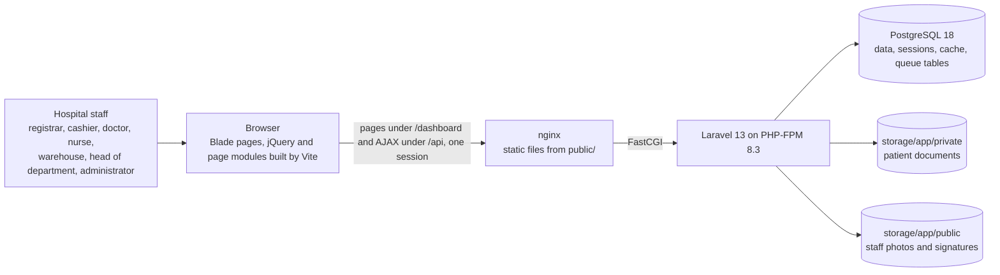
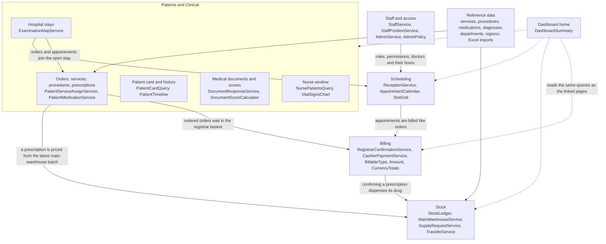
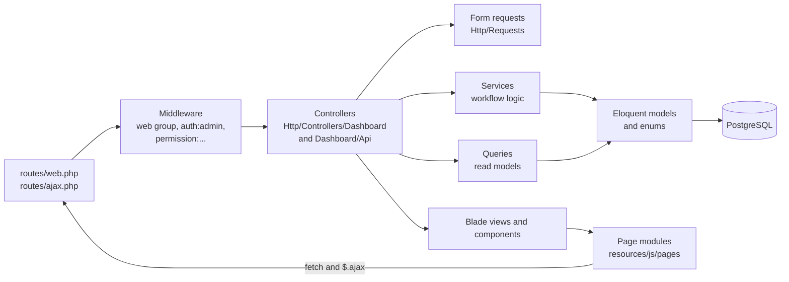
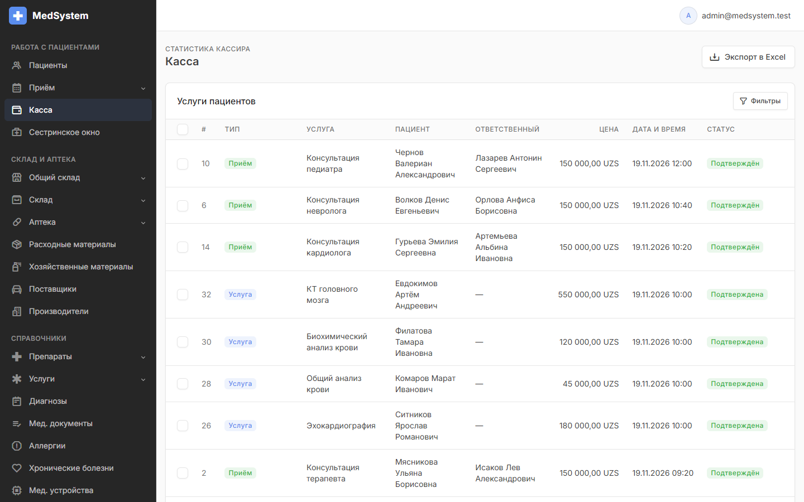
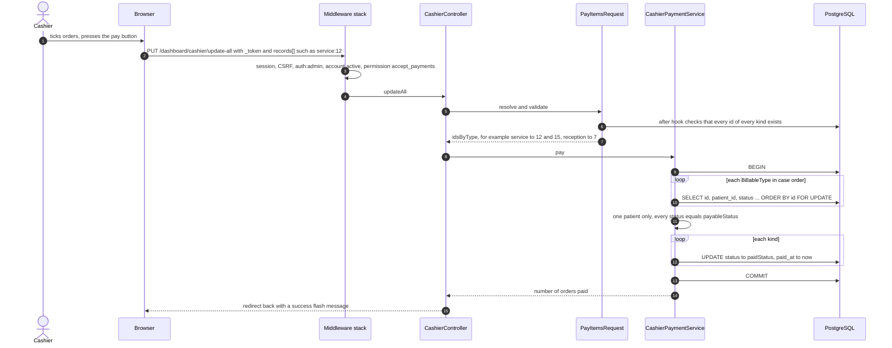

# Architecture overview

MedSystem is a hospital information system for one hospital: patient registration and hospital
stays, orders (services, procedures, appointments, prescriptions), the registrar and the cash
desk, the nurse station, warehouses and a pharmacy, staff and their access. It is a server-rendered
Laravel 13 application with a Russian user interface, backed by PostgreSQL 18.

This page gives the big picture. The details live next to it:

| Document | What it covers |
|---|---|
| [folder-layout.md](folder-layout.md) | Where each kind of class goes, module by module |
| [domain.md](domain.md) | The business rules, where the code enforces them and which test proves it |
| [data-model.md](data-model.md) | ER diagrams of the core tables, constraints, fixed-id reference rows |
| [security.md](security.md) | Authentication, authorization, CSRF, XSS, headers, files, logging |
| [testing.md](testing.md) | Test layout, helpers, the PostgreSQL test database, CI |
| [frontend.md](frontend.md) | Tabler, Vite, widgets, how a page is written |

## System context

- **Users.** Every user is an employee or an administrator who signs in on `/admin/login` with an
  account of the `admin` guard. There is no public or patient-facing part. What an account may do
  is decided by spatie/laravel-permission permissions, grouped into roles. A staff position (doctor,
  nurse, registrar, cashier...) is linked to one role (see [security.md](security.md)).
- **Browser.** Pages are Blade views on Tabler (Bootstrap 5). Interactive parts are jQuery code and
  ES modules under `resources/js/pages`, built by Vite. They call JSON endpoints under `/api`, which
  run on the same session and CSRF token as the pages ([frontend.md](frontend.md)).
- **Application.** One Laravel application. `compose.yaml` runs it as PHP-FPM behind nginx, with
  PostgreSQL and an optional Vite dev server. The image is built from `docker/php/Dockerfile`.
- **PostgreSQL** holds the data and also the framework's sessions, cache and queue tables
  (`SESSION_DRIVER`, `CACHE_STORE` and `QUEUE_CONNECTION` default to `database`). The schema relies
  on PostgreSQL features: an exclusion constraint, CHECK constraints, a partial unique index,
  `ILIKE` search and row locks ([data-model.md](data-model.md)).
- **Queue and mail.** No job is queued and no mail is sent, so the stack has no queue worker and
  no mail catcher. Excel exports are built during the request and downloaded directly.
  `QUEUE_CONNECTION=database` and the framework's `jobs` table stay as defaults: a worker service
  in `compose.yaml` is added together with the first queued job.
- **Files.** Documents attached to a patient are stored on the private `local` disk
  (`storage/app/private`). They are served only by `PatientFileController`, after the permission
  check. Staff photos and signatures, the licence scans of a medication and a supplier's contract
  terms go to the `public` disk, which the web server serves through the `storage:link` symlink
  ([security.md](security.md#files)).
- **Time.** `APP_TIMEZONE` defaults to `Asia/Tashkent`. Calendars, "today" and expiry dates are
  the hospital's local dates.

## Module map

The code is organised by the hospital's workflows ([folder-layout.md](folder-layout.md)). The five
code modules are `Patients`, `Clinical`, `Scheduling`, `Billing` and `Stock`. Staff and access, and
the reference catalogues, are mostly flat form services. They are drawn here as separate areas,
because they are separate concerns.

| Area | Pages | Core classes | Screens |
|---|---|---|---|
| Patients | patient list and card, stays (examination maps), nurse window, vital signs | `PatientService`, `ExaminationMapService`, `RetainedRecords`, `PatientCardQuery`, `PatientListQuery`, `NursePatientsQuery` | [patients](../screenshots/patients.png), [patient card](../screenshots/patient-card.png), [nurse window](../screenshots/nurse-window.png) |
| Clinical | ordering services and procedures, prescriptions, medical documents, surveys, catalogue imports | `PatientServiceAssignService`, `PatientMedicationService`, `DangerousCombinationCheck`, `DocumentResponseService`, `Scoring\DocumentScoreCalculator` | the order buttons and warnings of the [patient card](../screenshots/patient-card.png) |
| Scheduling | appointment booking by service, a doctor's weekly calendar, receptions list | `ReceptionService`, `AppointmentCalendar`, `SlotGrid`, `TimeRange` | [booking](../screenshots/appointment.png), [doctor calendar](../screenshots/doctor-calendar.png) |
| Billing | the registrar card of the patient page, the cashier list and its export | `RegistrarConfirmationService`, `CashierPaymentService`, `RegistrarBasketQuery`, `CashierItemsQuery`, `BillableItemLoader` | [cashier](../screenshots/cashier.png) |
| Stock | main warehouse receipts and remains, department warehouses, supply requests, pharmacies, transfers | `StockLedger`, `MainWarehouseService`, `SupplyRequestService`, `TransferService`, `StockAlertsQuery` | [main warehouse remains](../screenshots/stock-remains.png) |
| Staff and access | staff, positions and their permissions, admin accounts, sign-in | `StaffService`, `StaffPositionService`, `AdminService`, `AdminPolicy`, `Auth\LoginRequest` | [staff](../screenshots/staff.png), [sign-in](../screenshots/login.png) |
| Reference data | regions, cities, departments, floors, offices, services, medications, diagnoses, equipment... | flat `*Service` classes, `Imports\ServicesImport`, `DiagnosisImport`, `DangerousCombinationImport` | |
| Dashboard home | the home page: the day in the hospital, one card per page the account may open | `DashboardSummary`, `DashboardCard`, `StockAlertsQuery` | [dashboard](../screenshots/dashboard.png) |

What each screen is for is listed in the [documentation index](../README.md#screenshots).

## Layers

A request passes through these layers in order. Each layer has one job, and the arch tests
(`tests/Arch/ArchitectureTest.php`) check the boundaries that can be checked mechanically.

| Layer | Responsibility | Rules that hold |
|---|---|---|
| Routes | `routes/web.php` holds the sign-in routes and the pages under `/dashboard`. `routes/ajax.php` holds their AJAX endpoints, mounted by `bootstrap/app.php` under `/api` in the `web` group behind `auth:admin`. | Every route but sign-out names a permission, either on the route or in the controller's `HasMiddleware::middleware()`. `RouteAuthorizationTest` checks every route. |
| Middleware | Session, CSRF, authentication, account state, permission. The app adds `SecurityHeaders` and `RejectMalformedInput` (first in the group) and `EnsureAccountIsActive` (last). | The order is shown in the lifecycle below. |
| Controllers | Turn a request into one call of a service or a query, then into a view, a redirect with a flash message, or JSON. They catch domain exceptions and show their Russian message. | Thin. Classes end in `Controller`. |
| Form requests | Validation, Russian attribute names, and small parsing helpers (`PayItemsRequest::idsByType()`). They reject input the database could not store, so bad input gets a 422 and never reaches PostgreSQL as an error. | They live in `App\Http\Requests` and extend `FormRequest`. |
| Services | The workflows: status transitions, stock and money movements, booking. They open the transaction, lock the rows they decide on, and throw a module exception to refuse. | They do not use the HTTP layer (no `Request`, `response()`, `redirect()`, `abort()`). This is an arch rule. |
| Queries | Read models for a page or an export (`CashierItemsQuery`, `PatientCardQuery`, `DashboardSummary`). The pages with long lists (patient card and list, cashier, nurse window, dashboard...) load with a fixed number of queries, and their tests count them. | Classes ending in `Query` live in `App\Queries`. |
| Models and enums | Eloquent models with typed casts. Stored vocabularies are string-backed enums with Russian labels. Status lifecycles come from `nextStatuses()`. Polymorphic columns store morph-map aliases. | Models live in `App\Models`. Enums implement `HasLabel`. |
| Views and page modules | Blade views escape every value. Server data reaches scripts through `data-*` attributes or JSON blocks. Scripts never build HTML from unescaped values. | `AllPagesTest` finds no `{!! !!}` in any view ([frontend.md](frontend.md)). |

Three cross-cutting rules are set in `bootstrap/app.php`:

- Requests under `api/*`, and requests that expect JSON, always get JSON errors (401, 403, 419,
  422), even from a plain `fetch()`.
- A `DELETE` that hits `ON DELETE RESTRICT` (SQLSTATE 23503 or 23001) is not reported as a crash.
  The user gets the message "Запись нельзя удалить: она используется в других разделах." as a
  flash message, or as a JSON 409 on AJAX routes.
- A record id in the URL that PostgreSQL cannot read as a `bigint` (`/dashboard/patients/abc`)
  makes route model binding's query fail with SQLSTATE 22P02 or 22003. That is answered 404, like
  an id that does not exist; the same SQLSTATE anywhere else stays a reported 500.

## One request end to end: the cashier takes a payment

The registrar has confirmed a patient's orders, so they wait for payment. The cashier ticks some of
them on `/dashboard/cashier` and presses "Оплатить выбранные". Payment is all or nothing, and only
for one patient at a time.

Step by step, with the real classes:

1. **The list.** `GET /dashboard/cashier` (`cashier.index`, permission `view_cashier`) runs
   `CashierController::index`. `CashierFilterRequest` turns the query string into a `CashierFilter`
   (patient name, day, `PaymentState`). `CashierItemsQuery::paginate()` builds one `UNION ALL` of
   the four order tables, sorts and paginates it in PostgreSQL, and `BillableItemLoader` loads only
   that page's rows as `BillableItem`s with eager-loaded names. The view shows a checkbox per payable
   order (`BillableItem::isPayable()`), but only when the account holds `accept_payments`. The
   checkbox value is `BillableItem::key()`, for example `service:12`. Prices are printed with
   `Amount::format()`, statuses with `<x-status-badge>`.
2. **The form.** The form posts to `cashier.updateAll` with `@method('PUT')` and `@csrf`.
3. **Middleware.** First the global middleware runs (`TrimStrings`, `ConvertEmptyStringsToNull`,
   ...). Then the `web` group runs in this order: `SecurityHeaders`, `RejectMalformedInput`,
   `EncryptCookies`, `AddQueuedCookiesToResponse`, `StartSession`, `ShareErrorsFromSession`,
   `PreventRequestForgery` (the CSRF check), `Authenticate:admin`, `AuthenticateSession` (it ends a
   session whose account's password changed since), `SubstituteBindings`, `EnsureAccountIsActive`. The route's `PermissionMiddleware:accept_payments` runs last. A
   registrar who holds only `view_cashier` gets a 403 here.
4. **Validation.** `PayItemsRequest` accepts at most 500 records. Each record must match
   `^(service|reception|procedure|medication):[1-9][0-9]{0,17}$` and must not repeat. Its `after()`
   hook looks up the ids of each kind and names the missing ones. If validation fails, Laravel sends
   the user back to the form with the errors (or a JSON 422 for AJAX). `idsByType()` returns the ids
   grouped by `BillableType` value.
5. **The transaction.** `CashierPaymentService::pay()` runs in `DB::transaction()`:
   - `lockOrders()` locks the selected rows with `SELECT ... FOR UPDATE`. It goes kind by kind in
     the order of the `BillableType` cases, then by id. This fixed order means two payments, or a
     payment and a patient deletion (`RetainedRecords` uses the same order), cannot deadlock. If a
     row has disappeared since validation, it throws `PaymentRefusedException::missing()`.
   - `ensurePayable()` refuses a payment whose orders belong to more than one patient. It also
     refuses any order whose status is not `BillableType::payableStatus()`: `confirmed` for
     services, procedures and appointments, `sent_to_floor` for prescriptions.
   - For each kind, one `UPDATE` sets `paidStatus()` and the moment of the payment (`paid_at`).
     Services, procedures and appointments become `paid`. A prescription becomes
     `received_at_station`: paying for it releases the drug to the nurse station.
6. **The answer.** On success the controller redirects back with "Оплачено записей: N.". A
   `PaymentRefusedException` rolls everything back, and its Russian message is shown as the error
   flash message. The layout's `<x-flash />` renders either one on the next page.

What makes this safe under concurrency:

- If the cashier double-clicks, the second request waits on the row locks. It then reads `paid`
  and is refused: nothing is paid twice (`CashierPaymentTest`).
- Money is not computed during the payment. Every order already holds the price and currency it was
  ordered at (see [domain.md](domain.md#prices-and-currencies-are-snapshots)). Sums are exact and
  kept per currency (`CurrencyTotals`): the registrar's basket total and its Excel export add
  integer minor units (`Amount`), and the dashboard tiles and the cashier export let PostgreSQL add
  the `numeric` column (`CashierItemsQuery::totals()`).

The registrar's confirmation on the patient card (`RegistrarController::confirm`, then
`RegistrarConfirmationService::confirm()`) follows the same pattern. Its extra step is that
confirming a prescription takes the drug out of stock through `StockLedger`. That flow is described
in [domain.md](domain.md#registrar-confirmation).

## Related decisions

- [ADR 0002](../adr/0002-workflow-services-read-models-and-form-requests.md): Workflow services by module, read models in queries, form requests
- [ADR 0004](../adr/0004-row-locks-in-a-fixed-order.md): Row locks in a fixed order
- [ADR 0001](../adr/0001-postgresql-as-the-only-database.md): PostgreSQL as the only database
