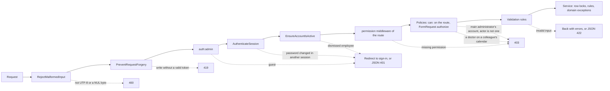

# Security

MedSystem holds medical and financial records, and only hospital staff use it. Everything except
the sign-in page and the `/up` health check needs a signed-in account. What an account may do is
decided per route by a permission.

This page describes the mechanisms and the tests that keep them in place. Test paths are under
`tests/Feature/`.

A request to the dashboard or to `/api` meets the checks in this order. `SecurityHeaders` wraps
all of them, so its headers also reach every refusal.

## Authentication

| Mechanism | Where | Tested in |
|---|---|---|
| **One guard.** `admin` is a session guard on the `admins` table, and it is the default guard. There are no other guards and no public registration. Guests are redirected to `/admin/login`. | `config/auth.php`, `bootstrap/app.php` (`redirectGuestsTo`) | `Security/AuthenticationTest.php`, `SmokeTest.php` |
| **Sign-in.** `POST /admin/login` validates the e-mail and password, then signs in an active account. After sign-in the session id is regenerated, against session fixation. "Remember me" is used only when it is ticked. | `AdminAuthController::login()`, `Auth\LoginRequest::authenticate()` | `Security/AuthenticationTest.php` |
| **Throttling.** The `login` rate limiter allows 5 attempts a minute for one login from one address. The key is the transliterated, lower-cased e-mail plus the IP. The 6th attempt goes back to the form with the wait time and a `Retry-After` header. | `AppServiceProvider::boot()` (`RateLimiter::for('login')`), `throttle:login` on the route | `Security/AuthenticationTest.php`, `Frontend/LoginPageTest.php` |
| **No account probing.** A wrong password always gets the generic message. Only someone who knows the right password learns that the account was switched off. | `LoginRequest::authenticate()` (`$guard->validate()` is called only after a failed attempt) | `Security/AuthenticationTest.php` |
| **Inactive accounts.** An employee's login ends with their dismissal (`Admin::active()`, see [domain.md](domain.md#staff-positions-roles-and-dismissals)). Sign-in refuses such accounts. `EnsureAccountIsActive` is the last middleware of the `web` group. It ends the session of an account dismissed while signed in, or coming back with a "remember me" cookie, before any route runs: a redirect to the login form, or a JSON 401 on `/api`. | `EnsureAccountIsActive`, `Admin::isActive()` | `Security/AuthenticationTest.php` |
| **Sign-out.** Sign-out is `POST` only. It invalidates the session and regenerates the CSRF token. | `AdminAuthController::logout()` | `Security/AuthenticationTest.php` |
| **Passwords.** Passwords are hashed by the model's `hashed` cast (bcrypt; `BCRYPT_ROUNDS`). New passwords need at least 8 characters. An empty password on an edit form keeps the old one. A new password ends the account's other sessions and its "remember me" cookies on their next request (`AuthenticateSession`, enabled by `authenticateSessions()` in `bootstrap/app.php`); the session that changed its own password stays signed in. | `Admin::casts()`, `Admin\StoreRequest`, `Admin\UpdateRequest`, `StaffRequest`, `AdminService::update()`, `AdminController::update()`, `StaffController::update()` | `Scheduling/AdminAccountsTest.php`, `Scheduling/StaffManagementTest.php`, `Security/AuthenticationTest.php`, `Database/FactoriesTest.php` |
| **First administrator.** `AdminSeeder` creates it from `ADMIN_EMAIL` / `ADMIN_PASSWORD` (`config/medsystem.php`), with the `main_admin` role. In production it refuses to seed the default password. | `AdminSeeder` | `Database/SeedersTest.php` (the account and its role; the production refusal is not tested) |
| **Session cookie.** The cookie is `HttpOnly` and `SameSite=Lax`. Set `SESSION_SECURE_COOKIE=true` wherever the app runs over HTTPS. Sessions are stored in the database and last 120 minutes by default. | `config/session.php`, `.env.example` | `Security/SecurityHeadersTest.php` |

## Authorization

### A permission on every route

Permissions belong to the `admin` guard and are seeded by `PermissionSeeder`. The `main_admin` role
holds all of them. Every other role is a staff position's role
([domain.md](domain.md#staff-positions-roles-and-dismissals)).

- Every route under `/dashboard` and `/api` needs `auth:admin` and a `permission:` middleware.
  Resource controllers declare one permission per action in `HasMiddleware::middleware()`, for
  example `list_regions`, `create_regions`, `edit_regions`, `delete_regions`. Every other route
  carries its own.
- A page reached from several screens accepts the permission of any of them (`permission:a|b`).
- Every AJAX endpoint requires the permission of the page that calls it.
- The only route that needs a session but no permission is `logout`.
- `Authorization/RouteAuthorizationTest.php` walks the router and checks this for every route:
  - every dashboard and `/api` route has `auth:admin` and a permission, except the documented
    exception (`Tests\Support\DashboardRoutes::AUTHENTICATED_ONLY`)
  - every permission named in middleware is seeded, and every seeded permission is checked
    somewhere
  - every middleware resolves to a class, and every route points at an existing controller method
- `Authorization/PageAccessTest.php` opens every parameterless page as:
  - an account without a role: 403 everywhere, the record pages included
  - `main_admin`: every page answers 200 on the data of a fresh install, and every AJAX GET
    endpoint answers 200 over the demo data
  - the seeded registrar and cashier roles: exactly the pages their permissions allow
- `Frontend/AllPagesTest.php` renders every dashboard page, record pages included, over the demo
  data as `main_admin` and as the demo registrar and cashier.
- `Security/ApiAccessTest.php` checks that every `/api` route runs on the admin session behind a
  permission, answers guests with a JSON 401, and requires the calling page's permission. Every
  `/api` route with a `{staff}` or `{reception}` parameter must also carry
  `can:workOnCalendar` (`ReceptionPolicy`).
- `Authorization/ActionPermissionsTest.php` pins the separations that matter:
  - the cashier pays and the registrar cannot
  - the registrar confirms and the cashier cannot
  - approving supply requests is separate from viewing them
  - receiving and writing off main-warehouse stock is separate from viewing it

### The menu and the buttons follow the permissions

- **The menu.** The sidebar has one definition, `App\Support\Navigation\Navigation`. Each link names
  the permission its route checks. `<x-sidebar />` (`App\View\Components\Sidebar`) renders
  `Navigation::visibleTo()`, which keeps the links the account's gate allows and drops groups and
  sections left empty.
  - `Frontend/NavigationTest.php` requires each link's permission to be exactly the one its route
    checks.
  - `Authorization/MenuTest.php` renders the sidebar for each permission. An account that may only
    open the dashboard sees no menu entry.
- **The buttons.** Views show create, edit, delete and action buttons inside `@can(...)`. The
  `*PagesTest` files under `tests/Feature/Frontend` and the page tests of each module check that a
  button appears only for accounts that may use it.
- **Dashboard cards.** A home-page card is shown only to accounts that may open the page it links
  to (`DashboardCard::permissions()`, `Dashboard/DashboardCardsTest.php`).

### Record-level rules

Some decisions depend on the record, not only on a permission. Most of them are made by three
policies, registered with `Gate::policy()` in `AppServiceProvider`: `AdminPolicy`,
`ReceptionPolicy` and `DocumentResponsePolicy`. A policy runs after the route's permission: as
`can:` middleware on the route, in `FormRequest::authorize()` before validation, or through
`Gate::authorize()` in the controller. A denial is a 403 with a Russian reason.

| Rule | Where | Tested in |
|---|---|---|
| Only a main administrator may change the e-mail, password or roles of a main administrator's account, or delete it. This applies on the admins screen and through the staff form of the employee who owns that login. | `AdminPolicy` (registered with `Gate::policy()` in `AppServiceProvider`), `Admin\UpdateRequest::authorize()`, `StaffRequest::authorize()`, `Gate::authorize()` in `AdminController` and `StaffController` | `Scheduling/AdminAccountsTest.php`, `Scheduling/StaffManagementTest.php`, `Frontend/SchedulingPagesTest.php` |
| Nobody deletes their own account. The last main administrator who can still sign in can be neither deleted nor dismissed. | `AdminService::ensureDeletable()`, `isLastMainAdmin()` | `Scheduling/AdminAccountsTest.php`, `Scheduling/StaffManagementTest.php` |
| No staff position can take the name, and with it the permissions, of the `main_admin` role. | `StaffPosition::RESERVED_ROLE_NAMES`, `StaffPositionRequest`, `StaffPositionService` | `Scheduling/StaffPositionRolesTest.php` |
| A doctor's account works only on the doctor's own calendar: the appointment list, the services and the doctors of a service on the booking page, the calendar page, the free and booked slots, a booking, and the appointment dialog with its cancellation. Anything else is a 403 with the reason. The doctor position decides, not the role: a `main_admin` login linked to a doctor employee is confined too. `ReceptionRequest::authorize()` asks the policy before validation, even for an employee id that names nobody, so a refused doctor learns nothing about which ids exist. The policy covers the booking calendars only: the patient card's history (`view_patients`), registrar confirmation and cash-desk payment reach the appointments of every employee ([domain.md](domain.md#scheduling-and-the-no-overlap-rule)). | `ReceptionPolicy::workOnCalendar()` (`can:workOnCalendar` on the routes, `ReceptionRequest::authorize()`, the filter in `Api\ReceptionController::staffByService()`); `Admin::doctorProfile()` in `ReceptionController` and `DashboardSummary` | `Scheduling/ReceptionPagesTest.php`, `Scheduling/ReceptionBookingTest.php`, `Scheduling/StaffAvailabilityTest.php`, `Scheduling/ReceptionStatusTest.php`, `Security/ApiAccessTest.php`, `Dashboard/DashboardSummaryTest.php` |
| A nurse sees the inpatients of their own department and records readings only there. They open and mark done the recommended actions only of the sheets of those open stays. | `NursePatientsQuery`; `DocumentResponsePolicy::trackActions()` (`DocumentScoreController::getActions()`, `StorePatientDocumentScoreRequest::authorize()`) | `Patients/NurseWindowTest.php`, `Clinical/MedicalDocumentsTest.php` |
| A patient's file is reachable only through its own patient. A file id of another patient is a 404. | `scopeBindings()` on the `patients.files.*` routes | `Security/PatientFilesTest.php` |
| A filled-in medical document can be deleted only while it is an initial nursing assessment that no stay holds yet; every other response is a medical record. | `DocumentResponsePolicy::delete()` (`Gate::authorize()` in `DocumentController`), `DocumentResponseService::deleteUnattachedAssessment()` (one conditional `DELETE`) | `Clinical/MedicalDocumentsTest.php` |
| The answers page of a filled-in medical document (`documents.show.answer`) opens only an initial nursing assessment, to the permission of the stay form that links it: one no stay holds yet for `create_patient_map` (new-stay form), one attached to an open stay for `edit_maps` (edit form). Like the forms, it reaches these assessments for every patient. Every other response is a 403 whatever the patient: other documents, and a closed stay's assessment. The 403 names the form the assessment belongs to, or the patient card for a closed stay. Every sheet stays readable on the patient card (`view_patients`). | `DocumentResponsePolicy::view()` (`Gate::authorize()` in `DocumentController::showAnswer()`), `DocumentResponse::isInitialAssessment()` / `isUnattachedInitialAssessment()` | `Clinical/MedicalDocumentsTest.php` |
| The appointment dialog's endpoint (`api.receptions.show`) sends only what the dialog prints: times, status, the patient's and the doctor's names. Both calendar permissions reach it without `view_patients`. | `Api\ReceptionController::show()` | `Security/ApiAccessTest.php`, `Scheduling/ReceptionStatusTest.php` |
| An examination map's state (open or closed) is checked only after the permission, so it is revealed only to staff who may act on the map. | the middleware order in `ExaminationMapController::middleware()` | `Authorization/ActionPermissionsTest.php` |

## CSRF

The `/api` endpoints are mounted in the `web` middleware group (`bootstrap/app.php`). They share
the admin session and its CSRF protection with the pages. They are not a stateless API.

- Laravel 13's `PreventRequestForgery` accepts a write when one of these holds:
  - the browser's `Sec-Fetch-Site` header says `same-origin` (`same-site` is not accepted)
  - the request's token matches the session token
- Forms carry `@csrf`. The layout prints `<meta name="csrf-token">`.
- `resources/js/lib/http.js` sends that token as `X-CSRF-TOKEN` on every jQuery AJAX call
  (`$.ajaxSetup`) and on `fetchJson()` writes.
- A 419 (stale token) or 401 (session gone) answer to an AJAX call opens a modal whose only action
  is reloading the page.
- State-changing actions use `POST`, `PUT`, `PATCH` or `DELETE`, never `GET`.
  - Main-warehouse write-off and deleting a document response use `DELETE`.
  - Changing a service status uses `PATCH`.
- Tested in `Security/CsrfProtectionTest.php` (it switches off the test-mode bypass of the
  middleware) and `Security/StateChangingRoutesTest.php`.

## XSS

| Rule | Where | Tested in |
|---|---|---|
| Views print values only with `{{ }}`, which escapes them. No view contains `{!! !!}`. | all of `resources/views` | `Frontend/AllPagesTest.php` ("prints no unescaped value in any view"), `Frontend/LayoutTest.php` ("escapes flash messages") |
| Server data reaches scripts through `data-*` attributes or a `` block, read with `pageData()`. `@json` escapes `<`, `>`, `&` and quotes, so a value cannot close the script element. | `resources/js/lib/data.js`, the views | `Frontend/PatientsPagesTest.php`, `Frontend/ClinicalPagesTest.php`, `Scheduling/ReceptionPagesTest.php` |
| A script that builds HTML passes every value through `escapeHtml()`, or sets `textContent` / `.text()`. | `resources/js/lib/escape.js` and the page modules | (code review rule, see [frontend.md](frontend.md)) |
| Views have no inline event handlers and no `javascript:` links. Inline scripts must parse. Nothing is loaded from a CDN. | the views | `Frontend/AllPagesTest.php` (every page, through `RenderedPage`), `Frontend/PageRenderTest.php` (the sign-in page) |
| Error pages show a Russian message and a way back, never exception details. Production must run with `APP_DEBUG=false`. | `resources/views/errors`, `.env.example` | `Frontend/ErrorPagesTest.php` |

There is no Content-Security-Policy header yet. The views still contain inline scripts. Moving
them into page modules is what a strict CSP would need first.

## Security headers

`App\Http\Middleware\SecurityHeaders` is the first middleware of the `web` group. Its headers
therefore also reach the 401, 403 and 419 answers and the login redirect that later middleware
produce. If a response already sets one of these headers, it keeps its own value.

| Header | Value |
|---|---|
| `X-Frame-Options` | `SAMEORIGIN` |
| `X-Content-Type-Options` | `nosniff` |
| `Referrer-Policy` | `strict-origin-when-cross-origin` |
| `Permissions-Policy` | `camera=(), microphone=(), geolocation=(), payment=(), usb=()` |
| `Strict-Transport-Security` | `max-age=31536000; includeSubDomains`, only on HTTPS requests |

The nginx configuration (`docker/nginx/default.conf`) adds the first three headers to the static
files it serves itself. It never serves PHP files other than `index.php`, and it denies dotfiles.
Tested in `Security/SecurityHeadersTest.php`.

## Files

| Kind | Disk | Served by |
|---|---|---|
| Documents attached to a patient | `local`, the private disk (`storage/app/private`, under `patient_files/`) | `PatientFileController::show()` on `GET /dashboard/patients/{patient}/files/{file}`, permission `view_patients` or `edit_patients`. It is the only way to read them. |
| Staff photos and signatures | `public` (`storage/app/public`, under `staff_photo/`) | the web server, through the `storage:link` symlink |
| Licence and certificate scans of a medication, a supplier's contract terms | `public` (under `medical_licenses/` and `supplier_contract_terms/`) | the web server, through the same symlink |

- Uploads to a patient are limited to pdf, jpg, jpeg, png, doc and docx, at most 10 files of
  10 MB each (`PatientRequest`).
- Files on the public disk are reference documents, not patient data. Staff photos and signatures
  must be jpg, png or webp images, the medication and supplier documents pdf, jpg or png, each at
  most 2 MB (`StaffRequest`, `MedicationRequest`, `SupplierRequest`). Laravel stores every upload
  under a random 40-character name, so a URL cannot be guessed, but anyone who has it can open the
  file without signing in.
- PDF, JPEG and PNG files open in the browser. Every other type is sent as a download, so a file
  the browser could run is never rendered in the application's origin.
- Deleting a file needs `edit_patients` and the `DELETE` route bound through the patient. The row
  is deleted first, then the file on the disk.
- 1.x stored patient uploads on the public disk, where the web server served them to anyone
  holding the URL. `php artisan patient-files:privatize --force` moves every file of its
  `patient_files/` folder, with or without a row, to the same path on the private disk, checks each
  copy and deletes the public one; it never overwrites a different private file. The controller
  reads the private disk only, so a file not yet moved is a 404, not a public download. Before and
  after the move, `public/.htaccess` and `docker/nginx/default.conf` refuse `/storage/patient_files/`.
- The framework does not serve the private disk: `'serve'` is off for the `local` disk in
  `config/filesystems.php`, so there is no `storage/{path}` route. Such a route, answering to any
  URL signed with `APP_KEY`, would bypass `PatientFileController`'s patient-scoped binding and
  permission check.
- Tested in `Security/PatientFilesTest.php`.

## Input hardening

- **Malformed bytes.** `RejectMalformedInput` (second in the `web` group) answers 400 with
  "Запрос содержит недопустимые символы." to any query string, form body or JSON body that is not
  valid UTF-8 or contains a NUL byte. PostgreSQL would reject such bytes with SQLSTATE 22021, a 500
  wherever a filter reaches a query. PDO would cut a bound string at the NUL byte, so the query
  would silently run on another value. Uploaded files are not inspected. Tested in
  `Security/MalformedInputTest.php` and `Billing/CashierListTest.php`.
- **Form requests match the schema.** String lengths, integer ranges, postcode digits, id sizes
  (`PayItemsRequest` accepts at most 18 digits) and enum values (`Rule::enum()`) are checked before
  anything reaches PostgreSQL. A value the database could not hold gets a 422, not a 500. Many
  tests are named for this, for example "rejects a reading longer than its column instead of
  failing on it".
- **Search text is matched literally.** Every name search goes through `App\Queries\LikePattern`,
  which escapes `%`, `_` and `\`. `PatientSearchRequest` caps the patient picker at 100
  characters.
- **Spreadsheet formulas.** The cashier and registrar exports bind every cell through
  `App\Exports\TextSafeValueBinder`: a string that starts with `=` (a patient name, a comment) is
  written as text, so the spreadsheet never runs it as a formula; prices stay numbers. Tested in
  `Security/SpreadsheetFormulaTest.php`.
- **SQL.** Queries use the query builder with bindings. The raw fragments are in the read
  models: `CashierItemsQuery`, `RegistrarBasketQuery`, `StockAlertsQuery` and `DashboardSummary`.
  They interpolate only table names, enum values and constants of the code. Dates are bound.
- **Mass assignment.** Models declare `$fillable`. Controllers pass `validated()` data to the
  services. Six models extend `Pivot`. Four of them (`PatientMedication`, `PatientProcedure`,
  `MainWarehouseMedication`, `PatientServiceStaff`) declare no `$fillable` and are unguarded like
  every pivot; services create them from explicit attribute lists.
- **Malformed ids in URLs.** A route id that is not a whole number within `bigint` reaches
  PostgreSQL through implicit route binding, which refuses it (22P02, 22003). `bootstrap/app.php`
  maps exactly that failure, recognised by `ImplicitRouteBinding` in its trace, to a 404. Tested in
  `Security/MalformedInputTest.php`.
- **JSON errors on AJAX.** `/api/*` and JSON requests always get JSON errors (401, 403, 419, 422,
  409), never an HTML page.

## Logging and audit

- **Exceptions.** Unhandled exceptions are reported by Laravel's handler to the `stack` channel,
  which is `single` by default (`storage/logs/laravel.log`, `LOG_LEVEL`). The containers also log
  to stderr, which php-fpm passes on to the container log: `compose.yaml` sets
  `LOG_STACK=single,stderr` (so `make logs` shows the errors), and the `prod` image logs to
  `stderr` only (`LOG_CHANNEL`), since a file in a container would grow unrotated and be lost
  with it. The test suite keeps to `single`.
  - A `DELETE` refused by `ON DELETE RESTRICT` is a user mistake, not a crash. It is not reported
    (`dontReportWhen` in `bootstrap/app.php`).
  - Domain refusals (`PaymentRefusedException`, `StockException`...) are caught by the controllers
    and shown to the user. They are not logged.
  - Password fields are never flashed back to the session.
- **Stock.** Every stock change writes a `stock_movements` row with its reason, its source
  document and the signed-in admin (`StockLedger`). That journal is the audit trail of the
  warehouses.
- **No general audit log.** Sign-ins, payments and status changes are not journaled beyond the
  row's own `updated_at`. An order does not record which cashier took the payment.
- **Telescope** is a dev dependency. It is registered only when `APP_ENV=local`
  (`AppServiceProvider::register()`), and it records only while `TELESCOPE_ENABLED` is true
  (`false` in `.env.example`). In `local`, Telescope's own authorization lets every visitor of the
  development server open `/telescope`, so a local environment must not be reachable from other
  networks. The `viewTelescope` gate (main administrators only) and the hiding of the `_token`
  parameter and the cookie and CSRF headers (`TelescopeServiceProvider`) would apply outside
  `local`, where Telescope is not registered at all.

## Checks in CI and the arch tests

- **Pest arch presets** (`tests/Arch/ArchitectureTest.php`):
  - `php`: no debugging functions or unsafe language functions
  - `security`: no weak hashing, predictable randomness, `eval` or shell calls
  - `env()` is read only in config files, the files without a namespace included
- **Dependency audit** (the CI job `dependency-audit`):
  - `composer audit --abandoned=report` fails on any security advisory for a Composer package
  - `npm audit --omit=dev --audit-level=high` fails on high advisories in the packages that reach
    the browser build
- Reporting a vulnerability: see [SECURITY.md](../../SECURITY.md).

## Related decisions

- [ADR 0008](../adr/0008-authorization-permissions-positions-and-policies.md): Authorization
- [ADR 0009](../adr/0009-restrict-deletes-and-retain-records.md): Restricted deletes and retained records
